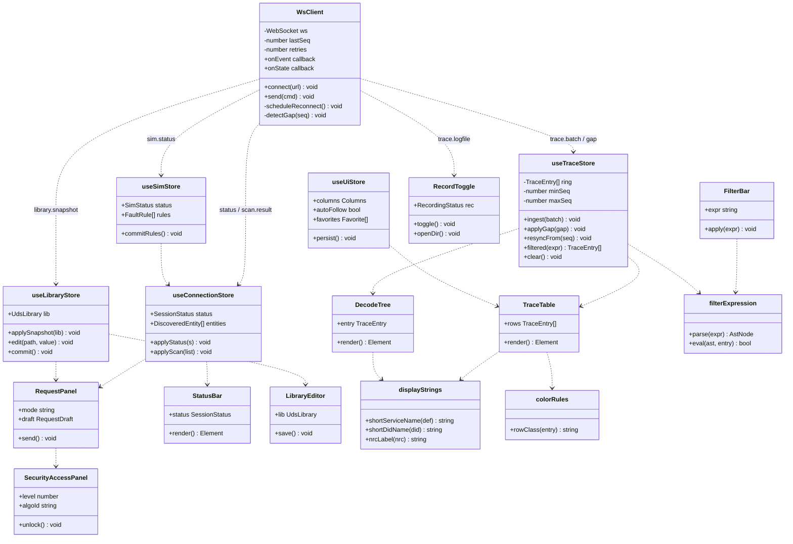
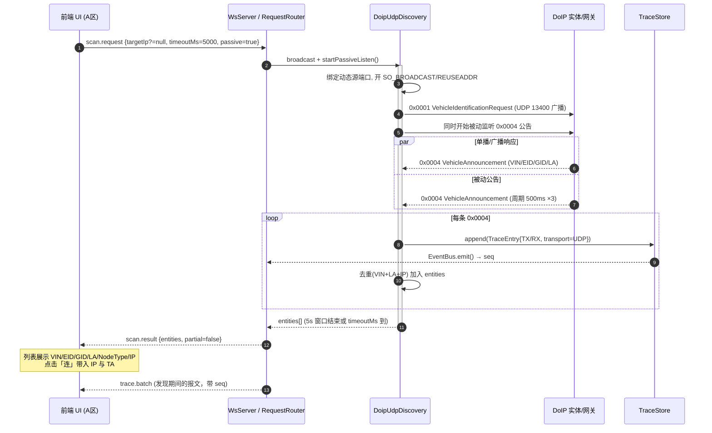
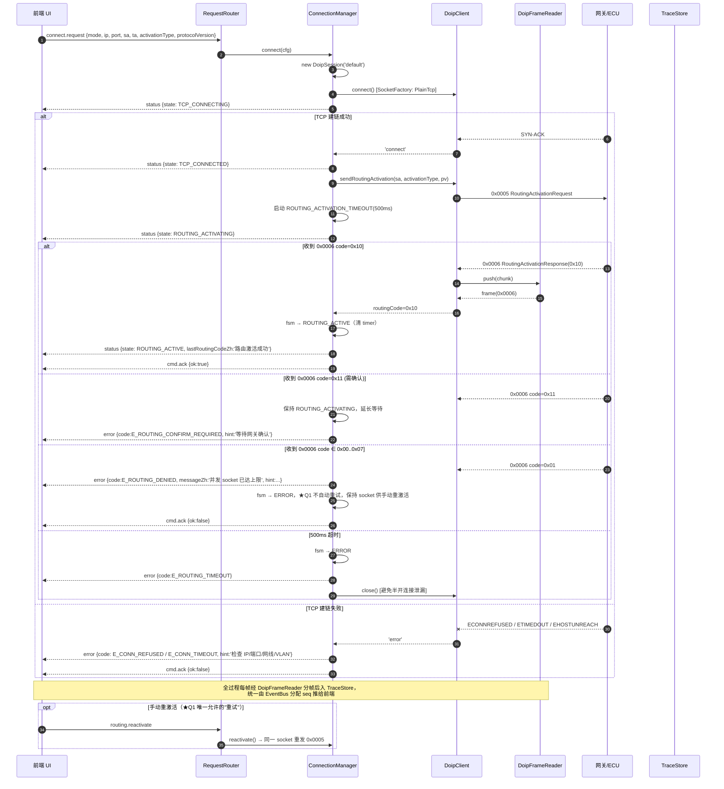
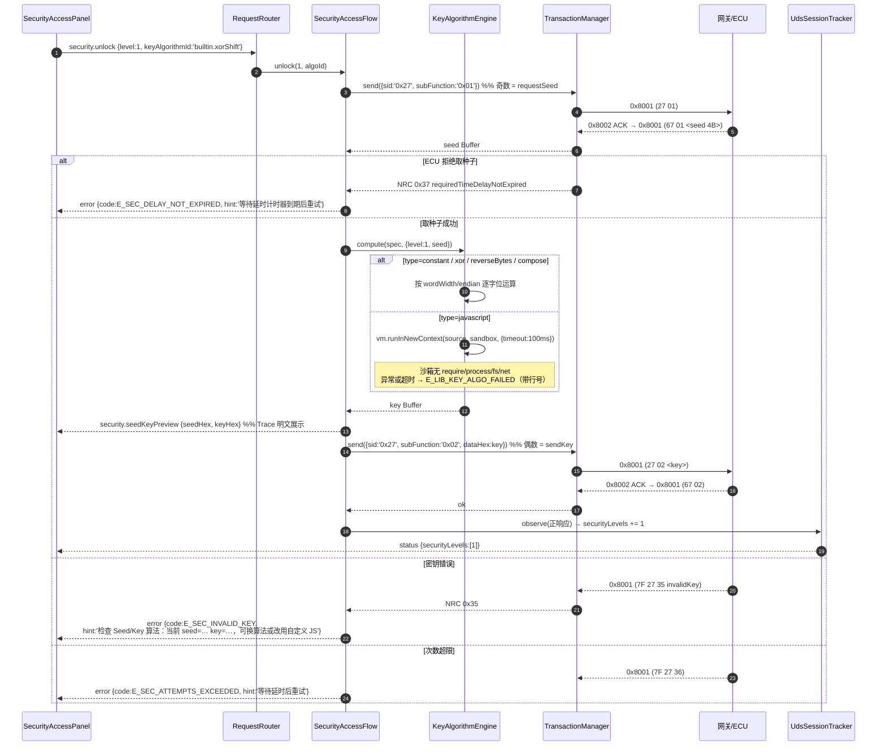
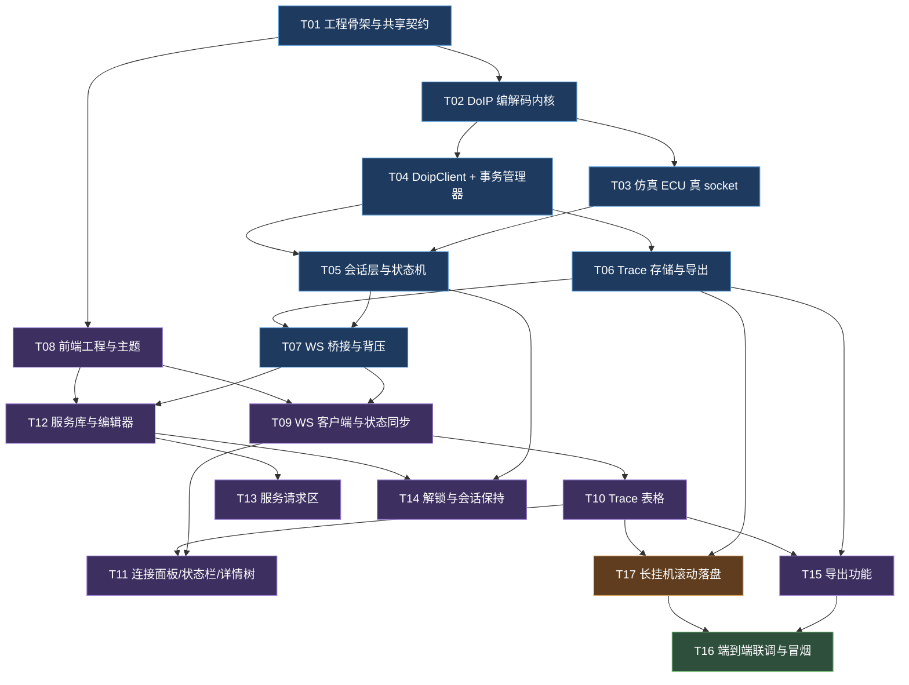

# DoIP 诊断控制台 — 系统设计文档

| 项目 | 内容 |
| --- | --- |
| Language | 简体中文 |
| Project Name | `doip_diagnostic_console` |
| 文档版本 | **v1.1**（含变更 1「长挂机滚动落盘提前到 P0」与变更 2「Seed/Key 改为 `ported` 移植算法主路径」） |
| 撰写人 | 项目组 |
| 上游输入 | `docs/PRD.md` v1.0（906 行）+ 项目组对 Q1–Q13 的裁决 |
| 交付形态 | 单机本地运行：浏览器 UI（React）+ 本机 Node 协议栈后端（raw TCP/UDP socket） |
| 运行环境 | Node.js ≥ 20 LTS（实测环境 v22.22.2）、npm workspaces、TypeScript 5.x |

> **本文档只做设计，不含业务源码。** 所有代码均为"接口约定/示意片段"，实现阶段由工程师按此落地。

---

## 0. 设计摘要与裁决落地

### 0.1 架构一句话

> **后端是唯一的协议真相源**（`shared/` 定义契约 → `server/src/doip` 实现 ISO 13400-2 编解码与 TCP 分帧 → `server/src/txn` 做三方事务配对 → `server/src/bridge` 经 WebSocket 以带 `seq` 的有序事件流推给前端）；**仿真 ECU 是一个跑在 127.0.0.1 上的真 DoIP Server**；前端只做渲染、表单与指令下发，**不做任何协议判断**。

### 0.2 Q1–Q13 裁决 → 设计落点对照表

| 裁决 | 设计落点（章节） | 落地方式 |
| --- | --- | --- |
| Q1 NACK/激活失败仅记录+提示，不自动重试；提供手动重激活 | §3.7 / §5.2 | `ConnectionManager` 收到失败码只做状态迁移 + 上报 `error` 事件；UI 暴露 `[重激活]` 按钮，指令 `routing.reactivate`。**全项目禁止任何自动重连/自动重发逻辑**（除 WS 自身重连） |
| Q2 NACK 码表按 13400-2:2012 Table 实现，且必须可配置 | §3.5 / §8.4 | 码表不写死在代码里，放 `data/uds-library.json` 的 `doipTables.nackTable`（含 `nameZh`/`hint`），`UdsLibraryStore` 热更新后立即生效；代码里只留一份 fallback 常量供库文件损坏时使用 |
| Q3 超时值常量化，禁止散落硬编码 | §3.2 | `shared/src/protocol/constants.ts` 唯一定义 `TIMING`；后端启动时从 `server/src/config/defaults.ts` 深合并（可被 UI 覆盖）；CI 加一条 grep 守卫：`src/**` 出现裸数字超时字面量（排除 constants.ts）即 fail |
| Q4 P0 只做单 TCP 连接 + TA 切换，预留多会话 | §3.8 | `ConnectionManager` 内部持有 `Map<sessionId, DoipSession>`，P0 UI 只创建/展示 `default` 一个 session；多标签页只需加 UI，不改后端协议栈 |
| Q5 P0 导出 = CSV(带中文解码列) + JSON + 原始 HEX dump；.asc/.pcapng 转 P1 | §3.11 | `exporters/` 三个实现 + 统一 `ExportRequest{scope, range}` 参数；导出为**后端生成 → HTTP 下载**（避免前端 Blob 大对象内存峰值） |
| Q6 P0 无脚本，但"发送一个 UDS 请求"抽成单一 API | §3.6 / §5.3 | 唯一入口 `UdsService.sendUdsRequest(req: SendUdsRequest): Promise<SendUdsResult>`；P1 脚本层直接复用该 API，无需重写协议逻辑 |
| Q7 Key 算法 = 常量 / 位运算表达式 / 自定义 JS；**不做 DLL FFI** | §3.9 | `KeyAlgorithmEngine` 三种 provider；JS 走 `node:vm` 沙箱（无 require/process/fs，100 ms 超时，异常带行号） |
| Q8 协议版本默认 0x02 (2012)，UI 可切 0x03 | §3.1 / §8.5 | `protocolVersion` 走连接配置；`DoipHeaderCodec` 对 0x02/0x03 统一处理（头结构一致），0x03 仅影响 inverse 与后续 0x9001 支持 |
| Q9 TLS(3496) 保持 P1 | §3.8 | `DoipClient` 的 socket 由 `SocketFactory` 注入，P0 只实现 `PlainTcpFactory`；P1 加 `TlsSocketFactory` 即可，协议层零改动 |
| Q10 仿真 ECU = 扁平多逻辑地址（≥3），不做网关子网拓扑 | §3.10 | `SimEcuRuntime` 一个 `DoipEntityServer` 实例注册 N 个 `VirtualEcu`（各自 LA），扁平分发；P1 加 `GatewayRouter` 时不改 `VirtualEcu` |
| Q11 纯本机部署，不加鉴权 | §3.12 | WS 与 HTTP 只 bind `127.0.0.1`；**代码里写死 `localhost` 绑定**（不放配置文件，避免被改成 0.0.0.0） |
| Q12 预置通用 DID 与示例 DTC | §3.5 | `data/uds-library.json` 预置 0xF18x/0xF19x/0xF1Ax 通用 DID；DTC 表预置示例条目并全部 `builtin:false` 以便客户替换 |
| Q13 Trace 服务名中英双语短名 | §3.5 / §8.6 | 服务库每条加 `shortZh`（≤6 字）与 `shortEn`（≤5 字符）；Trace 列渲染 `${shortEn}(0x${id}) ${shortZh}`，完整 `nameZh` 进 tooltip 与详情面板 |

### 0.3 四个技术难点的方案摘要

| 难点 | 方案 | 详见 |
| --- | --- | --- |
| ① TCP 流式分帧 | `DoipFrameReader`：单块可增长 Buffer + `off` 游标的状态机；三层守卫（payloadLength 上界 / 缓冲区上界 / 分帧超时）；inverse 校验 `lenient` 默认、`strict` 可切；失同步默认关连接、可选字节级重同步 | §3.3 |
| ② 三方事务配对 | `TransactionManager`：`txnId` 贯穿 `0x8001 请求 → 0x8002/0x8003 → 0x8001 UDS 响应`；6 状态超时机；区分 `FAILED_ACK_TIMEOUT`（网关没收下）与 `FAILED_UDS_TIMEOUT`（网关已转发但 ECU 未回） | §3.6 / §5.3 |
| ③ 仿真与真实路径一致 | 仿真 ECU = `net.createServer` + `dgram` 真 socket 监听 127.0.0.1:13400；客户端连仿真与连真实走**同一个 `DoipClient` 实例类型**，差别只有 `host/port` 两个字段 | §3.10 / §1.5 |
| ④ WS 报文流与断线重连 | 全局单调 `seq` 有序事件流 + 环形缓冲（按条数 100k **且** 字节预算 200 MB 双上限淘汰）+ 50 ms 批量打包 + `bufferedAmount` 背压三级降级 + 重连按 `fromSeq` 补齐 | §3.12 |

### 0.4 v1.1 变更摘要

| 变更 | 内容 | 主要落点 |
| --- | --- | --- |
| **变更 1** | D8「长挂机自动分段落盘」**从 P1 提前到 P0**。新增 `RollingFileSink`，把全量 TraceEntry 流式写入 `~/.doip-console/trace-logs/<session>/trace-NNNNNN.jsonl`；与 `BatchFlusher` 平级挂在 `EventBus` 上，**WS 背压降级不影响落盘**；WS 新增 `record.start/stop/status/openDir` 与 `trace.logfile` 事件 | §3.11.1、§3.12、任务 **T17**（挂 M5）、§10 A3 / B4、§11 D8 |
| **变更 2** | Seed/Key 算法**主路径改为 `ported`**（客户 代码逐行移植为具名算法，注册进 `KeyAlgorithmRegistry`）；保留常量/位运算/JS 三类兜底；新增 `data/key-algo-vectors.json` 测试向量与 `KeyVectorVerifier`，**移植算法必须通过全部向量**（CI 强制） | §3.9、任务 **T14**（改）、§10 B3（中→低）、§11 D2（转为待提交物） |

> **未改动**：§3.1–§3.4（DoIP 报文/常量/分帧/payload 编解码）与 §3.10（仿真 ECU）的核心设计**完全未动**；`shared/` 侧只做类型追加。正在实施的 M1（T01–T04）无需返工。

---

## 1. 实现方案与框架选型

### 1.1 总体架构

```
┌─────────────────────────── 浏览器 (localhost) ───────────────────────────┐
│  React 18 + Vite + MUI v6 + Tailwind                                     │
│  ┌────────┐ ┌────────┐ ┌────────┐ ┌────────┐ ┌────────┐ ┌────────┐      │
│  │A 连接区│ │B 请求区│ │C Trace │ │D 详情树│ │E 状态栏│ │F 库编辑│      │
│  └────────┘ └────────┘ └────────┘ └────────┘ └────────┘ └────────┘      │
│        zustand store  ←  WsClient(seq 校验 / 重连 / resync)              │
└─────────────────────────────── WebSocket /ws ────────────────────────────┘
                                     │  ↑ 有序事件流（全局 seq）
┌─────────────────────── Node 后端进程 (127.0.0.1:8787) ───────────────────┐
│  bridge/      WsServer · BatchFlusher · BackpressureGuard · ResyncService │
│  session/     ConnectionManager · SessionStateMachine · TesterPresent     │
│  txn/         TransactionManager（三方配对 + 超时机）                     │
│  doip/        DoipClient ── DoipFrameReader ── DoipPayloadCodec           │
│               DoipUdpDiscovery                                            │
│  uds/         UdsDecoder · UdsLibraryStore · KeyAlgorithmEngine           │
│  sim/         SimEcuRuntime ── DoipEntityServer(真 socket) ── VirtualEcu  │
│  trace/       TraceStore(环形缓冲) · exporters                            │
└───────────────┬──────────────────────────────────┬───────────────────────┘
                │ TCP 13400 / UDP 13400            │ 127.0.0.1:13400 (仿真)
        ┌───────▼────────┐                 ┌───────▼────────┐
        │  真实 ECU/网关  │                 │  内置仿真 ECU   │
        └────────────────┘                 └────────────────┘
```

### 1.2 关键技术选型与理由

| 层 | 选型 | 理由 | 被否决的替代 |
| --- | --- | --- | --- |
| 语言（全栈） | **TypeScript 5.x，strict 模式** | 前端/后端/共享三层同一类型系统；DoIP/UDS 全是位与字节操作，`strict` + branded type 能把"地址是 number 还是 string"这类错误在编译期拦掉 | JavaScript（省不了多少，反而丢掉协议字段的安全网） |
| Monorepo | **npm workspaces**（`shared` / `server` / `web`） | Node 22 自带 npm 10，零额外工具；三个包体量都不大，不需要 Turborepo/Nx 的增量构建 | pnpm（需额外安装）、Turborepo（过度） |
| 后端运行时 | **Node.js 22 + `node:net` / `node:dgram` 原生 socket** | DoIP 就是 TCP/UDP 上的自定帧，原生 socket 最直接、无依赖、可控性最高；Node 单线程事件循环天然规避 C++ DoIP-Lib 的线程安全问题 | Python（与客户既有工具链可能冲突，且前端已定 TS）；C++（工期不可控） |
| WS 服务端 | **`ws@^8` 挂在自写 `node:http` server 上**（监听 `upgrade`） | HTTP 静态托管 + WS 同端口同 origin，零 CORS、零反向代理；需要自己控制 `bufferedAmount` 做背压，裸 `ws` 暴露得最充分；约 40 行接管代码 | `socket.io`（自带重连但封死了二进制/背压细节、体积大）；`@fastify/websocket`（多引 fastify 依赖，收益不大） |
| HTTP 静态托管 | **自写 ~80 行 static handler**（`node:http` + `node:fs`） | 生产模式只需托管 `web/dist` 单目录 + 一个 `/api/export` 下载路由 | express/fastify（为 2 个路由引入框架不值得） |
| 参数校验 | **zod@^3** | 服务库 JSON 与 WS 消息契约两处都必须运行时校验（用户可编辑 JSON = 不可信输入）；zod 的 schema 同时产出 TS 类型，契约与类型单一来源 | ajv（JSON Schema 与 TS 类型两份，易漂移）；手写校验（易漏） |
| 日志 | **pino@^9**（dev 用 `pino-pretty`） | 结构化 JSON 日志，高频 Trace 场景下性能远好于 console；日志级别可按模块调 | winston（配置重）；console（无级别、无结构化） |
| 后端测试 | **vitest@^2** | 与前端同测试框架，一份心智；原生 TS/ESM 支持，无需 ts-jest 配置；`fake timers` 对超时状态机测试非常关键 | jest（ESM 配置痛苦）；node:test（断言与 mock 能力弱） |
| 构建/运行 | **tsx@^4**（dev 直跑 TS）、**tsc** 产出 `dist` | 后端也要 TS，dev 免编译；生产 `tsc -p tsconfig.build.json` 后 `node dist/index.js` | nodemon+ts-node（慢）；打包成 bundle（不需要，本机运行） |
| 前端框架 | **React 18.3 + Vite 5.4** | 客户已锁定；Vite dev 的 `/ws` proxy 让前后端分离开发 | Next.js（SSR 无意义，纯本地 SPA） |
| UI 组件库 | **MUI v6 + @emotion** | 表格/Tabs/Dialog/TreeView/Autocomplete 全是本项目高频件，MUI 开箱即用；`CssVarsProvider` 支持深色主题变量，与 IDE 观感一致 | antd（中文友好但表格虚拟滚动与 TreeView 弱于 MUI 生态）；手写（工期翻倍） |
| CSS | **Tailwind 3.4**（`preflight: false`） | 只用它做布局与间距微调，避免与 MUI 抢样式主权；**必须关闭 preflight**，否则会重置 MUI 的按钮/表格基线样式 | Tailwind v4（PostCSS 插件体系变了，MUI 共存资料少，风险不值得）；纯 CSS Modules（写起来慢） |
| 虚拟滚动 | **@tanstack/react-virtual@^3** | 10 万行 Trace 是硬指标，必须虚拟滚动；headless，与 MUI Table 组合自由 | `react-window`（动态行高支持弱）；MUI X DataGrid（社区版功能受限、商业授权灰区） |
| 状态管理 | **zustand@^5** | Trace 是高频写入，需要"组件外可变存储 + 选择性订阅"，Redux 的不可变开销在这里是纯负担；zustand 的 `subscribeWithSelector` 可让 TraceTable 只订阅增量而不触发全树重渲染 | Redux Toolkit（样板多、高频写性能差）；Context（10 万行必卡） |
| CSV 生成 | **自写（~60 行）+ UTF-8 BOM** | 必须写 BOM，否则 Excel 打开中文列乱码；字段转义规则自己控 | papaparse（浏览器端生成大 CSV 会撑爆内存；本项目改为后端生成） |

### 1.3 为什么不用 Electron / Tauri

客户已锁定"Web 前端 + 本地 Node 后端"，这里补充论证该形态成立、且优于桌面壳：

1. **协议栈必须与 UI 解耦**——DoIP 栈要处理 TCP 分帧、定时器、环形缓冲，这些在渲染进程里跑会阻塞 UI；本设计把它放在独立 Node 进程，天然隔离。Electron 若把栈放 main 进程，本质就是"套了个 150 MB Chromium 的本地服务器"，多一层 IPC 却没多任何能力。
2. **体积与启动**：目标 ≤ 50 MB。Electron 空壳 ~120 MB + Chromium；Tauri 虽小（~10 MB）但要引入 Rust 工具链 —— 而本项目的难点（分帧、事务、仿真）全在 TS 侧，Rust 帮不上忙，反而制造两套构建。
3. **跨平台与"免安装"**：Node 22 + 浏览器在 Win/macOS/Linux 一致；用户最熟悉的浏览器就是最好的 Trace 渲染器（DevTools 还能直接查 WS 帧）。
4. **多端与远程的天然可演进**：后端已是 HTTP+WS 服务，P2-04「远程访问」只需改绑定地址 + 加鉴权，不需要重写架构。
5. **代价与对策**：本机进程 + 浏览器的唯一代价是需要"启动一个 exe/脚本"。对策：`scripts/start.sh|start.bat` 一键拉起后端并自动打开 `http://127.0.0.1:8787`；后端退出前在终端打印明确提示。

### 1.4 进程与端口规划

| 端口 | 用途 | 绑定 | 冲突处理 |
| --- | --- | --- | --- |
| `8787` | 后端 HTTP（静态托管 + `/api/export` 下载）+ WebSocket `/ws` | `127.0.0.1` **写死** | 被占用则探测 8788–8797，实际端口打印到终端并写入 `~/.doip-console/last-port.json`，启动脚本自动打开正确 URL |
| `13400` UDP | 客户端发起车辆发现（广播/单播）+ 被动监听公告 | 客户端侧为动态源端口；被动监听需 `SO_REUSEADDR` | 监听失败降级为"仅主动请求模式"并提示 |
| `13400` TCP | 客户端连真实网关/ECU | — | — |
| `13400` TCP/UDP | **仿真 ECU 监听** | `127.0.0.1` | **默认端口 13401**（避免与"边仿真边连真件"场景撞车），UI 显示实际端口；用户可改回 13400 |

> 说明：仿真默认端口刻意与真实 DoIP 的 13400 错开一位。理由是 Q4 只做单连接时，"起仿真 + 连真件"两种模式仍可能在同一进程内并存（例如先用仿真验证再切真件），若都占 13400 会导致第二次启动失败。UI 在切换"仿真模式"时自动把目标端口填成仿真实际端口，用户无感。

### 1.5 为什么仿真 ECU 不能用"内存直连 mock"（难点 3 的核心论证）

这是本设计的**强约束**，理由逐条列清，实现阶段不得退化为 mock：

| # | 内存直连 mock 会漏掉的东西 | 真 socket 才能覆盖 |
| --- | --- | --- |
| 1 | TCP 半包/粘包/一帧多包 | 真实内核 TCP 栈会按 MSS/Nagle/窗口任意切分，正是难点 1 要解决的 |
| 2 | 分帧状态机的错误分支 | `payloadLength` 非法、缓冲区溢出、分帧超时，只有真流才会触发 |
| 3 | socket 层错误码 | `ECONNREFUSED` / `ETIMEDOUT` / `ECONNRESET` / `EPIPE`，mock 永远构造不出来 |
| 4 | 连接生命周期 | SYN→ESTABLISHED→FIN/RST、`close` 事件、`half-open` 连接 |
| 5 | 背压与延迟 | 真实 `socket.write` 返回 false、`bufferedAmount` 增长，才能验证 §3.12 的降级策略 |
| 6 | UDP 广播语义 | 车辆发现必须走 `dgram` 广播/多播，mock 会绕过端口复用与双网卡问题 |
| 7 | 第三方交叉验证 | 起仿真后可用 **Wireshark / python-doipclient / 客户自研 tester** 连 127.0.0.1 验证**我们自己的客户端**是否正确；mock 无法被外部观测 |
| 8 | 未来 TLS / 多连接 | socket 由 `SocketFactory` 注入，P1 换 TLS 或加并发会话时协议层零改动 |
| 9 | 故障注入的真实性 | "不响应"必须真的是不发字节（让客户端超时），而不是回调里 return null |
| 10 | 代码路径一致性可验证 | 可用断言证明：连仿真与连真实的调用栈完全相同（见 §9.3 的 TC-E2E-07） |

**额外收益**：仿真以独立进程模式运行（`SimEcuRuntime` 支持 `spawn` 子进程）时，Wireshark 抓 `lo0` 可直接看到完整 DoIP 报文，是调试协议栈的最强手段。

---

## 2. 目录结构与完整文件清单

```
doip-console/
├── package.json                      # npm workspaces 根；scripts: dev/build/test/smoke
├── tsconfig.base.json                # 全仓共享的 strict 配置
├── README.md                         # 启动方式、目录说明
├── .editorconfig / .gitignore
│
├── shared/                           # ── 前后端共享层（唯一契约源）──
│   ├── package.json                  # name: @doip/shared；exports: ".": "./src/index.ts"
│   ├── tsconfig.json
│   └── src/
│       ├── index.ts                  # 统一 re-export
│       ├── protocol/
│       │   ├── constants.ts          # ★ TIMING / LIMITS / PORTS 全部超时与上限常量
│       │   ├── payloadTypes.ts       # payload type 枚举 + 中文名 + 传输层归属
│       │   ├── doipTables.ts         # 路由激活响应码 / 通用头 NACK / 0x8003 NACK 码表（含 fallback）
│       │   ├── wsMessages.ts         # WS 消息契约（zod schema + 判别联合类型 + type guard）
│       │   └── errorCodes.ts         # 错误码注册表（码/等级/中文说明/处置建议/可重试性）
│       ├── types/
│       │   ├── doip.ts               # DoipHeader / DoipFrame / 各 payload 接口
│       │   ├── uds.ts                # UdsDecodeResult / DecodeNode / SendUdsRequest / Key 算法 spec
│       │   ├── trace.ts              # TraceEntry / TraceEvent / 导出请求
│       │   ├── session.ts            # 连接状态机枚举 / 会话状态 / 实体信息 / 仿真配置
│       │   └── library.ts            # UDS 服务库 schema（zod）+ TS 类型
│       └── util/
│           ├── hex.ts                # hex 大小写/空格规范化、parse/format、校验
│           ├── time.ts               # ISO8601(μs) 与相对时间、mono 时钟
│           └── address.ts            # 逻辑地址 number<->'0xXXXX'、别名解析
│
├── server/
│   ├── package.json                  # private；deps: ws/zod/pino；dev: vitest/tsx
│   ├── tsconfig.json / vitest.config.ts
│   └── src/
│       ├── index.ts                  # 引导：加载库→起 HTTP/WS→注册路由→信号处理
│       ├── config/defaults.ts        # 从 TIMING 派生运行时配置，支持 UI 覆盖与持久化
│       ├── doip/
│       │   ├── DoipHeaderCodec.ts    # 8 字节头 encode/decode + inverse 校验
│       │   ├── DoipFrameReader.ts    # ★难点1：TCP 累积缓冲分帧状态机
│       │   ├── DoipPayloadCodec.ts   # 各 payload type 的 payload 编解码（表驱动）
│       │   ├── DoipClient.ts         # Tester 侧：TCP 连接、路由激活、写 0x8001、AliveCheck
│       │   ├── DoipUdpDiscovery.ts   # UDP 0x0001/2/3 请求 + 0x0004 被动监听/主动收集
│       │   ├── DoipEntityServer.ts   # 实体侧 TCP server（仿真 ECU 复用；也用于 "自检对端"）
│       │   ├── DoipEntityUdp.ts      # 实体侧 UDP：响应识别请求 + 周期公告
│       │   └── SocketFactory.ts      # socket 创建注入点（PlainTcp / [P1]Tls）
│       ├── txn/
│       │   ├── Transaction.ts        # 事务对象与状态枚举
│       │   ├── TransactionManager.ts # ★难点2：三方配对 + 超时状态机 + 功能寻址聚合
│       │   └── TxnMatchPolicy.ts     # 配对规则（SA/TA 反转、SID 期望、previousMessage 前缀校验）
│       ├── uds/
│       │   ├── UdsDecoder.ts         # userData → 三层解码树（服务/子功能/DID/NRC）
│       │   ├── UdsEncoder.ts         # 表单/库定义 → 请求字节
│       │   ├── UdsLibraryStore.ts    # 加载/校验/热更新/合并自定义项/导入导出
│       │   ├── UdsLibraryValidator.ts# zod 校验 + 语义检查（DID 重复、SID 冲突）
│       │   ├── KeyAlgorithmEngine.ts # ★四类 Key 算法 provider 执行器（ported / 常量 / 位运算 / JS 沙箱）
│       │   ├── KeyVectorVerifier.ts  # ★用 data/key-algo-vectors.json 做移植算法校准
│       │   ├── SecurityAccessFlow.ts # 0x27 请求种子→算 Key→发密钥 编排
│       │   └── algorithms/
│       │       ├── KeyAlgorithmRegistry.ts   # ★算法注册表（具名算法 + 适用 level + 长度约束）
│       │       └── ported/
│       │           └── CustomerSeedKey.ts    # ★客户 算法移植（P0 首版为占位，待替换）
│       ├── session/
│       │   ├── ConnectionManager.ts  # 多会话容器（P0 单实例）；连接/断开/重激活编排
│       │   ├── DoipSession.ts        # 单条会话：socket + reader + txn + 状态机
│       │   ├── SessionStateMachine.ts# 状态迁移表与非法迁移拦截
│       │   ├── TesterPresentScheduler.ts # 3E 周期任务 + S3 倒计时广播
│       │   └── UdsSessionTracker.ts  # UDS 会话/安全等级推断（由 Trace 事实驱动）
│       ├── sim/
│       │   ├── SimEcuRuntime.ts      # 仿真启停、端口分配、实体注册、（可选）子进程隔离
│       │   ├── VirtualEcu.ts         # 单个虚拟 ECU 的 UDS 应答状态机
│       │   ├── SimUdsResponder.ts    # 0x10/11/14/19/22/27/2E/3E 应答实现 + DID/DTC 数据集
│       │   ├── FaultInjector.ts      # 故障规则表匹配与执行（NRC/NACK/不响应/延迟/自定义）
│       │   └── simPresets.ts         # 默认 3 个虚拟 ECU 的配置（VIN/EID/GID/LA/DID/DTC）
│       ├── trace/
│       │   ├── TraceStore.ts         # 环形缓冲（条数+字节双上限）+ 全局 seq 分配
│       │   ├── TraceEntryBuilder.ts  # DoipFrame → TraceEntry（含解码与配对引用）
│       │   ├── RollingFileSink.ts    # ★变更1：长挂机 .jsonl 滚动落盘（流式写、崩溃不丢）
│       │   └── exporters/
│       │       ├── index.ts          # 导出入口（按 format 分发，产出 Buffer）
│       │       ├── CsvExporter.ts    # CSV（UTF-8 BOM + 中文解码列）
│       │       ├── JsonExporter.ts   # JSON（含配对与延迟，可回导）
│       │       └── HexDumpExporter.ts# 原始 hex dump（带偏移/ASCII 侧栏）
│       ├── bridge/
│       │   ├── WsServer.ts           # upgrade 接管、连接生命周期、心跳
│       │   ├── EventBus.ts           # 后端内部 → 外发事件的中枢（唯一 seq 分配点）
│       │   ├── BatchFlusher.ts       # ★难点4：50ms 批量打包
│       │   ├── BackpressureGuard.ts  # bufferedAmount 三级降级
│       │   ├── ResyncService.ts      # fromSeq 补齐 + 状态快照补发
│       │   └── RequestRouter.ts      # 前端指令 → 各服务；统一 cmd.ack / error
│       ├── logging/logger.ts         # pino 实例与子日志命名规范
│       ├── errors/AppError.ts        # AppError 类 + toWsError()
│       └── __tests__/                # 见 §9
│
├── web/
│   ├── package.json / vite.config.ts / tsconfig.json
│   ├── tailwind.config.ts / postcss.config.js / index.html
│   └── src/
│       ├── main.tsx                  # React 挂载 + MUI CssVarsProvider(深色)
│       ├── App.tsx                   # AppShell + Tab 编排
│       ├── theme.ts                  # 深色主题变量、Trace 行配色 token
│       ├── index.css                 # Tailwind 指令 + 少量全局（滚动条/等宽字体）
│       ├── ws/
│       │   ├── WsClient.ts           # 连接、心跳、指数退避重连、seq 缺口检测
│       │   ├── useWsConnection.ts    # React 绑定：连接态 + 指令 send(cmd)
│       │   └── useResync.ts          # 重连后按 lastSeq 发起 resync
│       ├── store/
│       │   ├── useTraceStore.ts      # 环形数组 + 增量订阅 + 过滤视图
│       │   ├── useConnectionStore.ts # 连接/路由/会话/解锁状态
│       │   ├── useLibraryStore.ts    # 服务库（含编辑与即时生效）
│       │   ├── useSimStore.ts        # 仿真启停与故障注入规则
│       │   └── useUiStore.ts         # 列显隐、自动跟随、主题、收藏夹（localStorage）
│       ├── components/
│       │   ├── layout/AppShell.tsx           # 五分区栅格骨架 + 可折叠左栏/下栏
│       │   ├── toolbar/TopToolbar.tsx        # 模式切换、目标 IP/端口、连接按钮、设置
│       │   ├── connection/
│       │   │   ├── ConnectionPanel.tsx       # A 区容器
│       │   │   ├── EntityDiscoveryList.tsx   # 发现结果列表（VIN/EID/GID/LA）
│       │   │   ├── RoutingActivationCard.tsx # SA/TA/激活类型/协议版本 + [重激活]
│       │   │   ├── SessionSecurityCard.tsx   # 会话/解锁等级 chips
│       │   │   ├── SimEcuControl.tsx         # [启动][停止] + 端口显示
│       │   │   └── FaultInjectDialog.tsx     # 故障注入规则编辑
│       │   ├── request/
│       │   │   ├── RequestPanel.tsx          # B 区 Tab 容器
│       │   │   ├── ServiceForm.tsx           # 库驱动动态表单（服务/子功能/DID/参数）
│       │   │   ├── RawHexMode.tsx            # 手工 hex 输入 + 校验
│       │   │   ├── AddressingSwitch.tsx      # 物理/功能寻址
│       │   │   ├── HexPreview.tsx            # 实时 hex 预览 + 字节归属 tooltip
│       │   │   ├── SecurityAccessPanel.tsx   # 0x27 一键解锁（含算法选择）
│       │   │   ├── PeriodicSendDialog.tsx    # 周期发送参数
│       │   │   └── FavoritesBar.tsx          # 收藏快捷发送
│       │   ├── trace/
│       │   │   ├── TraceTable.tsx            # C 区虚拟滚动表格
│       │   │   ├── TraceRow.tsx              # 单行渲染（着色/配对左边框）
│       │   │   ├── TraceToolbar.tsx          # 暂停/跟随/清除/导出/列设置
│       │   │   ├── FilterBar.tsx             # 表达式 + 预设 chips
│       │   │   ├── RecordToggle.tsx          # ★变更1：录盘开关 + 文件路径/进度显示
│       │   │   └── useVirtualRows.ts         # @tanstack/react-virtual 封装
│       │   ├── detail/
│       │   │   ├── DetailPanel.tsx           # D 区容器
│       │   │   ├── DecodeTree.tsx            # 三层字段树（含偏移与含义）
│       │   │   ├── HexView.tsx               # hex ↔ 字段双向高亮
│       │   │   └── ErrorExplainCard.tsx      # NRC/NACK/超时解释（hint 驱动）
│       │   ├── status/StatusBar.tsx          # E 区（S3 倒计时 / 3E 心跳 / 计数 / RTT）
│       │   ├── library/
│       │   │   ├── LibraryEditor.tsx         # F 区左右分栏容器
│       │   │   ├── ServiceEditor.tsx / DidEditor.tsx / NrcEditor.tsx
│       │   │   ├── AliasEditor.tsx / KeyAlgorithmEditor.tsx
│       │   │   └── LibraryIoButtons.tsx      # 导入/导出/重置内置
│       │   ├── export/ExportMenu.tsx         # CSV/JSON/HEX 导出 + 范围选择
│       │   └── common/
│       │       ├── HexInput.tsx              # 受控 hex 输入（大写、非法提示）
│       │       ├── ErrorBoundary.tsx         # 局部崩溃隔离
│       │       ├── SnackHost.tsx             # 通知与错误互跳
│       │       └── EmptyState.tsx
│       ├── decode/
│       │   ├── displayStrings.ts     # ★Q13：shortEn(0xXX) shortZh 短名拼装
│       │   ├── filterExpression.ts   # Wireshark 风格表达式解析与求值
│       │   └── colorRules.ts         # 行着色规则（按层与结果）
│       ├── hooks/
│       │   ├── useAutoScroll.ts / useHotkeys.ts / usePersistedState.ts
│       └── types/index.ts            # re-export @doip/shared
│
├── data/
│   ├── uds-library.json              # ★内置可编辑服务库（Q2/Q12/Q13 落点）
│   └── key-algo-vectors.json         # ★变更2：客户提供的真实 Seed/Key 测试向量（校准用）
│
└── scripts/
    ├── start.sh / start.bat          # 一键启动后端并打开浏览器
    ├── smoke.mjs                     # ★端到端冒烟（无 UI，见 §9.3）
    └── check-no-hardcoded-timeout.mjs# CI 守卫：超时字面量不得散落
```

**文件计数**：shared 15 / server 44 / web 46 / data 2 / 根与脚本 8 ≈ **115 个文件**（不含测试与生成物）。
（变更 1 新增 `RollingFileSink.ts` + `RecordToggle.tsx`；变更 2 新增 `algorithms/` 3 个文件 + `KeyVectorVerifier.ts` + `key-algo-vectors.json`。）

> **与 M1 的关系**：本轮修订在 `shared/` 上**只做追加**（新增 `ported` 算法 spec 变体、录盘相关的 WS 指令/事件类型），**不修改 §3.1–§3.4、§3.10 与 DoIP/UDS 报文相关的任何既有定义**；M1 的 T01–T04 无需返工。

---

## 3. 核心数据结构与接口定义

> 以下为**源码级约定**，实现时 `shared/` 部分应逐字落地；`server/` 部分为接口签名与关键内部状态的约定。

### 3.1 DoIP 报文（`shared/src/types/doip.ts`）

```ts
import type { Buffer } from 'node:buffer';

/** 通用 DoIP 头：固定 8 字节，大端 */
export interface DoipHeader {
  protocolVersion: number;         // 0x02 | 0x03
  inverseProtocolVersion: number;  // = (~protocolVersion) & 0xff
  payloadType: number;             // 见 PayloadType
  payloadLength: number;           // 后续 payload 字节数（0..0xFFFFFFFF）
  /** 派生字段：(protocolVersion ^ inverseProtocolVersion) === 0xFF */
  inverseVersionValid: boolean;
}

/** 一个完整解出的 DoIP 帧（含头） */
export interface DoipFrame {
  header: DoipHeader;
  payload: Buffer;      // 长度严格等于 header.payloadLength
  raw: Buffer;          // 8 + payloadLength，深拷贝（不得引用 reader 内部缓冲）
  /** 该帧首字节到达的 mono 时间戳（ms），用于分帧超时判定 */
  firstByteAtMs: number;
}

export const DOIP_HEADER_LENGTH = 8;
export const DOIP_TCP_PORT = 13400;
export const DOIP_UDP_PORT = 13400;
export const DOIP_TLS_PORT = 3496;        // P1
export const PROTOCOL_VERSION_2012 = 0x02;
export const PROTOCOL_VERSION_2019 = 0x03;

export function inverseVersionOf(pv: number): number { return (~pv) & 0xff; }
export function isInverseVersionValid(pv: number, ipv: number): boolean {
  return (((pv ^ ipv) & 0xff) === 0xff);
}
```

### 3.2 常量集中地（`shared/src/protocol/constants.ts`）—— Q3 落点

```ts
/** 所有时序参数（ms）。禁止在业务代码中出现裸数字超时。 */
export const TIMING = {
  /* 连接与路由 */
  TCP_CONNECT_TIMEOUT_MS: 3000,
  ROUTING_ACTIVATION_TIMEOUT_MS: 500,
  ROUTING_REACTIVATE_MIN_INTERVAL_MS: 200,

  /* DoIP 传输层确认 */
  ACK_WAIT_TIMEOUT_MS: 2000,        // 发出 0x8001 后等 0x8002/0x8003 的上限
  ALIVE_CHECK_TIMEOUT_MS: 500,

  /* UDS 应用层层超时 */
  P2_CLIENT_MS: 200,                // 请求 → 首响应
  P2_STAR_CLIENT_MS: 5000,          // 收到 NRC 0x78 后的续等
  SUPPRESSED_NRC_WINDOW_MS: 200,    // 抑制正响应时，仍短暂等待可能的 NRC

  /* 会话保持 */
  TESTER_PRESENT_PERIOD_MS: 2000,
  TESTER_PRESENT_MIN_PERIOD_MS: 100,
  TESTER_PRESENT_MAX_PERIOD_MS: 60000,
  TESTER_PRESENT_SAFETY_FACTOR: 0.6, // 实际周期 = min(配置周期, S3_server * 0.6)
  S3_SERVER_DEFAULT_MS: 5000,
  S3_WARN_THRESHOLD_MS: 1000,       // 状态栏橙色预警

  /* 功能寻址 */
  FUNCTIONAL_AGGREGATION_WINDOW_MS: 2000,

  /* UDP 发现 */
  UDP_ANNOUNCE_LISTEN_MS: 5000,
  UDP_UNICAST_RESPONSE_TIMEOUT_MS: 2000,
  UDP_ANNOUNCE_INTERVAL_MS: 500,    // 仿真端发 3 次
  UDP_ANNOUNCE_COUNT: 3,

  /* TCP 分帧守卫 */
  FRAME_ASSEMBLY_TIMEOUT_MS: 5000,

  /* WebSocket 桥接 */
  WS_PUSH_FLUSH_INTERVAL_MS: 50,
  WS_HEARTBEAT_PING_MS: 15000,
  WS_PONG_TIMEOUT_MS: 45000,
  WS_RECONNECT_BASE_MS: 200,
  WS_RECONNECT_MAX_MS: 5000,

  /* Key 算法沙箱 */
  KEY_ALGO_TIMEOUT_MS: 100,
} as const;

/** ★变更1：长挂机滚动落盘策略（详见 §3.11.1） */
export const RECORDING: RecordingConst = { /* ...见 §3.11.1... */ } as const;

/** 容量与上限守卫 */
export const LIMITS = {
  MAX_PAYLOAD_BYTES: 4 * 1024 * 1024,        // 单帧 payload 上界（可调至 16 MiB）
  MAX_FRAME_READER_BUFFER_BYTES: 32 * 1024 * 1024,
  MAX_UDS_USERDATA_BYTES: 4 * 1024 * 1024 - 4,
  TRACE_RING_MAX_ENTRIES: 100_000,
  TRACE_RING_MAX_BYTES: 200 * 1024 * 1024,   // 与条数双上限，先到者触发淘汰
  TRACE_RESYNC_SNAPSHOT_ENTRIES: 2000,
  WS_MAX_ENTRIES_PER_BATCH: 500,
  WS_MAX_BYTES_PER_BATCH: 256 * 1024,
  WS_HIGH_WATER_BYTES: 1024 * 1024,
  WS_LOW_WATER_BYTES: 256 * 1024,
  WS_MAX_BACKPRESSURE_MS: 5000,              // 持续超限进入降级
  UI_TRACE_RENDER_WINDOW: 500,               // 前端同时保有的 DOM 行上限
} as const;

export const PORTS = {
  BACKEND_HTTP: 8787,
  BACKEND_PORT_FALLBACK_RANGE: [8788, 8797] as const,
  SIM_DEFAULT_TCP_UDP: 13401,                // 与真实 13400 错开
  SIM_PORT_FALLBACK_RANGE: [13402, 13410] as const,
} as const;
```

### 3.3 TCP 分帧状态机（`server/src/doip/DoipFrameReader.ts`）—— 难点 1

```ts
export interface FrameReaderOptions {
  maxPayloadBytes: number;              // LIMITS.MAX_PAYLOAD_BYTES
  maxBufferBytes: number;               // LIMITS.MAX_FRAME_READER_BUFFER_BYTES
  incompleteFrameTimeoutMs: number;     // TIMING.FRAME_ASSEMBLY_TIMEOUT_MS
  /** strict: inverse 校验失败即判失同步；lenient: 仅标记并继续（默认） */
  versionPolicy: 'strict' | 'lenient';
  /** 失同步后是否尝试字节级重同步扫描（默认 false = 直接报错由上层关连接） */
  resyncOnDesync: boolean;
  onFrame: (frame: DoipFrame) => void;
  onError: (e: FrameReaderError) => void;
}

export type FrameReaderErrorCode =
  | 'E_DOIP_INVERSE_VERSION_INVALID'
  | 'E_DOIP_PAYLOAD_TOO_LARGE'
  | 'E_DOIP_BUFFER_OVERFLOW'
  | 'E_DOIP_INCOMPLETE_FRAME_TIMEOUT';

export interface FrameReaderError {
  code: FrameReaderErrorCode;
  messageZh: string;
  /** false = 字节流已失同步，必须断开连接（上层负责 close） */
  recoverable: boolean;
  /** 出错时缓冲区前 256 字节的 hex，便于定位 */
  dumpHex: string;
}

/**
 * 单块可增长 Buffer + 读游标的实现（O(1) 摊还，避免 O(n^2) 拼接）。
 * 不变量：0 <= off <= len <= buf.length
 */
export class DoipFrameReader {
  private buf: Buffer;
  private len = 0;
  private off = 0;
  private firstByteAtMs = 0;

  constructor(private readonly opts: FrameReaderOptions) {
    this.buf = Buffer.allocUnsafe(64 * 1024);
  }

  /** socket 'data' 回调直接转发；同步产出 frame / error */
  push(chunk: Buffer): void {
    if (this.len === 0) this.firstByteAtMs = nowMonoMs();
    this.ensureCapacity(chunk.length);
    chunk.copy(this.buf, this.len);
    this.len += chunk.length;
    this.drain();
  }

  /** 由外层定时器（如每 1s）调用，处理"半包卡死" */
  tick(): void {
    if (this.len > this.off && nowMonoMs() - this.firstByteAtMs > this.opts.incompleteFrameTimeoutMs) {
      this.fail('E_DOIP_INCOMPLETE_FRAME_TIMEOUT', 'TCP 字节流中出现不完整 DoIP 帧且超时未完成', false);
    }
  }

  reset(): void { this.len = 0; this.off = 0; this.firstByteAtMs = 0; }

  private drain(): void {
    for (;;) {
      const r = this.tryParseOne();
      if (r.kind === 'needMore') return;
      if (r.kind === 'error') { this.fail(r.code, r.messageZh, r.recoverable); return; }
      this.opts.onFrame(r.frame);
      if (this.off >= this.len) { this.reset(); return; }  // 刚好消费完，重置避免残留
    }
  }

  private tryParseOne(): ParseResult {
    const avail = this.len - this.off;
    if (avail < 8) return { kind: 'needMore' };          // ① 半包：头都不全

    const pv  = this.buf[this.off];
    const ipv = this.buf[this.off + 1];
    const payloadType   = this.buf.readUInt16BE(this.off + 2);
    const payloadLength = this.buf.readUInt32BE(this.off + 4);

    // ② inverse 校验：lenient 下仅打标，不阻断解析
    const inverseVersionValid = isInverseVersionValid(pv, ipv);
    if (!inverseVersionValid && this.opts.versionPolicy === 'strict') {
      return { kind: 'error', code: 'E_DOIP_INVERSE_VERSION_INVALID',
               messageZh: `协议版本校验失败(0x${hex8(pv)}/0x${hex8(ipv)})，字节流可能已失同步`,
               recoverable: false };
    }

    // ③ payloadLength 合法性：先判上界再谈内存
    if (payloadLength > this.opts.maxPayloadBytes) {
      return { kind: 'error', code: 'E_DOIP_PAYLOAD_TOO_LARGE',
               messageZh: `payloadLength=${payloadLength} 超过上限 ${this.opts.maxPayloadBytes}，疑似失同步`,
               recoverable: false };
    }

    const total = 8 + payloadLength;
    if (avail < total) {                                  // 半包：等更多字节
      if (this.len > this.opts.maxBufferBytes) {
        return { kind: 'error', code: 'E_DOIP_BUFFER_OVERFLOW',
                 messageZh: '分帧缓冲超过上界仍未凑齐一帧', recoverable: false };
      }
      return { kind: 'needMore' };
    }

    // ④ 完整帧：raw 必须深拷贝（reader 缓冲会被后续压实/覆写）
    const raw = Buffer.allocUnsafe(total);
    this.buf.copy(raw, 0, this.off, this.off + total);
    const payload = raw.subarray(8);
    this.off += total;

    // ⑤ 压实：当已消费超过 1 MiB 或浪费过半，整体前移
    if (this.off > 1024 * 1024 || this.off * 2 > this.len) {
      this.buf.copy(this.buf, 0, this.off, this.len);
      this.len -= this.off; this.off = 0;
      if (this.len === 0) this.firstByteAtMs = nowMonoMs();
    }

    return { kind: 'frame', frame: {
      header: { protocolVersion: pv, inverseProtocolVersion: ipv, payloadType,
                payloadLength, inverseVersionValid },
      payload, raw, firstByteAtMs: this.firstByteAtMs,
    }};
  }
}
```

**关键决策说明（难点 1 的显式答案）**

| 问题 | 决策 |
| --- | --- |
| 缓冲区增长上界 | 双重闸门：单帧 `payloadLength > MAX_PAYLOAD_BYTES(4 MiB)` 立即判错；累积缓冲 `> MAX_FRAME_READER_BUFFER_BYTES(32 MiB)` 判错。两者均 `recoverable=false` |
| payloadLength 合法性校验 | 必须在分配/等待前校验。注意 JS 中 `readUInt32BE` 返回无符号数（最大 4294967295），不会溢出为负，但仍需与上界比较 |
| 超上限如何处置 | 上报 `FrameReaderError`（含前 256 字节 hex dump）→ `DoipSession` 记录一条 `error` Trace 与日志 → **关闭 socket** → 状态机进 `ERROR`。不尝试继续解析（继续解析必然产生垃圾帧） |
| inverse 校验失败 | 默认 `lenient`：Trace 中置 `inverseVersionValid=false` 并打黄色警示角标，**继续解析**（现实中大量网关/样件填 0xFF）。用户可在设置里切 `strict`：立即关连接并提示"按 ISO 应回复 Generic Header NACK 0x00"。**我们作为 Tester 不主动发 0x0000 NACK**（那是实体侧职责），只在日志中提示 |
| 一帧含多包 | `drain()` 的 `for(;;)` 循环天然处理；每帧回调一次，不合并 |
| 失同步恢复 | 默认关闭连接（可预测）。设置项 `resyncOnDesync=true` 时启用字节级扫描：从 `off+1` 起寻找满足「inverse 有效 && payloadType ∈ 已知集合 && 8+len ≤ 剩余字节」的头，最多扫 `maxBufferBytes`，命中则丢弃前面的垃圾并告警。默认不开，因为它会产生**看似正常的假帧** |
| 内存拷贝 | 采用单块 Buffer + 游标 + 条件压实，`push` 为 O(chunk)，压实 O(剩余)，摊还 O(1)。**每帧 `raw` 必须深拷贝**——这是最容易埋雷的一处（否则 UI/导出会读到已被覆写的字节） |

### 3.4 Payload 编解码（`DoipPayloadCodec.ts` + `payloadTypes.ts`）

```ts
export const PayloadType = {
  GENERIC_HEADER_NACK: 0x0000,
  VEHICLE_IDENTIFICATION_REQ: 0x0001,
  VEHICLE_IDENTIFICATION_REQ_EID: 0x0002,
  VEHICLE_IDENTIFICATION_REQ_VIN: 0x0003,
  VEHICLE_ANNOUNCEMENT: 0x0004,
  ROUTING_ACTIVATION_REQ: 0x0005,
  ROUTING_ACTIVATION_RES: 0x0006,
  ALIVE_CHECK_REQ: 0x0007,
  ALIVE_CHECK_RES: 0x0008,
  ENTITY_STATUS_REQ: 0x4001,
  ENTITY_STATUS_RES: 0x4002,
  POWER_MODE_REQ: 0x4003,
  POWER_MODE_RES: 0x4004,
  DIAGNOSTIC_MESSAGE: 0x8001,
  DIAGNOSTIC_MESSAGE_ACK: 0x8002,
  DIAGNOSTIC_MESSAGE_NACK: 0x8003,
  TRANSPORT_LAYER_PAYLOAD_TYPE: 0x9001,   // 2019/Amd1，P0 仅识别不解析
} as const;

export const PAYLOAD_TYPE_META: Record<number, { name: string; nameZh: string; transport: 'TCP'|'UDP'|'BOTH' }> = {
  0x0000: { name: 'GenericDoipHeaderNack', nameZh: '通用头否定响应', transport: 'BOTH' },
  0x0001: { name: 'VehicleIdentificationRequest', nameZh: '车辆识别请求', transport: 'UDP' },
  0x0004: { name: 'VehicleAnnouncement', nameZh: '车辆公告/识别响应', transport: 'UDP' },
  0x0005: { name: 'RoutingActivationRequest', nameZh: '路由激活请求', transport: 'TCP' },
  0x0006: { name: 'RoutingActivationResponse', nameZh: '路由激活响应', transport: 'TCP' },
  0x0007: { name: 'AliveCheckRequest', nameZh: '存活检查请求', transport: 'TCP' },
  0x0008: { name: 'AliveCheckResponse', nameZh: '存活检查响应', transport: 'TCP' },
  0x8001: { name: 'DiagnosticMessage', nameZh: '诊断报文', transport: 'TCP' },
  0x8002: { name: 'DiagnosticMessagePositiveAck', nameZh: '诊断报文肯定确认', transport: 'TCP' },
  0x8003: { name: 'DiagnosticMessageNegativeAck', nameZh: '诊断报文否定确认', transport: 'TCP' },
  /* ... */
};

/* ── payload 接口 ── */
export interface RoutingActivationRequestPayload {
  sourceAddress: number; activationType: number;
  reservedIso: number;   reservedOem: Buffer;     // 4B
}
export interface RoutingActivationResponsePayload {
  testerLogicalAddress: number; doipEntityLogicalAddress: number;
  routingActivationResponseCode: number;
  reservedIso: number; reservedOem: Buffer;
}
export interface DiagnosticMessagePayload {
  sourceAddress: number; targetAddress: number; userData: Buffer;
}
export interface DiagnosticMessageAckPayload {
  sourceAddress: number; targetAddress: number;
  ackCode: number; previousMessage: Buffer;       // 网关回显的被确认报文（长度不定）
}
export interface DiagnosticMessageNackPayload {
  sourceAddress: number; targetAddress: number;
  nackCode: number; previousMessage: Buffer;
}
export interface VehicleAnnouncementPayload {
  vin: string; logicalAddress: number; eid: Buffer; gid: Buffer;
  furtherActionRequired: number; vinGidSyncStatus: number;
}
```

编解码采用**表驱动**：`Record<payloadType, { decode(buf): T; encode(v): Buffer }>`，未知 payloadType → 不抛异常，产出 `{ kind:'unknown', hex }` 并在 Trace 标记 `Unknown(0xXXXX)`（对应 P0-03 验收"未知服务显示为 Unknown 而非崩溃"）。

### 3.5 UDS 服务库与解码（`shared/src/types/library.ts` + `server/src/uds/`）

```ts
/* ── 服务库顶层（data/uds-library.json）── */
export interface UdsLibrary {
  schemaVersion: '1.0';
  meta: { name: string; description: string; updatedAt: string };
  /** ★Q2：DoIP 层码表也放库里，可配置 */
  doipTables: {
    routingActivationCodes: CodeEntry[];
    genericHeaderNackCodes: CodeEntry[];
    diagnosticMessageNackCodes: CodeEntry[];   // 0x8003，按 ISO 13400-2:2012 Table
    ackCodes: CodeEntry[];
  };
  nrcTable: NrcEntry[];
  services: ServiceDef[];
  didTable: DidEntry[];
  dtcTable: DtcEntry[];
  keyAlgorithms: KeyAlgorithmSpec[];
  addressing: { testerLogicalAddress: string; functionalAddress: string; aliases: AliasEntry[] };
}

export interface CodeEntry {
  code: string;               // '0x10'
  name: string;               // 'RoutingSuccessfullyActivated'
  nameZh: string;             // '路由激活成功'
  hint?: string;              // 处置建议，驱动 ErrorExplainCard
  builtin: boolean;
}

export interface NrcEntry extends CodeEntry { severity?: 'error' | 'warn' | 'info'; }

export interface ServiceDef {
  id: string;                 // '0x10'
  name: string;               // 'DiagnosticSessionControl'
  nameZh: string;             // '诊断会话控制'
  /** ★Q13：Trace 内联短名 */
  shortEn: string;            // 'DSC'   ≤5 char
  shortZh: string;            // '会话控制' ≤6 字
  positiveResponseId: string; // '0x50'
  supportsFunctional: boolean;
  builtin: boolean;
  flow?: 'seedKey' | 'none';
  keyAlgorithmRef?: string;
  enableIn?: 'P0' | 'P1';
  form: FormField[];
  positiveResponseForm: FormField[];
}

export type FormFieldRole = 'subFunction' | 'did' | 'data';
export interface FormField {
  name: string; role: FormFieldRole;
  offset: number; length: number;      // length = -1 表示取到报文结尾
  widget: 'select' | 'didSelect' | 'hex' | 'number' | 'text';
  optional?: boolean;
  endian?: 'big' | 'little';
  values?: Array<{ value: string; name: string; nameZh: string }>;
}

export interface DidEntry {
  id: string; name: string; nameZh: string;
  shortEn?: string; shortZh?: string;
  codec: 'ascii' | 'hex' | 'uint8' | 'uint16' | 'uint32' | 'bcd' | 'raw';
  length?: number; builtin: boolean;
}

/* ── 解码结果 ── */
export interface DecodeNode {
  offset: number; length: number;      // 相对 userData 起始
  field: string;                        // 'sid' | 'subFunction' | 'dataIdentifier' | ...
  valueHex: string;                     // 大写、空格分隔（UI）；导出用 hexCompact
  nameEn?: string; nameZh?: string; shortZh?: string;
  meaning?: string;                     // 人类可读解释
  children?: DecodeNode[];
}

export interface UdsDecodeResult {
  decoded: boolean;                     // false = 未能识别，不抛异常
  serviceId: number | null;
  serviceName: string | null;
  shortEn: string | null; shortZh: string | null;   // ★Q13
  isPositive: boolean;                  // 正响应 / 负响应 / 请求
  messageKind: 'request' | 'positive' | 'negative' | 'unknown';
  subFunction: number | null; subFunctionName: string | null; subFunctionNameZh: string | null;
  suppressPositiveResponse: boolean;
  did: number | null; didName: string | null; didNameZh: string | null;
  nrc: number | null; nrcName: string | null; nrcNameZh: string | null; nrcHint: string | null;
  params: Array<{ name: string; value: string; offset: number }>;
  tree: DecodeNode | null;
}

export function decodeUds(userData: Buffer, lib: UdsLibrary, ctx: { role: 'tx'|'rx' }): UdsDecodeResult;
export function encodeUds(def: ServiceDef, values: Record<string, string>, lib: UdsLibrary): Buffer;
```

**解码规则（必须实现，避免歧义）**

1. `sid` = `userData[0]`。查 `services` 命中 → `messageKind='request'`；否则查 `positiveResponseId === sid` → `'positive'`（此时用 `positiveResponseForm` 解析）；否则若 `sid === 0x7F` → `'negative'`。
2. 负响应固定结构 `7F <reqSid> <nrc>`；`nrc === 0x78` 视为 **pending，不是错误**（`severity:'info'`），由事务机转入 P2* 续等。
3. 子功能字节最高位 = `suppressPosRsp` 标志：解析时 `suppress = (b & 0x80) !== 0`，`subFunction = b & 0x7F`。
4. 未知 SID/DID/NRC：返回 `Unknown(0x1F)` 形式，**绝不抛异常**（P0-03 验收 ②）。
5. 服务库热更新后，`UdsLibraryStore` 触发 `library.reloaded`，后端对**环形缓冲内最近 N=2000 条**重算解码并推 `trace.repatched`，前端就地更新（P0-10 验收 ②）。

### 3.6 事务管理器（`server/src/txn/`）—— 难点 2

```ts
export type TxnState =
  | 'CREATED'               // 已建对象，尚未写出
  | 'WAITING_ACK'           // 已写出 0x8001，等 0x8002 / 0x8003
  | 'WAITING_UDS_RESPONSE'  // 已收 0x8002，等 0x8001 UDS 响应（P2）
  | 'WAITING_PENDING'       // 收到 NRC 0x78，续等（P2*）
  | 'COMPLETED'             // 收到预期响应
  | 'SUPPRESSED'            // 抑制正响应，收 ACK 后即完成
  | 'FAILED_ACK_TIMEOUT'    // 网关没收下（没回 ACK/NACK）
  | 'FAILED_UDS_TIMEOUT'    // 网关已转发，ECU 未响应
  | 'FAILED_NACK'           // 网关明确拒绝转发（0x8003）
  | 'CANCELLED';            // 连接断开/用户取消

export interface Transaction {
  txnId: string;                    // 'tx-0007'
  sessionId: string;
  createdAtMs: number;
  addressing: 'physical' | 'functional';
  sa: number; ta: number;
  requestUdsHex: string;            // '10 03'（展示）/ 内部另存 Buffer
  sid: number;                      // 请求 SID（0x10）
  expectedPositiveSid: number;      // sid | 0x40
  suppressPositiveResponse: boolean;

  /* ── 三方配对的落点 ── */
  seqRequest: number | null;        // 0x8001 请求 Trace 的 seq
  seqAck: number | null;            // 0x8002 的 seq
  seqNack: number | null;           // 0x8003 的 seq
  seqResponses: number[];           // 0x8001 UDS 响应的 seq（功能寻址可多条）

  state: TxnState;
  stateEnteredAtMs: number;
  timers: { ack?: NodeJS.Timeout; p2?: NodeJS.Timeout; p2star?: NodeJS.Timeout; functional?: NodeJS.Timeout };
  nackCode: number | null; nackNameZh: string | null;
  nrc: number | null; nrcNameZh: string | null;
  latencyMs: number | null;         // seqRequest → 首个响应
  gatewayForwardLatencyMs: number | null; // 0x8001 请求 → 0x8002 ACK（网关收下耗时）
  /** 功能寻址：按 SA 聚合的响应 */
  functionalResponses: Array<{ sa: number; seq: number; nrc: number | null; atMs: number }>;
  errorCode: string | null;         // E_TXN_*
  note: string | null;              // 给 Trace 的人类可读结论
}
```

```ts
export class TransactionManager {
  private byId = new Map<string, Transaction>();
  /** 待匹配索引：key = `${sa}->${ta}`（注意是"响应方向"，即发起时的 ta→sa） */
  private pending = new Map<string, Transaction[]>();
  private completedRing: Transaction[] = [];   // 保留最近 1000 条供导出配对

  /** 唯一发送入口（★Q6：脚本层复用此 API） */
  async send(req: SendUdsRequest): Promise<SendUdsResult>;

  /* ── 由 DoipSession 的收帧回调驱动 ── */
  onDiagnosticMessageAck(payload: DiagnosticMessageAckPayload, seq: number): void;
  onDiagnosticMessageNack(payload: DiagnosticMessageNackPayload, seq: number): void;
  onDiagnosticMessage(payload: DiagnosticMessagePayload, seq: number): void;
  onSessionClosed(reason: string): void;      // 所有未终态事务 → CANCELLED

  private transition(t: Transaction, next: TxnState, note?: string): void;
  private matchForResponse(sa: number, ta: number, userData: Buffer): Transaction | null;
}
```

**配对规则（`TxnMatchPolicy.ts`，必须严格按此实现）**

| 入向报文 | 匹配逻辑 |
| --- | --- |
| `0x8002 ACK` | 主键 = `key(ta=txn.sa, sa=txn.ta)`，取该队列中最早的 `WAITING_ACK` 事务。二次校验：若 `previousMessage` 长度 ≥ 2，则要求 `previousMessage[0..]` 与 `txn.requestUdsBytes` 前缀一致；不一致则记录 `warn`（`E_TXN_ACK_PREVIOUS_MISMATCH`）但仍按 FIFO 配对（因为部分网关截断回显） |
| `0x8003 NACK` | 同上（同一个 pending 队列），命中即 `FAILED_NACK`，`note = '网关未转发（非 UDS 层错误）：' + nackNameZh`。**明确不查 NRC 表** |
| `0x8001` 且 `userData[0] === 0x7F` | 期望 `userData[1] === txn.sid`；命中 → 若 NRC=0x78 转 `WAITING_PENDING`（启 P2*），否则 `COMPLETED`（记 NRC） |
| `0x8001` 且正响应 | 期望 `userData[0] === txn.expectedPositiveSid`。物理寻址取该队列最早 `WAITING_UDS_RESPONSE/WAITING_PENDING`；**功能寻址**追加到 `functionalResponses`，保持 `WAITING_UDS_RESPONSE` 直到窗口结束 |
| `0x8001`（无任何事务命中） | 记为 `UNSOLICITED`（如 ECU 主动上报 / 其他 tester 的流量），Trace 打 `tag:unsolicited`，`transactionId = null` |

**超时状态机与文案（难点 2 的核心交付）**

```
CREATED ──write()──▶ WAITING_ACK ──0x8002──▶ WAITING_UDS_RESPONSE ──正响应──▶ COMPLETED
                          │                        │        │
                          │                        │        └──7F xx 78──▶ WAITING_PENDING
                          │                        │                          │   ┌──────────────┘
                          │                        │                          ├── P2* 内来响应 ──▶ COMPLETED
                          │                        │                          └── P2* 超时 ──▶ FAILED_UDS_TIMEOUT
                          │                        └── P2 超时 ──▶ FAILED_UDS_TIMEOUT
                          │                           文案：「网关已收下并转发（收到 0x8002 ACK），
                          │                                  但 ECU 在 P2/P2* 内未响应」
                          ├── 0x8003 ──▶ FAILED_NACK
                          │     文案：「网关未转发（非 UDS 层错误）：<nackNameZh>」
                          └── ACK_WAIT 超时 ──▶ FAILED_ACK_TIMEOUT
                                文案：「网关未在 <n>ms 内返回 ACK/NACK，请求可能未进入网关」

抑制正响应（sid|0x80）：
WAITING_ACK ──0x8002──▶ SUPPRESSED（同时开 SUPPRESSED_NRC_WINDOW 短窗，若期间来 7F 则记 NRC）
```

**关键实现约束**

- 每个状态迁移必须清除上一个状态的 timer，避免"幽灵超时"。
- `transition()` 是唯一改 `state` 的方法，内置非法迁移检查（如 `COMPLETED → WAITING_ACK` 记 warn 并忽略）。
- `latencyMs` 与 `gatewayForwardLatencyMs` 分开记：前者是端到端（请求→UDS 响应），后者是网关收下耗时（请求→ACK）。**这两个数在 Trace 详情面板分别展示**，是诊断"卡在网关还是卡在 ECU"的关键依据。
- 事务终态后移出 `pending`，压入 `completedRing`（上限 1000，导出时按 `seq` 关联）。
- 连接断开时 `onSessionClosed()` 把所有非终态事务置 `CANCELLED` 并清 timer（**防止 Node 进程因悬挂 timer 不退出**）。

### 3.7 会话状态机（`shared/src/types/session.ts` + `server/src/session/`）

```ts
export type ConnectionState =
  | 'DISCONNECTED' | 'SCANNING' | 'TCP_CONNECTING' | 'TCP_CONNECTED'
  | 'ROUTING_ACTIVATING' | 'ROUTING_ACTIVE' | 'ALIVE_CHECKING'
  | 'CLOSING' | 'CLOSED' | 'ERROR';

/** 合法迁移表（SessionStateMachine 用，非法迁移记 warn 并拒绝） */
export const ALLOWED_TRANSITIONS: Record<ConnectionState, ConnectionState[]> = {
  DISCONNECTED:      ['SCANNING', 'TCP_CONNECTING', 'ERROR'],
  SCANNING:          ['DISCONNECTED', 'ERROR'],
  TCP_CONNECTING:    ['TCP_CONNECTED', 'ERROR', 'CLOSED'],
  TCP_CONNECTED:     ['ROUTING_ACTIVATING', 'CLOSING', 'CLOSED', 'ERROR'],
  ROUTING_ACTIVATING:['ROUTING_ACTIVE', 'ROUTING_ACTIVATING', 'ERROR', 'CLOSING'], // 0x11 需确认 → 停在原态
  ROUTING_ACTIVE:    ['ALIVE_CHECKING', 'ROUTING_ACTIVE', 'CLOSING', 'CLOSED', 'ERROR'],
  ALIVE_CHECKING:    ['ROUTING_ACTIVE', 'ERROR', 'CLOSING'],
  CLOSING:           ['CLOSED', 'ERROR'],
  CLOSED:            ['DISCONNECTED'],
  ERROR:             ['DISCONNECTED', 'TCP_CONNECTING'],   // 用户 dismiss 或手动重连（非自动）
};

export type UdsSessionType = 'DEFAULT' | 'PROGRAMMING' | 'EXTENDED' | 'UNKNOWN';

export interface SessionStatus {
  sessionId: string;
  state: ConnectionState;
  stateSinceMs: number;
  peer: { host: string; port: number; mode: 'real' | 'sim' } | null;
  sa: number; ta: number;
  activationType: number; protocolVersion: number;
  lastRoutingCode: number | null; lastRoutingCodeZh: string | null;
  udsSession: UdsSessionType;
  securityLevels: number[];             // 已解锁的等级（如 [1]）
  s3RemainingMs: number | null;
  testerPresent: { enabled: boolean; periodMs: number; nextDueMs: number | null };
  counters: { tx: number; rx: number; errors: number; traceCount: number };
  lastRttMs: number | null;
}

export interface DiscoveredEntity {
  vin: string; eid: string; gid: string;
  logicalAddress: string;               // '0x1000'
  ip: string; port: number;
  nodeType: 'gateway' | 'node' | 'unknown';
  furtherActionRequired: number;
  vinGidSyncStatus: number;
  viaAnnouncement: boolean;             // true=被动监听到的 0x0004
  discoveredAtMs: number;
  isSimulated: boolean;                 // 仿真实体标记，UI 打「仿真」标签
}
```

`UdsSessionTracker` 的状态**只由 Trace 事实驱动**（不靠本地猜测）：收到 `10 0x` 正响应 → 切对应会话；收到 `7F 10 xx` → 不变；连接断开/ECU 复位 → 回 `DEFAULT`；`27 <odd>` 取种子后 `27 <even>` 正响应 → 加入 `securityLevels`。这样保证 UI 显示与真实报文一致。

### 3.8 连接管理器（Q4 落点）

```ts
export class ConnectionManager {
  private sessions = new Map<string, DoipSession>();   // P0 只有 'default'
  private activeId: string | null = null;

  async connect(cfg: ConnectConfig): Promise<void>;    // 建 socket → 0x0005 → 等 0x0006
  async reactivate(): Promise<void>;                   // ★Q1：手动重激活，同一 socket 重发 0x0005
  async disconnect(reason: string): Promise<void>;
  setTargetAddress(ta: number): void;                  // ★Q4：TA 切换，不重建连接
  get(sessionId?: string): DoipSession | undefined;
  list(): SessionStatus[];
}
```

- `DoipSession` 内部组合：`socket`（由 `SocketFactory` 创建）、`DoipFrameReader`、`TransactionManager`、`TesterPresentScheduler`、`UdsSessionTracker`。
- **P0 只实例化一个 `DoipSession`**，但 `ConnectionManager` 的 API 全部以 `sessionId` 为参数，P1 多标签页只需加 UI 与 `activeId` 切换。
- `setTargetAddress` 只改 `DoipSession.ta`，后续请求用新 TA；已激活的路由不变（DoIP 路由激活是针对 socket 而非 TA 的）。

### 3.9 Key 算法引擎（Q7 落点 + **变更 2：`ported` 移植算法为主路径**）

> **变更 2 背景**：客户回答"我有 C 代码/公式，需要移植"。原先把"通用位运算表达式"当主路径的定位被推翻——那种写法要求客户把已有算法**重新表达**成我们的 DSL，既易错又难验证。新定位：
> - **主路径 = `ported`**：把客户 算法逐行翻译成 TS，作为**具名算法**注册进注册表，UI 里直接选名字用。
> - 保留 `constant` / `xor` / `compose` / `javascript` 作为**通用兜底**（换项目、换 ECU 时仍有价值），但不再是主路径。
> - **不做 FFI**（Q7 裁决不变）。

#### 3.9.1 算法注册表（`server/src/uds/algorithms/KeyAlgorithmRegistry.ts`）

```ts
/** 一条移植算法的注册项。compute 必须是纯函数：同样输入恒定同样输出，且不得有副作用/I/O。 */
export interface PortedAlgorithm {
  /** 稳定唯一 id，UI 下拉用；命名规范 `ported.<厂商>.<用途>` */
  id: string;                          // 'ported.customer.seedkey-l1'
  nameZh: string;                      // '客户算法 Level 1（C 代码移植）'
  /** 适用的安全等级；支持一个算法覆盖多等级 */
  appliesToLevels: number[];           // [1] 或 [1, 3, 5]
  /** 输入 seed 长度约束；null = 不限 */
  seedLengthBytes: number | null;      // 4
  /** 输出 key 长度；null = 与 seed 等长 */
  keyLengthBytes: number | null;       // 4
  /** 具名实现；签名固定，便于向量校验与单测批量遍历 */
  compute(level: number, seed: Uint8Array): Uint8Array;
  /** 来源：'customer-c' = 已由客户 代码移植；'placeholder' = 占位实现，待替换 */
  origin: 'customer-c' | 'placeholder';
  /** 已通过 data/key-algo-vectors.json 全部向量校验则为 true */
  verified: boolean;
  /** 移植说明：算法要点、C 源码出处、翻译时的注意点（如 int 宽度/符号性/移位行为差异） */
  notes?: string;
}

export class KeyAlgorithmRegistry {
  private byId = new Map<string, PortedAlgorithm>();
  register(a: PortedAlgorithm): void;
  unregister(id: string): void;
  get(id: string): PortedAlgorithm | undefined;
  /** UI 下拉数据源：按 level 过滤，placeholder 排在最后并打「待替换」标记 */
  listForLevel(level: number): PortedAlgorithm[];
  /** 启动时对所有 registered 算法跑一遍向量校验，未通过的在日志 warn 且 verified=false */
  verifyAll(vectors: KeyTestVector[]): VerifyReport;
}
```

**移植时最容易踩的三个坑（必须写进 `notes` 并在 code review 时检查）**

| C 侧写法 | TS/JS 侧陷阱 | 正确做法 |
| --- | --- | --- |
| `uint32_t x = seed[i] << 24` | JS 位运算是 **32 位有符号**，`<<` 超 31 位会溢出/变负 | 一律用 `>>> 0` 归一，或超过 32 位改用 `BigInt` 并显式 `& mask` |
| `int` 隐式符号扩展 | JS 没有 8/16 位整型，右移会带符号 | 用 `>>>` 无符号右移；负值统一 `(v >>> 0)` |
| `uint8_t` 溢出自动截断 | JS 数字不会自动截断 | 每个算术步后显式 `& 0xFF` / `& 0xFFFFFFFF` |

#### 3.9.2 测试向量校准（`data/key-algo-vectors.json` + `KeyVectorVerifier.ts`）

```ts
export interface KeyTestVector {
  id: string;                          // 'v1'
  level: number;                       // 1
  seedHex: string;                     // 'A1 B2 C3 D4'（大写空格分隔）
  expectedKeyHex: string;              // '5A 5A 5A 5A'
  source?: string;                     // '客户提供 2026-09-22' / '实车抓取'
  note?: string;
}
export interface KeyVectorsFile {
  schemaVersion: '1.0';
  /** 该向量集绑定到哪个算法 id；一个算法可有多组向量 */
  bindings: Record<string, string[]>;  // { 'ported.customer.seedkey-l1': ['v1','v2'] }
  vectors: KeyTestVector[];
}

export interface VerifyReport {
  algorithmId: string;
  total: number; passed: number; failed: number;
  failures: Array<{ vectorId: string; expectedKeyHex: string; actualKeyHex: string }>;
}

export class KeyVectorVerifier {
  static load(path: string): KeyVectorsFile;
  static verify(a: PortedAlgorithm, vectors: KeyTestVector[]): VerifyReport;
}
```

**验收硬门槛（写进 T14 的验收方式）**

- 单测 `TC-K09`：对每一个 `origin: 'customer-c'` 的注册算法，遍历其绑定的全部向量，**必须 100% 通过**，否则 CI 失败。
- 单测 `TC-K10`：`key-algo-vectors.json` 为空或仅含 placeholder 绑定时，允许跳过，但必须有一条 `it.skip` 之外的显式断言"当前为占位实现"，防止占位算法被当成正式交付蒙混过关。
- UI「算法试算」按钮：选算法 → 输入 Seed（或直接用上一次取到的 Seed）→ 显示 Key hex，并与向量表中同 seed 的期望值做**同屏对照**（相同则打绿勾）。
- 后端启动时跑一次 `verifyAll()`，任一算法失败 → 日志 `warn` + 首屏下发 `error{code:'E_LIB_KEY_ALGO_UNVERIFIED'}`，**但不阻止启动**（算法可能因 ECU 差异而部分不适配）。

#### 3.9.3 完整 spec 与执行器

```ts
export type KeyAlgorithmSpec =
  /* ★变更后新增：主路径 —— 引用注册表中的具名移植算法 */
  | { id: string; name: string; type: 'ported';  algorithmId: string; params?: Record<string, unknown> }
  /* 通用兜底（保留） */
  | { id: string; name: string; type: 'constant';     params: { keyHex: string } }
  | { id: string; name: string; type: 'xor';          params: { maskHex: string; wordWidth: 8|16|32; endian: 'big'|'little' } }
  | { id: string; name: string; type: 'reverseBytes'; params: Record<string, never> }
  | { id: string; name: string; type: 'compose';      params: { wordWidth: 8|16|32; endian: 'big'|'little'; steps: KeyOp[] } }
  | { id: string; name: string; type: 'javascript';   source: string; params?: Record<string, unknown> };

export type KeyOp =
  | { op: 'xor'; maskHex: string }
  | { op: 'not' }
  | { op: 'add' | 'sub'; value: number; modulo?: number }
  | { op: 'shiftL' | 'shiftR'; bits: number }
  | { op: 'rotL' | 'rotR'; bits: number }
  | { op: 'swapEndian' }
  | { op: 'reverseBytes' }
  | { op: 'bswap16' | 'bswap32' };

export interface KeyContext { level: number; seed: Buffer; params?: Record<string, unknown>; }

export class KeyAlgorithmEngine {
  constructor(private readonly registry: KeyAlgorithmRegistry) {}

  /** 恒定纯函数；任何失败抛 AppError('E_LIB_KEY_ALGO_FAILED') 并带原因 */
  compute(spec: KeyAlgorithmSpec, ctx: KeyContext): Buffer {
    switch (spec.type) {
      case 'ported': {
        const a = this.registry.get(spec.algorithmId);
        if (!a) throw new AppError('E_LIB_KEY_ALGO_NOT_FOUND', { id: spec.algorithmId });
        if (a.seedLengthBytes !== null && ctx.seed.length !== a.seedLengthBytes)
          throw new AppError('E_LIB_KEY_ALGO_SEED_LEN', { expect: a.seedLengthBytes, actual: ctx.seed.length });
        const key = a.compute(ctx.level, ctx.seed);          // 纯函数
        if (a.keyLengthBytes !== null && key.length !== a.keyLengthBytes)
          throw new AppError('E_LIB_KEY_ALGO_KEY_LEN', { expect: a.keyLengthBytes, actual: key.length });
        return Buffer.from(key);
      }
      /* 其余 provider 分支不变 */
    }
  }
}
```

**语义约定（位运算/compose 分支仍需保留，写进 README 与 UI 提示）**

- `wordWidth` 决定运算粒度：seed 按大端切成 N 个字（8/16/32 bit），逐字运算后按原序拼回；**不足一个字时不补零，按字节原样保留**（避免"seed 长度非 4 倍数"时的静默错误）。
- `rotL/rotR` 的旋转宽度 = `wordWidth`。
- `compose` 的 `steps` 按数组顺序串行执行。
- 运算一律用**无符号整数**，`add/sub` 默认按 `2^wordWidth` 取模。

**JS 沙箱（不做 FFI，但必须防呆）**

```ts
import vm from 'node:vm';
const sandbox = {
  level: ctx.level, seed: Uint8Array.from(ctx.seed), params: ctx.params ?? {},
  helpers: { xor, rotl, bswap, toU32, fromU32, hex },   // 只给纯计算助手
  result: null as Uint8Array | null,
};
vm.createContext(sandbox);            // 无 require / process / fs / net
vm.runInNewContext(
  `(function(level, seed, params, helpers){ ${spec.source} })`,
  sandbox, { timeout: TIMING.KEY_ALGO_TIMEOUT_MS, displayErrors: true }
);
```

- 沙箱内**没有任何 I/O 能力**（不注入 `require`/`process`/`globalThis` 的宿主引用）。
- 超时 100 ms、异常捕获后上报 `E_LIB_KEY_ALGO_FAILED`（带 `vm` 的错误行号）。
- 编译结果按 `source` 哈希缓存（`vm.Script` 复用），避免每次解锁都重编译。

> 注：`ported` 算法**不走沙箱**——它是我们自己的 TS 源码，走正常模块加载；只在 `origin:'placeholder'` 时于 UI 明确标注。

#### 3.9.4 UI：解锁面板（`web/src/components/request/SecurityAccessPanel.tsx`）

- 算法下拉：数据源 `registry.listForLevel(level)`，**`ported` 类排最前**，`placeholder` 排最后并渲染灰色「待替换（当前为占位实现）」标记；`verified=true` 的算法右侧打绿勾。
- 选择后展示该算法的元信息：`seedLengthBytes` / `keyLengthBytes` / `notes`。
- 「试算」按钮：用上一次取到的 Seed（或手填 Seed）算出 Key hex，与 `key-algo-vectors.json` 中同 seed 的期望值**同屏对照**。
- 若所选算法 `verified=false`，解锁按钮旁显示橙色提示"该算法未通过测试向量校验，解锁可能失败（NRC 0x35）"。
- 库编辑器 `KeyAlgorithmEditor.tsx` 相应增加：`ported` 算法为**只读展示 + 选择**（源码在 `server/src/uds/algorithms/ported/`，不在 JSON 里编辑）；可编辑的仍是 `constant`/`compose`/`javascript` 三类。

### 3.10 仿真 ECU（Q10 落点，难点 3）

```ts
export interface SimEntityConfig {
  logicalAddress: string;              // '0x1000'
  vin: string; eid: string; gid: string;
  nodeType: 'gateway' | 'node';
  furtherActionRequired: 0 | 1;
  vinGidSyncStatus: number;
  dids: Record<string, { codec: DidEntry['codec']; valueHex: string }>;
  dtcs: Array<{ code: string; nameZh: string; status: number; snapshotHex?: string }>;
  timing: { s3ServerMs: number; p2ServerMs: number; responseDelayMs: number };
  security: {
    levels: Record<number, {
      seedHex: string;                 // 固定 seed，便于复现
      keyAlgorithmId?: string;         // 期望的 Key 算法（用于自动校验）
      expectedKeyHex?: string;         // 或直接给定期望 Key
      delayMs?: number; maxAttempts?: number; lockoutMs?: number;
    }>;
  };
  supportedSids: string[];             // 未列出 → 回 NRC 0x11
  routingActivation: { accept: boolean; forcedCode?: string; reservedOemHex?: string };
}

export interface FaultRule {
  id: string; enabled: boolean;
  match: { logicalAddress?: string; sid?: string; subFunction?: string; did?: string; occurrence?: 'once'|'always'|'count' };
  action:
    | { kind: 'nrc'; code: string }                  // 回 7F <sid> <nrc>
    | { kind: 'nack'; code: string }                 // 回 0x8003（不进 UDS）
    | { kind: 'noResponse' }                         // 真·不发字节（让客户端超时）
    | { kind: 'delayMs'; ms: number }                // 延迟后正常响应（验证 P2*）
    | { kind: 'dropConnection' }                     // 直接 RST
    | { kind: 'customHex'; hex: string }             // 原样回自定义 userData
    | { kind: 'routingCode'; code: string };         // 路由激活时强制返回该码
  remaining: number | null;                          // null=无限
}

export class SimEcuRuntime {
  async start(cfg: { port: number; entities: SimEntityConfig[]; isolatedProcess?: boolean }): Promise<{ port: number }>;
  async stop(): Promise<void>;
  getStatus(): { running: boolean; port: number | null; entities: SimEntityConfig[]; uptimeMs: number };
  setFaultRules(rules: FaultRule[]): void;
  patchEntity(la: string, patch: Partial<SimEntityConfig>): void;   // 热改 VIN/DID/DTC
}
```

**边界（`DoipEntityServer` 是客户端与仿真共用的实体侧实现）**

- `DoipEntityServer`：`net.createServer` 接受 N 条 TCP 连接；每条连接维护激活状态（未激活时收到 0x8001 → 回 0x8003 NACK 0x02 invalid source address）。
- `DoipEntityUdp`：`dgram` 绑定 `127.0.0.1:port`，响应 0x0001/0x0002/0x0003，启动后按 `UDP_ANNOUNCE_INTERVAL_MS` 发 3 次 0x0004 公告。
- `VirtualEcu` 只处理 UDS 语义（收 userData → 回 userData 或 NRC），**不感知传输层**；`DoipEntityServer` 负责分包/ACK/NACK。这个切分让 P1 加"网关 + 子网 ECU 拓扑"时只改 `DoipEntityServer` 的路由层。
- 故障注入在**最外层拦截**：`DoipEntityServer` 收到 0x8001 后先问 `FaultInjector.match()`，命中则按 action 处理，不再进 `VirtualEcu`。
- `isolatedProcess: true` 时用 `child_process.fork` 跑 `SimEcuRuntime`，好处：① 可被 Wireshark 抓到独立进程流量；② 注入的崩溃（如 `dropConnection` 风暴）不会带崩主进程。默认 `false`（同进程，启动更快）。

### 3.11 Trace 条目与导出

```ts
export interface TraceEntry {
  seq: number;                          // 全局单调（后端 EventBus 分配）
  transactionId: string | null;         // 三方配对键
  ts: string;                           // ISO8601 UTC，μs：'2026-09-21T10:00:00.123456Z'
  tsRelMs: number;                      // 相对会话起点
  transport: 'TCP' | 'UDP';
  direction: 'TX' | 'RX';
  peer: string;                         // '192.168.1.10:13400'
  sessionId: string;

  doip: {
    protocolVersion: number; inverseVersionValid: boolean;
    payloadType: number; payloadTypeName: string; payloadTypeNameZh: string;
    payloadLength: number;
    sourceAddress: number | null; targetAddress: number | null;
    sourceAddressName: string | null; targetAddressName: string | null;
    ackCode: number | null; ackNameZh: string | null;
    nackCode: number | null; nackNameZh: string | null;
    activationResponseCode: number | null; activationResponseCodeZh: string | null;
    vin: string | null; eid: string | null; gid: string | null;
    headerHex: string;                  // 8 字节头，大写无空格
  };

  uds: UdsDecodeResult;

  linkedSeq: number | null;             // 配对的上一条（请求→ACK→响应 成链）
  txnRole: 'request' | 'ack' | 'nack' | 'response' | 'unsolicited' | null;
  latencyMs: number | null;
  gatewayForwardLatencyMs: number | null;
  timeout: boolean;
  errorCode: string | null; errorNameZh: string | null;
  tags: string[];                       // ['周期3E'] ['unsolicited']
  rawHex: string;                       // 完整帧（含头），大写无空格
}

export type ExportFormat = 'csv' | 'json' | 'jsonl' | 'hexdump';   // ★变更1：新增 jsonl（与落盘分片同格式）
export interface ExportRequest {
  format: ExportFormat;
  sessionId?: string;
  scope: 'all' | 'filtered' | 'selected';
  filterExpr?: string;                  // scope=filtered 时由前端回传表达式，后端重放过滤
  seqRange?: [number, number];
  includeTags?: { hidePeriodicTesterPresent: boolean };
}
```

**CSV 列（固定顺序，P0-04 验收）**
`seq,时间戳,相对时间(ms),传输层,方向,对端,PayloadType,PT名称(中),SA,SA名称,TA,TA名称,长度,服务(短中英),子功能,DID,DID名称,NRC,NRC名称(中),事务ID,配对seq,延迟(ms),网关转发耗时(ms),标签,错误码,原始HEX`
—— 文件头写 **UTF-8 BOM**（Excel 中文不乱码），`\r\n` 换行，字段按 RFC4180 转义。

### 3.11.1 长挂机滚动落盘（`server/src/trace/RollingFileSink.ts`）—— **变更 1：D8 从 P1 提前到 P0**

> **为什么必须有它**：环形缓冲（§3.12）只解决"最近可见"，10 万条上限一到就覆盖早期历史，长挂机（>8 小时）场景事后无法追溯。落盘是 B4 的真正兜底——**缓冲可以丢，磁盘不能丢**。

#### 落盘目录与文件命名

```
~/.doip-console/trace-logs/
└── 20260922-103012-default/                 # <会话启动时刻 yyyymmdd-HHMMSS>-<sessionId>
    ├── session.json                          # 会话元数据：peer/sa/ta/protocolVersion/启动时刻/工具版本
    ├── index.json                            # 分片清单：[{file, seqRange, entries, bytes, startedAt, endedAt}]
    ├── trace-000001.jsonl                    # 分片：一行一条 TraceEntry（紧凑 JSON，无缩进）
    ├── trace-000002.jsonl
    └── ...
```

- 目录在**录盘启动时**创建（`fs.mkdirSync(dir, {recursive:true})`），落盘路径全程对前端可见。
- `.jsonl` 每行 = 一个完整 `TraceEntry` 的 `JSON.stringify`（含 `rawHex`，保证事后可完全还原，不依赖原始 socket）。
- `index.json` 在**每次滚动与优雅关闭时**重写（原子写：写 `.tmp` 再 `rename`），避免中途崩溃留下半个文件。

#### 滚动策略（三者皆可配，**先到者触发**）

```ts
/** 追加到 shared/src/protocol/constants.ts */
export const RECORDING = {
  AUTO_START: true,                    // 后端启动即开始录盘（客户有长挂机需求）
  FLUSH_INTERVAL_MS: 1000,             // 攒批后最长 1000ms 强制刷盘（可调到 100ms 提高崩溃安全性）
  MAX_ENTRIES_PER_BATCH: 1000,         // 攒够这么多条立即刷
  /** 滚动触发（三选一先到者） */
  MAX_ENTRIES_PER_FILE: 500_000,       // 按条数
  MAX_FILE_BYTES: 256 * 1024 * 1024,   // 按大小 256 MiB
  MAX_FILE_DURATION_MS: 3_600_000,     // 按时间 1 小时
  /** 保留（0 = 不限制） */
  RETAIN_MAX_BYTES_PER_SESSION: 5 * 1024 * 1024 * 1024,  // 5 GiB：超出删最旧分片
  RETAIN_MAX_FILES: 0,
  RETAIN_MAX_DAYS: 0,
  /** 磁盘保护 */
  MIN_FREE_BYTES: 1024 * 1024 * 1024,  // 可用空间 < 1 GiB → 停录并报错
  /** 写入流背压 */
  SINK_HIGH_WATER_BYTES: 16 * 1024 * 1024,
  PROGRESS_PUSH_INTERVAL_MS: 5000,     // 状态/进度事件节流
} as const;
```

- **滚动时**必须 `flush + end + close` 当前流，再开新流；`index.json` 追加一条记录。
- **保留策略**默认只启用 `RETAIN_MAX_BYTES_PER_SESSION`（5 GiB），超出时删除最旧分片并推事件告知；`RETAIN_MAX_FILES/DAYS` 默认 0（不自动删），交给用户手动清理——避免"挂机一晚回来发现日志被自己删了"。

#### 与 TraceStore / BatchFlusher / 背压的关系（**关键，实现时不可搞错**）

```
                EventBus.emit(entry)   ← 唯一 seq 分配点
                        │
        ┌───────────────┴────────────────┐
        ▼                                ▼
 RollingFileSink                    BatchFlusher
 （全量、独立背压）                  （可降级、50ms 打包）
        │                                │
   .jsonl 分片                      WS → 前端
```

| 问题 | 决策 |
| --- | --- |
| 同步写还是异步写？ | **异步、复用攒批**。绝不每条 `appendFileSync`（5000 条/s 会直接卡死事件循环）。`RollingFileSink` 与 `BatchFlusher` 同为 EventBus 的**平级订阅者**，各自攒批：Sink 按 `MAX_ENTRIES_PER_BATCH=1000` 或 `FLUSH_INTERVAL_MS=1000` 触发，一次 `write(Buffer.concat(lines))` |
| 挂在 BatchFlusher 之前还是之后？ | **必须挂在之前（平级于 EventBus 原始入口）**。若挂在之后，WS 背压 L2 降级会把落盘一起丢——那就失去兜底意义了 |
| WS 背压会不会影响落盘？ | **不会**。两条链路 independent，`trace.gap` 只描述 WS 推送的缺口，磁盘侧始终全量 |
| 落盘自身背压怎么办？ | 检查 `stream.writableLength > SINK_HIGH_WATER_BYTES(16 MiB)` → 进入 `lossy` 模式：丢弃普通条目并累计 `droppedCount`，**仍保留 error 类条目**；恢复后写入一行 `{"kind":"gap","reason":"sinkBackpressure","fromSeq":..,"toSeq":..,"count":..}` 显式标记缺口。**seq 语义与 §3.12 一致：永不断号，丢失必显式告知** |
| 崩溃会丢多少？ | `FLUSH_INTERVAL_MS`(1 s) 窗口内的未刷批次。已 write 的字节由 OS 保证持久；**不做每条 fsync**（性能代价太大）。窗口内数据可通过调小 `FLUSH_INTERVAL_MS` 到 100 ms 收紧，代价是写放大 |
| `rawHex` 是否落盘？ | **是**。`TraceEntry` 全字段原样落盘，事后可完全离线还原，不依赖任何原始 socket 或缓冲 |

#### 写盘失败降级（**不得拖垮主链路**）

| 故障 | 行为 |
| --- | --- |
| 目录创建/文件打开失败（`EACCES` / `ENOENT`） | `Sink` 置 `state='disabled'`，上报 `E_IO_SINK_OPEN_FAILED`（含原因与路径）。**连接、发请求、Trace 显示、导出全部照常**。UI 录盘开关置灰并显示原因 |
| 写入中 `ENOSPC` / `EIO` / `EACCES` | 立即 `end()` 当前流并置 `state='error'`，推 `error` + `trace.logfile{state:'error'}`；**主链路不受影响**；已写分片保留可用 |
| 可用空间 < `MIN_FREE_BYTES` | 每次滚动时用 `fs.statfsSync` 检查；不足则停录 + `E_IO_DISK_FULL`，提示"磁盘可用空间不足 1 GiB，已停止录盘（不会影响当前连接与 Trace）" |
| 是否自动重试 | **不自动重试**（与 Q1「行为可预测」一致）。提供 UI 手动「重新开启录盘」；恢复时开新分片，不续写旧分片（避免半损坏文件） |

#### 前端告知：新增 `trace.logfile` 事件

```ts
export interface LogFileInfo {
  file: string;                        // 'trace-000001.jsonl'
  absolutePath: string;
  seqRange: [number, number];
  entries: number; bytes: number;
  startedAtMs: number; endedAtMs: number | null;
}

export interface RecordingStatus {
  state: 'recording' | 'stopped' | 'disabled' | 'error';
  sessionDir: string | null;           // '~/.doip-console/trace-logs/20260922-103012-default'
  currentFile: string | null;
  files: LogFileInfo[];                // 已滚动完成的 + 当前分片
  entriesWritten: number;              // 本次会话累计
  bytesWritten: number;
  droppedCount: number;                // 落盘侧丢弃计数（背压/写失败）
  startedAtMs: number | null;
  /** state==='error'|'disabled' 时的原因 */
  errorCode?: string; errorNameZh?: string;
}
```

- 推送时机：状态变化时立即推；`recording` 期间按 `PROGRESS_PUSH_INTERVAL_MS=5000` 节流推进度；**不随每条 Trace 推**。
- 前端 `RecordToggle.tsx`（C 区工具栏）：`● 录制中 000123 条 / 12.4 MB` + 路径（hover 显示全路径）+ 点击可复制路径；另有「停止/开始」「在访达/资源管理器中打开」两个动作（后者走 `record.openDir` 指令）。
- `trace.gap` 之外，**新增此事件是必要的**：用户需要知道"日志写在哪个盘、写了多少、有没有在丢"，否则落盘等于黑盒。

#### 与导出的关系

- 录盘分片**本身就是导出物**：`index.json` + `.jsonl` 可被后续任何工具读取。
- 导出菜单（§6 T15）**新增 `.jsonl` 格式**（`ExportFormat` 增加 `'jsonl'`），复用 `JsonExporter` 的行序列化器，对当前缓冲/过滤结果导出为单个 `.jsonl`。
- CSV/JSON/HEX 导出逻辑不变，仍作用于环形缓冲；**长历史一律引导用户去 `sessionDir` 取分片**。

### 3.12 WebSocket 契约与桥接（难点 4）

```ts
/** 所有后端→前端事件共用同一个全局 seq 分配器，构成单一有序流 */
export interface WsEnvelope<T = unknown> {
  v: 1;
  type: string;
  /** 仅"可重放流事件"带 seq；控制类（hello/pong/cmd.ack）不带 */
  seq?: number;
  ts: number;                            // epoch ms
  payload: T;
}

/* ── 后端 → 前端 ── */
export type ServerEvent =
  | { type: 'hello';            payload: { serverVersion: string; seqNow: number; traceMinSeq: number; traceMaxSeq: number } }
  | { type: 'pong';             payload: { t: number } }
  | { type: 'trace.batch';      payload: { events: StreamEvent[] } }   // ★50ms 打包
  | { type: 'trace.gap';        payload: { fromSeq: number; toSeq: number; count: number; reason: 'backpressure'|'overflow' } }
  | { type: 'trace.repatch';    payload: { entries: TraceEntry[] } }   // 服务库热更新后重算
  | { type: 'trace.logfile';    payload: RecordingStatus }             // ★变更1：落盘状态/路径/进度
  | { type: 'status';           payload: SessionStatus }
  | { type: 'scan.result';      payload: { entities: DiscoveredEntity[]; partial: boolean } }
  | { type: 'sim.status';       payload: SimStatus }
  | { type: 'library.snapshot'; payload: UdsLibrary }
  | { type: 'error';            payload: WsError }
  | { type: 'cmd.ack';          payload: { id: string; ok: boolean; error?: WsError } }
  | { type: 'export.ready';     payload: { id: string; downloadUrl: string; filename: string; bytes: number } };

export type StreamEvent =
  | { kind: 'trace.entry'; entry: TraceEntry }
  | { kind: 'status';      status: SessionStatus }
  | { kind: 'error';       error: WsError };

export interface WsError {
  code: string;                          // 'E_CONN_REFUSED'
  messageZh: string;
  hintZh?: string;
  severity: 'info' | 'warn' | 'error';
  linkedSeq?: number;                    // ★P0-14：与 Trace 行互跳
  retryable?: boolean;
  detail?: unknown;
}

/* ── 前端 → 后端 ── */
export type ClientCommand =
  | { type: 'session.hello';   id: string; payload: { lastSeq: number } }
  | { type: 'scan.request';    id: string; payload: { targetIp?: string; timeoutMs?: number; passive?: boolean } }
  | { type: 'connect.request'; id: string; payload: ConnectConfig }
  | { type: 'disconnect';      id: string; payload: { reason?: string } }
  | { type: 'routing.reactivate'; id: string; payload: Record<string, never> }
  | { type: 'target.set';      id: string; payload: { ta: string } }
  | { type: 'uds.send';        id: string; payload: SendUdsRequest }
  | { type: 'security.unlock'; id: string; payload: { level: number; keyAlgorithmId?: string; customKeyHex?: string } }
  | { type: 'testerPresent';   id: string; payload: { enable: boolean; periodMs?: number; subFunction?: string } }
  | { type: 'sim.start';       id: string; payload: { entities?: SimEntityConfig[]; port?: number } }
  | { type: 'sim.stop';        id: string; payload: Record<string, never> }
  | { type: 'sim.injectFault'; id: string; payload: { rules: FaultRule[] } }
  | { type: 'library.update';  id: string; payload: { library: UdsLibrary } }
  | { type: 'trace.resync';    id: string; payload: { fromSeq: number } }
  | { type: 'trace.clear';     id: string; payload: Record<string, never> }
  /* ★变更1：长挂机滚动落盘控制 */
  | { type: 'record.start';    id: string; payload: { sessionDir?: string; overrides?: Partial<RecordingConfigOverrides> } }
  | { type: 'record.stop';     id: string; payload: Record<string, never> }
  | { type: 'record.status';   id: string; payload: Record<string, never> }
  | { type: 'record.openDir';  id: string; payload: { dir?: string } }   // 本机打开文件管理器
  | { type: 'export.request';  id: string; payload: ExportRequest };

/** record.start 允许前端覆盖的落盘参数（其余取 RECORDING 常量） */
export interface RecordingConfigOverrides {
  maxEntriesPerFile?: number;
  maxFileBytes?: number;
  maxFileDurationMs?: number;
  flushIntervalMs?: number;
  retainMaxBytesPerSession?: number;
}

export interface SendUdsRequest {
  addressing: 'physical' | 'functional';
  /** 二选一：表单模式给 sid/sub/did；原始模式给 hex */
  sid?: string; subFunction?: string; dids?: string[]; dataHex?: string;
  rawHex?: string;
  expectResponse?: boolean;             // 默认 true
  p2TimeoutMs?: number; p2StarTimeoutMs?: number;
  tag?: string;                         // 如 '周期3E'
  txnHint?: string;                     // 供上层（未来脚本）做关联
}
export interface SendUdsResult {
  ok: boolean; txnId: string; state: TxnState;
  responseHex?: string; nrc?: number; nrcNameZh?: string;
  nackCode?: number; nackNameZh?: string;
  latencyMs?: number; gatewayForwardLatencyMs?: number;
  errorCode?: string; note?: string;
  /** 功能寻址：多响应按 SA 分组 */
  functionalResponses?: Array<{ sa: number; hex: string; nrc: number | null }>;
}
```

**批量打包 + 背压（难点 4 的显式策略）**

```ts
export class BatchFlusher {
  private queue: StreamEvent[] = [];
  private timer: NodeJS.Timeout | null = null;
  private approxBytes = 0;

  enqueue(e: StreamEvent): void {
    this.queue.push(e);
    this.approxBytes += estimateBytes(e);
    // ① 数量/字节超阈 → 立即 flush（不等 50ms）
    if (this.queue.length >= LIMITS.WS_MAX_ENTRIES_PER_BATCH ||
        this.approxBytes >= LIMITS.WS_MAX_BYTES_PER_BATCH) { this.flush(); return; }
    // ② 否则确保有一个 50ms 后的 flush
    if (!this.timer) this.timer = setTimeout(() => this.flush(), TIMING.WS_PUSH_FLUSH_INTERVAL_MS);
  }

  flush(): void {
    if (this.timer) { clearTimeout(this.timer); this.timer = null; }
    if (this.queue.length === 0) return;
    const guard = this.guard;   // BackpressureGuard
    if (guard.isSaturated()) { guard.onSaturated(this.queue.length); /* 见下 */ }
    const events = this.queue; this.queue = []; this.approxBytes = 0;
    this.send({ v: 1, type: 'trace.batch', ts: Date.now(), payload: { events } });
  }
}
```

**三级降级（BackpressureGuard）**

| 级别 | 触发条件 | 行为 |
| --- | --- | --- |
| L0 正常 | `ws.bufferedAmount < WS_LOW_WATER_BYTES` | 正常 50 ms 打包推送 |
| L1 节流 | `bufferedAmount ∈ [LOW, HIGH)` | 暂停 flush（队列继续攒），每 100 ms 复查；队列超 `MAX_ENTRIES_PER_BATCH` 时**只保留关键事件**（error/status），普通 trace 条目**计数丢弃** |
| L2 降级 | `bufferedAmount ≥ HIGH` 或 L1 持续 > `WS_MAX_BACKPRESSURE_MS` | 只推送 `status/error/cmd.ack`；trace 条目按 **采样 + 计数**处理：每 100 条保留 1 条，其余累计到 `droppedCount` |
| 恢复 | `bufferedAmount < LOW` | 立即补发一条 `trace.gap{fromSeq,toSeq,count,reason:'backpressure'}` + `status` 快照，前端在缺口处显示灰条"此处丢弃 N 条（后端背压）"，**再恢复正常推送** |

关键约定：**seq 永不回退、永不断号**。被丢弃的区间必须用 `trace.gap` 显式告知，前端据此显示占位灰条而不是"看起来没丢"。

**断线重连与补齐**

1. 后端 `WsServer` 每 15 s `ping`，45 s 未 `pong` 则 `terminate()`。
2. 前端 `WsClient` 指数退避重连（200 ms → 5 s，带抖动），重连成功后立刻发 `session.hello{lastSeq}`。
3. 后端 `ResyncService`：
   - 若 `lastSeq === 0`（首次）→ 发 `library.snapshot` + `status` + 最近 `TRACE_RESYNC_SNAPSHOT_ENTRIES(2000)` 条。
   - 若 `lastSeq >= traceMinSeq` → 补齐 `(lastSeq, traceMaxSeq]` 区间的条目（分包发送，每包 500 条）。
   - 若 `lastSeq < traceMinSeq`（环形缓冲已回绕）→ 发 `trace.gap{reason:'overflow'}` + 现有全部条目，前端提示"后端缓冲已回绕，较早历史不可恢复"。
   - 补齐结束后**强制补发** `status` 快照（非 trace 事件不可回放，用快照对齐当前状态）。
4. 前端 `useResync` 在补齐期间显示"正在补齐历史…"，期间不阻塞实时推送。

**内存核算（P1-11 要求 10 万条 ≤ 300 MB）**

| 项 | 估算 | 说明 |
| --- | --- | --- |
| 单条 TraceEntry 对象（不含 raw） | ~450 B | 含 doip/uds 子对象与解码树 |
| `rawHex` 字符串 | 2 × (8+len) B | **不常驻**：环形缓冲存 `rawBytes: Buffer`，`rawHex` 在推送/导出时惰性生成（见下） |
| `rawBytes` Buffer | (8+len) B + 96 B 头部 | 典型诊断帧 len≈8~64 → ~100~170 B；大帧（读 DTC/刷写）可达 4 KB |
| 典型混合场景均值 | **~700 B/条** | 100 k 条 ≈ **70 MB** ✅ |
| 最坏场景（全 4 KB 大帧） | ~4.2 KB/条 | 100 k 条 ≈ 420 MB ❌ → 由 `TRACE_RING_MAX_BYTES=200MB` 字节上限兜底，实际约 47 k 条 |

因此 `TraceStore` 采用**条数 + 字节双上限淘汰**（先到者生效），并对 `rawBytes` 单独记账。这一条是实现时容易忽略、但直接决定"挂机一晚崩不崩"的关键。

---

## 4. 类图 / 模块关系图

### 4.1 后端核心类图

```mermaid
classDiagram
    direction LR

    class DoipFrameReader {
        -Buffer buf
        -number len
        -number off
        -number firstByteAtMs
        -FrameReaderOptions opts
        +push(chunk) void
        +tick() void
        +reset() void
        -drain() void
        -tryParseOne() ParseResult
        -fail(code, msg, recoverable) void
    }

    class DoipHeaderCodec {
        +encodeHeader(pv, pt, len) Buffer
        +decodeHeader(buf, off) DoipHeader
        +isInverseVersionValid(pv, ipv) bool
    }

    class DoipPayloadCodec {
        +decode(payloadType, payload) DoipPayload
        +encode(payloadType, value) Buffer
        +meta(payloadType) PayloadTypeMeta
    }

    class DoipClient {
        -Socket socket
        -SocketFactory factory
        +connect(cfg) Promise
        +sendRoutingActivation(cfg) Promise
        +sendDiagnosticMessage(sa, ta, userData) void
        +sendAliveCheck() Promise
        +close() void
        +onFrame callback
        +onClose callback
        +onError callback
    }

    class DoipUdpDiscovery {
        +broadcastRequest(timeoutMs) Promise
        +unicastRequest(ip, timeoutMs) Promise
        +startPassiveListen(cb) void
        +stopPassiveListen() void
    }

    class DoipEntityServer {
        -net.Server server
        -Map~string,VirtualEcu~ ecus
        -FaultInjector injector
        +start(port) Promise
        +stop() void
        -onConnection(socket) void
        -onFrame(conn, frame) void
        -routeDiagnostic(conn, payload) void
    }

    class DoipEntityUdp {
        +start(port) Promise
        +announce(count, intervalMs) void
        -onMessage(msg, rinfo) void
    }

    class VirtualEcu {
        -SimEntityConfig cfg
        -number session
        -Set~number~ unlocked
        +handleUds(userData) HandleResult
        +reset() void
    }

    class FaultInjector {
        -FaultRule[] rules
        +match(la, sid, sub, did) FaultRule
        +consume(rule) void
        +setRules(rules) void
    }

    class SimEcuRuntime {
        -DoipEntityServer tcp
        -DoipEntityUdp udp
        -ChildProcess child
        +start(cfg) Promise
        +stop() void
        +getStatus() SimStatus
        +setFaultRules(rules) void
        +patchEntity(la, patch) void
    }

    class Transaction {
        +string txnId
        +TxnState state
        +number sa
        +number ta
        +seqRequest number
        +seqAck number
        +seqNack number
        +seqResponses number[]
        +functionalResponses ResponseRef[]
        +latencyMs number
        +gatewayForwardLatencyMs number
    }

    class TransactionManager {
        -Map~string,Transaction~ byId
        -Map~string,Transaction[]~ pending
        -Transaction[] completedRing
        +send(req) Promise~SendUdsResult~
        +onAck(payload, seq) void
        +onNack(payload, seq) void
        +onDiagnosticMessage(payload, seq) void
        +onSessionClosed(reason) void
        -transition(t, next, note) void
        -matchForResponse(sa, ta, userData) Transaction
    }

    class TxnMatchPolicy {
        +keyOf(sa, ta) string
        +expectPositiveSid(sid) number
        +isNegativeResponse(userData) bool
        +previousMessageMatches(prev, req) bool
    }

    class ConnectionManager {
        -Map~string,DoipSession~ sessions
        -string activeId
        +connect(cfg) Promise
        +reactivate() Promise
        +disconnect(reason) Promise
        +setTargetAddress(ta) void
        +get(id) DoipSession
        +list() SessionStatus[]
    }

    class DoipSession {
        +string id
        +DoipClient client
        +DoipFrameReader reader
        +TransactionManager txns
        +TesterPresentScheduler tp
        +UdsSessionTracker tracker
        +SessionStateMachine fsm
        +SessionStatus status
        +onFrame(frame) void
        +emitTrace(entry) void
    }

    class SessionStateMachine {
        +current ConnectionState
        +can(next) bool
        +transition(next, reason) void
        +onChange callback
    }

    class TesterPresentScheduler {
        -Timeout timer
        +enable(periodMs, sub) void
        +disable() void
        +sendOnce() void
        +nextDueMs() number
    }

    class UdsSessionTracker {
        +udsSession UdsSessionType
        +securityLevels number[]
        +s3RemainingMs number
        +observe(entry) void
        +onReset() void
    }

    class UdsLibraryStore {
        -UdsLibrary lib
        +load(path) void
        +get() UdsLibrary
        +update(next) ValidationResult
        +importJson(text) ValidationResult
        +exportJson() string
        +onReload callback
    }

    class UdsDecoder {
        +decode(userData, lib, role) UdsDecodeResult
    }

    class UdsEncoder {
        +encode(def, values, lib) Buffer
    }

    class KeyAlgorithmRegistry {
        -Map~string,PortedAlgorithm~ byId
        +register(a) void
        +get(id) PortedAlgorithm
        +listForLevel(level) PortedAlgorithm[]
        +verifyAll(vectors) VerifyReport
    }

    class PortedAlgorithm {
        +string id
        +string nameZh
        +number[] appliesToLevels
        +number seedLengthBytes
        +number keyLengthBytes
        +string origin
        +bool verified
        +compute(level, seed) Uint8Array
    }

    class KeyVectorVerifier {
        +load(path) KeyVectorsFile
        +verify(a, vectors) VerifyReport
    }

    class KeyAlgorithmEngine {
        -KeyAlgorithmRegistry registry
        -Map~string,vm.Script~ cache
        +compute(spec, ctx) Buffer
        -ported(spec, ctx) Buffer
        -constant(spec, ctx) Buffer
        -bitwise(spec, ctx) Buffer
        -javascript(spec, ctx) Buffer
    }

    class RollingFileSink {
        -WriteStream stream
        -string sessionDir
        -number partIndex
        -LogFileInfo[] files
        -number droppedCount
        +start(cfg) Promise
        +stop() Promise
        +onEntry(entry) void
        +getStatus() RecordingStatus
        -roll(reason) void
        -flushBatch() void
        -fail(code) void
    }

    class SecurityAccessFlow {
        +unlock(level, algoId) Promise~UnlockResult~
        -requestSeed(level) Promise~Buffer~
        -sendKey(level, key) Promise~bool~
    }

    class TraceEntryBuilder {
        +fromFrame(frame, ctx, lib, txn) TraceEntry
        +fromTxnTimeout(txn) TraceEntry
    }

    class TraceStore {
        -RingBuffer~TraceEntry~ ring
        -number nextSeq
        +append(entry) number
        +since(fromSeq) TraceEntry[]
        +snapshot(n) TraceEntry[]
        +clear() void
        +stats() StoreStats
    }

    class EventBus {
        -number seq
        +emit(event) number
        +onEvent callback
    }

    class BatchFlusher {
        -StreamEvent[] queue
        +enqueue(e) void
        +flush() void
    }

    class BackpressureGuard {
        +level number
        +isSaturated() bool
        +onSaturated(count) void
        +onDrained() void
    }

    class ResyncService {
        +resync(fromSeq) void
        +sendSnapshot() void
    }

    class WsServer {
        +start(httpServer) void
        +broadcast(env) void
        -onUpgrade(req, socket) void
        -heartbeat() void
    }

    class RequestRouter {
        +route(ws, cmd) Promise
        -ack(ws, id, ok, err) void
    }

    class Exporters {
        +exportAs(format, entries, req) Buffer
    }

    DoipSession *-- DoipClient
    DoipSession *-- DoipFrameReader
    DoipSession *-- TransactionManager
    DoipSession *-- TesterPresentScheduler
    DoipSession *-- UdsSessionTracker
    DoipSession *-- SessionStateMachine
    DoipClient ..> DoipFrameReader : socket data
    DoipClient ..> DoipHeaderCodec
    DoipClient ..> DoipPayloadCodec
    DoipFrameReader ..> DoipHeaderCodec
    ConnectionManager o-- DoipSession
    TransactionManager o-- Transaction
    TransactionManager ..> TxnMatchPolicy
    TransactionManager ..> UdsDecoder
    SecurityAccessFlow ..> TransactionManager
    SecurityAccessFlow ..> KeyAlgorithmEngine
    KeyAlgorithmEngine ..> KeyAlgorithmRegistry
    KeyAlgorithmRegistry o-- PortedAlgorithm
    KeyVectorVerifier ..> PortedAlgorithm
    KeyVectorVerifier ..> KeyAlgorithmRegistry
    EventBus ..> RollingFileSink
    TraceEntryBuilder ..> UdsDecoder
    TraceEntryBuilder ..> Transaction
    DoipSession ..> TraceEntryBuilder
    TraceStore o-- EventBus
    EventBus ..> BatchFlusher
    BatchFlusher ..> BackpressureGuard
    BatchFlusher ..> WsServer
    WsServer ..> RequestRouter
    RequestRouter ..> ConnectionManager
    RequestRouter ..> UdsLibraryStore
    RequestRouter ..> SimEcuRuntime
    RequestRouter ..> ResyncService
    RequestRouter ..> Exporters
    ResyncService ..> TraceStore
    Exporters ..> TraceStore
    SimEcuRuntime *-- DoipEntityServer
    SimEcuRuntime *-- DoipEntityUdp
    SimEcuRuntime *-- FaultInjector
    DoipEntityServer o-- VirtualEcu
    DoipEntityServer ..> FaultInjector
    DoipEntityServer ..> DoipFrameReader
    DoipEntityServer ..> DoipPayloadCodec
    UdsLibraryStore ..> UdsDecoder
    UdsLibraryStore ..> TraceStore : repatch
```



### 4.2 前端模块关系图



---

## 5. 关键流程时序图

### 5.1 ① UDP 实体发现（0x0001 / 0x0004）



**失败分支**：`sendto` 抛 `EACCES`/`ENETUNREACH` → 上报 `E_UDP_BROADCAST_FAILED(hint: 检查多网卡与防火墙)`，降级为「仅单播 + 被动监听」并提示用户输入目标 IP。

### 5.2 ② TCP 连接 + 路由激活（含全部失败分支）



### 5.3 ③ 完整事务：0x8001 请求 → 0x8002 ACK → 0x8001 UDS 响应（含全部超时分支）

```mermaid
sequenceDiagram
    autonumber
    participant UI as 前端请求区
    participant RR as RequestRouter
    participant TM as TransactionManager
    participant CLI as DoipClient
    participant GW as 网关
    participant ECU as 目标 ECU
    participant ST as TraceStore

    UI->>RR: uds.send {addressing:'physical', sid:'0x10', subFunction:'0x03'}
    RR->>TM: send(req)
    TM->>TM: txn = new Transaction('tx-0007'); state=CREATED
    TM->>CLI: sendDiagnosticMessage(sa, ta, [0x10,0x03])
    CLI->>GW: 0x8001 (SA=0x0E00, TA=0x1000, userData=10 03)
    TM->>ST: append(请求 TraceEntry{txnRole:'request', txnId})
    TM->>TM: state=WAITING_ACK; 启动 ACK_WAIT_TIMEOUT(2000ms)

    alt 分支 A：正常三方完成
        GW-->>CLI: 0x8002 ACK (ackCode=0, previousMessage=10 03)
        TM->>ST: append(ACK TraceEntry{txnRole:'ack', linkedSeq=请求seq})
        TM->>TM: 记 gatewayForwardLatencyMs; 清 ack timer
        TM->>TM: state=WAITING_UDS_RESPONSE; 启动 P2(200ms)
        GW->>ECU: 转发 10 03
        ECU-->>GW: 50 03
        GW-->>CLI: 0x8001 (SA=0x1000, TA=0x0E00, userData=50 03)
        TM->>TM: matchForResponse(0x1000,0x0E00,50 03) → txn-0007 ✓
        TM->>ST: append(响应 TraceEntry{txnRole:'response', linkedSeq=ACK seq, latencyMs})
        TM->>TM: state=COMPLETED; 清 P2 timer
        TM-->>RR: SendUdsResult{ok:true, responseHex:'50 03', latencyMs}
        RR-->>UI: cmd.ack {ok:true} + trace.batch
        Note over UI: 会话状态由 UdsSessionTracker 依据响应事实切到 EXTENDED<br/>若已开启自动保持，则启动 3E 周期任务

    else 分支 B：网关拒绝转发（0x8003 NACK）
        GW-->>CLI: 0x8003 NACK (nackCode=0x03 unknown target address)
        TM->>ST: append(NACK TraceEntry{txnRole:'nack'})
        TM->>TM: state=FAILED_NACK; nackNameZh='目标地址未知'
        TM-->>RR: {ok:false, errorCode:'E_TXN_NACK', note:'网关未转发（非 UDS 层错误）'}
        RR-->>UI: error {code:E_TXN_NACK, linkedSeq:请求seq}
        Note over UI: ★Trace 行标红并注明"网关未转发（非 UDS 层错误）"<br/>详情面板给出三层归因，不与 NRC 混淆

    else 分支 C：ACK 超时（网关没收下）
        TM->>TM: ACK_WAIT_TIMEOUT(2000ms) 触发
        TM->>ST: append(超时 TraceEntry{timeout:true})
        TM->>TM: state=FAILED_ACK_TIMEOUT
        TM-->>UI: error {code:E_TXN_ACK_TIMEOUT,<br/>messageZh:'网关未在 2000ms 内返回 ACK/NACK，请求可能未进入网关'}
        Note over TM: ★与分支 D 严格区分：这是"网关没收下"

    else 分支 D：已 ACK 但 UDS 响应超时
        GW-->>CLI: 0x8002 ACK
        TM->>TM: state=WAITING_UDS_RESPONSE; 启动 P2(200ms)
        TM->>TM: P2 超时触发
        TM->>ST: append(超时 TraceEntry{timeout:true})
        TM->>TM: state=FAILED_UDS_TIMEOUT
        TM-->>UI: error {code:E_TXN_UDS_TIMEOUT,<br/>messageZh:'网关已收下并转发（收到 0x8002 ACK），但 ECU 在 200ms 内未响应'}
        Note over UI: ★与分支 C 严格区分：这是"网关已转发但 ECU 未回"

    else 分支 E：NRC 0x78 pending → P2* 续等
        GW-->>CLI: 0x8001 (7F 10 78)
        TM->>TM: state=WAITING_PENDING; 清 P2，启动 P2*(5000ms)
        alt P2* 内收到最终响应
            GW-->>CLI: 0x8001 (50 03)
            TM->>TM: state=COMPLETED
        else P2* 超时
            TM->>TM: state=FAILED_UDS_TIMEOUT
            TM-->>UI: error {code:E_TXN_UDS_TIMEOUT, hint:'ECU 持续 pending，考虑延长 P2*'}
        end

    else 分支 F：抑制正响应（10 83）
        TM->>TM: suppressPositiveResponse=true
        GW-->>CLI: 0x8002 ACK
        TM->>TM: state=SUPPRESSED; 开 200ms NRC 观察窗
        Note over TM: 窗口内若来 7F 10 xx 则记 NRC；否则静默完成，不报超时
    end

    opt 连接中途断开
        CLI-->>TM: onSessionClosed
        TM->>TM: 所有非终态事务 → CANCELLED，清全部 timer
    end
```

### 5.4 ④ 0x27 Security Access Seed/Key 解锁



### 5.5 ⑤ 功能寻址多响应聚合

```mermaid
sequenceDiagram
    autonumber
    participant UI as 请求区(寻址=功能)
    participant TM as TransactionManager
    participant GW as 网关
    participant E1 as ECU 0x1000
    participant E2 as ECU 0x1010
    participant E3 as ECU 0x1020
    participant ST as TraceStore

    UI->>TM: send({addressing:'functional', ta:0x1FFF, sid:'0x22', dids:['0xF190']})
    TM->>TM: txn.functional=true; state=WAITING_ACK
    TM->>GW: 0x8001 (SA=0x0E00, TA=0x1FFF, 22 F1 90)
    GW-->>TM: 0x8002 ACK (功能寻址通常只回一条)
    TM->>TM: state=WAITING_UDS_RESPONSE<br/>启动 FUNCTIONAL_AGGREGATION_WINDOW(2000ms)

    par 各 ECU 陆续响应
        E1-->>GW: 62 F1 90 <VIN1>
        GW-->>TM: 0x8001 (SA=0x1000, TA=0x0E00, 62 F1 90 ...)
        TM->>ST: append(txnId, sa=0x1000)
    and
        E2-->>GW: 62 F1 90 <VIN2>
        GW-->>TM: 0x8001 (SA=0x1010 ...)
        TM->>ST: append(txnId, sa=0x1010)
    and
        E3-->>GW: 7F 22 31
        GW-->>TM: 0x8001 (SA=0x1020, 7F 22 31)
        TM->>ST: append(txnId, sa=0x1020, nrc=0x31)
    end

    Note over TM: 窗口内每来一条都刷新"最后一条到达时间"，<br/>但窗口总长固定 2000ms（不无限延长，避免挂住）
    TM->>TM: 窗口到点 → 汇总 functionalResponses
    alt 收到 ≥2 条
        TM-->>UI: {ok:true, kind:'multi', count:3, responses:[按 SA 分组]}
    else 仅 1 条
        TM-->>UI: {ok:true, kind:'single'}
    else 0 条
        TM-->>UI: {ok:false, kind:'none', errorCode:'E_TXN_UDS_TIMEOUT'}
    end
    Note over UI: Trace 中同一 txnId 的响应按 SA 分组缩进展示，<br/>行首标注来源 SA 与别名
```

### 5.6 ⑥ 仿真 ECU 启动与故障注入

```mermaid
sequenceDiagram
    autonumber
    participant UI as 仿真控制卡片
    participant RR as RequestRouter
    participant SIM as SimEcuRuntime
    participant SRV as DoipEntityServer (真 socket)
    participant UDP as DoipEntityUdp
    participant FI as FaultInjector
    participant VE as VirtualEcu ×N
    participant CLI as DoipClient (客户端侧)

    UI->>RR: sim.start {port:13401, entities:[3×配置]}
    RR->>SIM: start(cfg)
    SIM->>SRV: net.createServer().listen(127.0.0.1, 13401)
    SIM->>UDP: dgram.bind(127.0.0.1, 13401)
    alt 端口被占用
        SRV-->>SIM: EADDRINUSE
        SIM->>SRV: 顺延 13402..13410 重试
        SIM-->>UI: sim.status {port:13402}   %% UI 显示实际端口
    end
    SIM->>UDP: announce() ×3 (间隔 500ms, 0x0004)
    SIM-->>UI: sim.status {running:true, port, entities, uptimeMs}
    Note over UI: 切"仿真模式"自动把目标填为 127.0.0.1:实际端口<br/>★客户端连仿真与连真实走完全相同的 DoipClient 路径

    UI->>RR: connect.request {ip:'127.0.0.1', port:13402, sa:'0x0E00', ta:'0x1000'}
    RR->>CLI: connect() → 0x0005 → 0x0006(0x10)
    CLI->>SRV: 0x0005 RoutingActivationRequest
    SRV->>SRV: 查 routingActivation 配置 / 问 FI.match(routingCode)
    SRV-->>CLI: 0x0006 code=0x10

    CLI->>SRV: 0x8001 (22 F1 90)
    SRV->>FI: match({la:'0x1000', sid:'0x22', did:'0xF190'})
    alt 命中故障规则
        FI-->>SRV: rule
        alt action=nrc 0x31
            SRV-->>CLI: 0x8002 ACK → 0x8001 (7F 22 31)
        else action=nack 0x03
            SRV-->>CLI: 0x8003 NACK (0x03)   %% 不进 UDS 层
        else action=noResponse
            SRV--xCLI: 不发任何字节 → 客户端 P2 超时 ★真实超时
        else action=delayMs 3000
            SRV->>SRV: setTimeout(3000)
            SRV-->>CLI: 0x8001 (7F 22 78) 先行 → 3s 后 (62 F1 90 ...)  %% 验证 P2*/pending
        else action=dropConnection
            SRV-->>CLI: socket.destroy() → 客户端 ECONNRESET
        end
        FI->>FI: remaining-- ; 归零则禁用规则
    else 未命中
        SRV->>VE: handleUds([22 F1 90])
        VE->>VE: 查 dids['0xF190'] → ascii VIN
        VE-->>SRV: 62 F1 90 <17B VIN>
        SRV-->>CLI: 0x8002 ACK → 0x8001 (62 F1 90 ...)
    end

    opt 热改数据集
        UI->>RR: sim.patchEntity {la:'0x1000', dids:{'0xF190':'...'}}
        RR->>SIM: patchEntity() → 立即生效，无需重启
    end

    UI->>RR: sim.stop
    RR->>SIM: stop() → 关 TCP/UDP，等待连接排空(≤1s)
    SIM-->>UI: sim.status {running:false}
```

---

## 6. 实现任务列表

> **分组原则**：M1 先跑通"无 UI 的自测闭环"（协议栈 + 仿真 + 冒烟脚本），确保技术难点 ①②③ 在无前端干扰下被验证；之后 M2 起才接前端。每条任务均标注 `任务ID / 描述 / 涉及文件 / 依赖 / 验收方式`。
>
> **统计**：6 个里程碑（M1–M6），共 **17 条任务**（T01–T17）。M1–M2 为 P0 主干，M3–M5 为 P0 功能面，M6 为联调收口。
>
> **变更记录（v1.1）**：变更 1（长挂机滚动落盘，D8 提前到 P0）→ 新增 **T17**（挂 M5），并在 T15/T16 上做连带修改；变更 2（Seed/Key 改为 `ported` 移植算法主路径）→ 修改 **T14** 的描述/涉及文件/验收方式。**T01–T13 的编号与分组完全不变**，正在实施的 M1（T01–T04）不受影响。

### M1 — 协议栈内核 + 仿真 ECU（无 UI 自测闭环）

| 任务 | 描述 | 涉及文件 | 依赖 | 验收方式 |
| --- | --- | --- | --- | --- |
| **T01** | **工程骨架与共享契约**：npm workspaces 根配置、TS strict 基线、`shared/` 全部类型与常量（constants / payloadTypes / doipTables / errorCodes / wsMessages）、hex/time/address 工具 | `package.json`、`tsconfig.base.json`、`shared/**` | — | `npm run typecheck` 通过；`shared` 内所有枚举可被 server 与 web 同时 import；`errorCodes` 覆盖率 ≥ 30 条 |
| **T02** | **DoIP 编解码内核**：8 字节头编解码、表驱动 payload 编解码、`DoipFrameReader` 分帧状态机（含三层守卫与压实策略） | `server/src/doip/DoipHeaderCodec.ts`、`DoipPayloadCodec.ts`、`DoipFrameReader.ts`、`SocketFactory.ts` | T01 | 单测 TC-F01~F12 全绿（半包/粘包/一帧多包/payload 超上限/缓冲溢出/分帧超时/inverse strict/压实正确性/raw 深拷贝） |
| **T03** | **仿真 ECU（真 socket DoIP Server）**：`DoipEntityServer` + `DoipEntityUdp` + `VirtualEcu` + `SimUdsResponder` + `FaultInjector` + `SimEcuRuntime` + 预置 3 个虚拟 ECU | `server/src/doip/DoipEntityServer.ts`、`DoipEntityUdp.ts`、`server/src/sim/**`、`shared/src/types/session.ts` | T02 | 单测覆盖 7 类请求；`node scripts/smoke.mjs` 能起仿真并完成 0x0005/0x10/0x27/0x22/0x3E/0x19；独立工具（python-doipclient 或 Wireshark）能连上 127.0.0.1 并看到合规报文 |
| **T04** | **DoipClient + 事务管理器**：TCP 连接、路由激活、`Transaction`/`TransactionManager`/`TxnMatchPolicy`、UDP 发现 | `server/src/doip/DoipClient.ts`、`DoipUdpDiscovery.ts`、`server/src/txn/**` | T02 | 单测覆盖难点 2 的 6 个分支（A~F）；`smoke.mjs` 打印每条事务的 `state / latencyMs / gatewayForwardLatencyMs / note`，超时分支文案与 §3.6 一致 |

### M2 — 后端服务层与 WebSocket 桥接

| 任务 | 描述 | 涉及文件 | 依赖 | 验收方式 |
| --- | --- | --- | --- | --- |
| **T05** | **会话层与状态机**：`SessionStateMachine`、`ConnectionManager`、`DoipSession`、`UdsSessionTracker`、`TesterPresentScheduler`、配置模块 | `server/src/session/**`、`server/src/config/defaults.ts` | T03, T04 | 非法状态迁移被拦截并记 warn；`reactivate` 可手动重激活；3E 周期任务启停与 S3 倒计时计算正确；断开后无悬挂 timer（进程可正常退出） |
| **T06** | **Trace 存储与导出**：`TraceStore`（双上限环形缓冲）、`TraceEntryBuilder`、CSV/JSON/HEX dump 三个导出器 | `server/src/trace/**` | T04 | 灌 100 k 条后内存 ≤ 200 MB 且淘汰正确；CSV 带 BOM 用 Excel 打开中文正常、可筛选排序；JSON 可被再次解析出配对关系 |
| **T07** | **WS 桥接与背压**：`WsServer`、`EventBus`、`BatchFlusher`、`BackpressureGuard`、`ResyncService`、`RequestRouter`、`AppError`、日志 | `server/src/bridge/**`、`server/src/errors/**`、`server/src/logging/**`、`server/src/index.ts` | T05, T06 | 断线重连后按 `fromSeq` 补齐；人为制造背压后收到 `trace.gap` 且 seq 不断号；心跳/超时断连正确；50 ms 打包生效（抓 WS 帧验证） |

### M3 — 前端骨架、连接面板与 Trace

| 任务 | 描述 | 涉及文件 | 依赖 | 验收方式 |
| --- | --- | --- | --- | --- |
| **T08** | **前端工程与主题**：Vite + React + MUI v6 + Tailwind（preflight off）、深色主题、AppShell 五分区栅格、zustand stores 骨架 | `web/package.json`、`vite.config.ts`、`tailwind.config.ts`、`index.html`、`src/main.tsx`、`App.tsx`、`theme.ts`、`index.css`、`layout/**`、`store/*` | T01 | `npm run dev` 起得来；五分区骨架与 PRD §6.1 线框一致；深色主题无 Tailwind/MUI 样式互相污染 |
| **T09** | **WS 客户端与状态同步**：`WsClient`（重连/心跳/seq 缺口）、`useResync`、connection/trace store 的增量摄入 | `web/src/ws/**`、`web/src/store/useTraceStore.ts`、`useConnectionStore.ts` | T07, T08 | 手动 `kill` 后端 → 前端自动重连并补齐缺口；人为造 gap 时显示灰条；10 k 条摄入时 UI 主线程无长任务阻塞（Performance 面板 ≤ 50 ms） |
| **T10** | **C 区 Trace 表格**：虚拟滚动表格、行着色、配对左边框、过滤栏、工具栏（暂停/跟随/清除/列设置）、右键菜单 | `web/src/components/trace/**`、`decode/colorRules.ts`、`decode/filterExpression.ts`、`decode/displayStrings.ts` | T09 | 10 000 行滚动不掉帧（≥ 50 fps）；`doip.type==0x8001 && uds.sid==0x22` 表达式可过滤；请求↔ACK↔响应 hover 同组高亮 |
| **T11** | **A 区连接面板 + E 区状态栏 + D 区详情树**：发现列表、路由激活卡片、会话/解锁卡片、仿真控制与故障注入弹窗；状态栏 7 项指标；三层解码树 + hex 双向高亮 + 错误解释卡 | `web/src/components/connection/**`、`status/**`、`detail/**`、`common/**` | T09, T10 | 完整走通"起仿真→发现→连接→激活→发请求"；详情树逐字节偏移正确；NRC/NACK/超时三类错误卡文案与后端 note 一致 |

### M4 — 请求区、解锁、寻址与会话保持

| 任务 | 描述 | 涉及文件 | 依赖 | 验收方式 |
| --- | --- | --- | --- | --- |
| **T12** | **服务库加载与 B/F 区编辑器**：zod 校验与语义检查、热更新与 repatch、服务/子功能/DID/NRC/别名/Key 算法六个编辑器、导入导出与"重置内置" | `server/src/uds/UdsLibraryStore.ts`、`UdsLibraryValidator.ts`、`data/uds-library.json`、`web/src/components/library/**`、`store/useLibraryStore.ts` | T07, T08 | 改一个 DID 名称 → 下一次解码立即生效且最近 2000 条被 repatch；导出再导入往返无损；非法 JSON 被拦下并给出行位置 |
| **T13** | **B 区服务请求区**：库驱动动态表单、原始 hex 模式、寻址切换、hex 预览、周期发送、收藏夹 | `web/src/components/request/**`（除 SecurityAccessPanel）、`server/src/uds/UdsEncoder.ts` | T12 | 8 个常用服务（10/11/14/19/22/27/2E/3E）表单化可发；非法 hex 即时提示；预览 hex 与实际发出字节逐字节一致 |
| **T14** | **0x27 解锁与 3E 会话保持（★变更 2）**：`KeyAlgorithmRegistry` + `ported` 移植算法（**首版为占位实现**）+ 常量/位运算/JS 三类兜底 provider（含 vm 沙箱）+ `KeyVectorVerifier` + `data/key-algo-vectors.json` 向量校验脚手架；`SecurityAccessFlow`、解锁面板（可选已注册 `ported` 算法 + 试算对照）、TesterPresent 开关与倒计时 UI | `server/src/uds/KeyAlgorithmEngine.ts`、`algorithms/KeyAlgorithmRegistry.ts`、`algorithms/ported/CustomerSeedKey.ts`、`KeyVectorVerifier.ts`、`SecurityAccessFlow.ts`、`data/key-algo-vectors.json`、`web/src/components/request/SecurityAccessPanel.tsx`、`library/KeyAlgorithmEditor.tsx`、`web/src/components/status/StatusBar.tsx` | T12, T05 | ① `TC-K09/K10` 通过：占位算法被显式标记为 `origin:'placeholder'` 且带"当前为占位实现"断言；② 拿到客户 代码后替换实现 → 绑定的向量 **100% 通过**（CI 强制）；③ 向量文件为空时单测不静默跳过；④ UI 能选 `ported` 算法并同屏对照试算 Key 与向量期望值；⑤ JS 算法超时/异常被捕获并报行号；⑥ 非默认会话 ≥ 30 min 不掉线 |

### M5 — 导出与长挂机落盘（★变更 1）

| 任务 | 描述 | 涉及文件 | 依赖 | 验收方式 |
| --- | --- | --- | --- | --- |
| **T15** | **导出功能落地**：导出菜单（CSV/JSON/**JSONL**/HEX）、范围与过滤范围选择、后端生成 + 下载链接 | `web/src/components/export/ExportMenu.tsx`、`server/src/bridge/RequestRouter.ts`（export 路由）、`server/src/trace/exporters/**` | T06, T10 | 四种格式各导出一次且内容正确；"仅导出过滤结果"与后端重放过滤一致；10 万条导出耗时 ≤ 10 s |
| **T17** | **★变更 1：长挂机滚动落盘**（D8 提前到 P0）：`RollingFileSink`（`.jsonl` 流式分片、三策略滚动、保留与磁盘保护、写失败降级）、`RecordingStatus` 与 `record.start/stop/status/openDir` 指令、前端 `RecordToggle` | `server/src/trace/RollingFileSink.ts`、`shared/src/protocol/constants.ts`（`RECORDING`）、`shared/src/types/trace.ts`、`shared/src/protocol/wsMessages.ts`、`server/src/bridge/{EventBus,RequestRouter}.ts`、`web/src/components/trace/RecordToggle.tsx`、`store/useUiStore.ts` | T06, T10 | ① 灌 20 万条 → 目录出现 ≥1 个分片，行数与条数一致，逐行 `JSON.parse` 全成功；② 三条滚动阈值各自可独立触发（单测用极小阈值验证）；③ **WS 处于 L2 背压降级时落盘仍全量**（关键回归）；④ 写盘目录置为只读 → 主链路（连接/发请求/Trace/导出）全部照常且收到 `E_IO_SINK_OPEN_FAILED`；⑤ 落盘侧背压丢弃后分片内出现 `kind:"gap"` 行；⑥ 前端能看到路径/条数/字节并在文件管理器中打开 |

### M6 — 联调与自测

| 任务 | 描述 | 涉及文件 | 依赖 | 验收方式 |
| --- | --- | --- | --- | --- |
| **T16** | **端到端联调与冒烟脚本**：`scripts/smoke.mjs` 全链路（含落盘与解锁向量校验）、CI 守卫脚本、性能与内存回归、错误码与文案走查 | `scripts/**`、`server/src/__tests__/**`（补充 e2e）、`README.md` | T15, T17 | `npm run smoke` 一次跑通"起仿真→发现→连接→激活→10 03→27 解锁→22 F190→19 02→3E 保持→导出→校验落盘分片"；100 k 条内存 ≤ 300 MB；CI grep 守卫拦截散落超时字面量 |

### 6.1 里程碑依赖图



**并行建议**：T03 与 T04 可在 T02 完成后并行（两条不同代码路径）；T08 前端骨架可与 M2 后端并行；T13 与 T14 可在 T12 完成后并行；**T15 与 T17 可并行**（两者在 `EventBus` 上是平级消费者，无共享写路径）。

**变更点提示（工程师注意）**

- **T17 与 T06/T07 的边界**：`RollingFileSink` 必须与 `BatchFlusher` 同为 `EventBus` 的**平级订阅者**，挂在 `emit()` 的原始入口上；**不得**消费 `BatchFlusher` 的输出（否则 WS 背压降级会连带丢落盘，兜底失效）。
- **T14 与 T17 均不触碰 M1**（`shared` 仅追加类型、新增独立模块），与正在实施的 T01–T04 无代码冲突。
- **编号自洽性**：T01–T16 编号与分组**保持不变**，变更 1 新增 **T17**（挂 M5），变更 2 仅修改 T14 的描述/涉及文件/验收方式。

---

## 7. 依赖包列表

### 7.1 根（`package.json`，private，npm workspaces）

```jsonc
{
  "devDependencies": {
    "typescript": "^5.6.3",      // 全仓统一类型系统（strict）
    "tsx": "^4.19.2",            // dev 直跑 TS（后端入口 + 冒烟脚本）
    "vitest": "^2.1.8",          // 前后端统一测试框架
    "@types/node": "^22.9.0",    // Node 22 类型
    "npm-run-all2": "^7.0.0"     // 并行 dev（server + web）
  }
}
```

### 7.2 `server/`

| 包 | 版本 | 用途 | 备注 |
| --- | --- | --- | --- |
| `ws` | `^8.18.0` | WebSocket 服务端 | 需要 `bufferedAmount` 做背压，裸 ws 暴露最充分；`@types/ws` 随包 |
| `zod` | `^3.23.8` | 服务库 JSON 与 WS 消息运行时校验 | 用户可编辑 JSON = 不可信输入；schema 同时产出 TS 类型 |
| `pino` | `^9.5.0` | 结构化日志 | 高频 Trace 场景下性能远好于 console |
| `pino-pretty` | `^13.0.0` | dev 环境可读日志 | 仅 devDependencies |
| `vitest` | `^2.1.8` | 单测 + fake timers（超时状态机必需） | devDependencies |
| `node:net` / `node:dgram` / `node:vm` / `node:http` / `node:fs` / `node:buffer` | 内置 | TCP/UDP socket、JS Key 算法沙箱、HTTP+WS 宿主、导出落盘 | 零额外依赖 |

> 刻意**不引入**：express/fastify（只为 2 个路由）、socket.io（封死背压细节）、ajv（与 TS 类型双份维护）、moment/dayjs（自写 μs 格式化约 20 行）、ffi-napi/koffi（Q7 明确不做 DLL 加载）。

### 7.3 `web/`

| 包 | 版本 | 用途 | 备注 |
| --- | --- | --- | --- |
| `react` / `react-dom` | `^18.3.1` | UI 框架 | 已锁定 |
| `vite` | `^5.4.11` | 构建与 dev server | `/api` `/ws` proxy 到 8787 |
| `@vitejs/plugin-react` | `^4.3.4` | React 插件 | |
| `@mui/material` | `^6.1.6` | 组件库（Table/Tabs/Dialog/TreeView/Autocomplete） | v6 支持 CSS 变量主题 |
| `@mui/icons-material` | `^6.1.6` | 图标 | |
| `@emotion/react` / `@emotion/styled` | `^11.13.5` | MUI 样式引擎 | 必须显式安装 |
| `@tanstack/react-virtual` | `^3.11.2` | 虚拟滚动（10 万行硬指标） | headless，与 MUI Table 自由组合 |
| `zustand` | `^5.0.1` | 状态管理 | `subscribeWithSelector` 做增量订阅 |
| `tailwindcss` | `^3.4.15` | 布局/间距原子类 | **必须 `preflight:false`**，否则重置 MUI 基线样式 |
| `postcss` / `autoprefixer` | `^8.4` / `^10.4` | Tailwind 构建链 | |
| `clsx` | `^2.1.1` | 条件 className | |
| `typescript` / `@types/react` / `@types/react-dom` | `^5.6` / `^18.3` | 类型 | |

> 刻意**不引入**：MUI X DataGrid（社区版受限 + 商业授权灰区）、react-window（动态行高弱）、reconnecting-websocket（需自管 seq/resync，自写 150 行更可控）、papaparse（导出放后端，避免浏览器内存峰值）、i18n 框架（P2 再说）。

---

## 8. 共享知识 / 跨文件约定

### 8.1 命名

| 对象 | 规则 | 示例 |
| --- | --- | --- |
| 文件 | 类型/类用 PascalCase，工具与钩子用 camelCase，React 组件 PascalCase | `TransactionManager.ts`、`hex.ts`、`TraceTable.tsx` |
| 常量 | 全大写下划线，集中在 `shared/src/protocol/constants.ts` | `TIMING.P2_CLIENT_MS` |
| 逻辑地址变量 | `sa` / `ta`（小写），number 类型 | `sa = 0x0E00` |
| Trace 字段 | 全小写 camelCase，与 JSON 导出字段**逐字一致**（避免映射层） | `gatewayForwardLatencyMs` |
| 事务 ID | `tx-%04d`（会话内单调） | `tx-0007` |
| 会话 ID | P0 固定 `'default'`，P1 用 `s-{nanoid8}` | `default` |

### 8.2 错误码规范

- 格式：`E_<域>_<名称>`，全大写。域：`DOIP`（协议层）/ `TXN`（事务）/ `CONN`（连接）/ `UDP` / `SEC`（安全访问）/ `SIM`（仿真）/ `LIB`（服务库）/ `WS`（桥接）/ `IO`（导出）/ `IMPL`（内部）。
- 每条错误必须含：`code` / `messageZh` / `severity` / `hintZh`（可选）/ `retryable` / `linkedSeq`（可选）。
- **禁止**把原始英文 error（`ECONNREFUSED`）直接丢给用户：必须经 `errorCodes.ts` 映射为中文 + 处置建议。
- **变更新增的码（需补进 `errorCodes.ts`）**：`E_IO_SINK_OPEN_FAILED`（录盘目录/文件打开失败）、`E_IO_SINK_WRITE_FAILED`（写入失败）、`E_IO_DISK_FULL`（可用空间不足）、`E_LIB_KEY_ALGO_NOT_FOUND`（算法 id 未注册）、`E_LIB_KEY_ALGO_SEED_LEN` / `E_LIB_KEY_ALGO_KEY_LEN`（长度约束不符）、`E_LIB_KEY_ALGO_UNVERIFIED`（算法未通过向量校验）。前三个属 `IO` 域且 **`severity:'warn'`、不阻断主链路**。
- 前端 `SnackHost` 只消费 `WsError`，不得自行拼错误文案（保证全项目口径一致）。
- `E_IMPL_*` 视为 bug，必须同时落 pino `error` 级日志（含 stack）。

### 8.3 日志规范

- 结构化 JSON（pino），字段：`{ts, level, mod, msg, ...ctx}`；`mod` 取值即目录名（`doip.frame`、`txn`、`sim`、`bridge.ws`、`trace`）。
- 级别约定：`trace`=每帧（**默认关闭**，`DOIP_LOG_FRAMES=1` 才开）；`debug`=分帧/压实细节；`info`=连接、激活、启停、导出；`warn`=非法状态迁移、inverse 校验失败、背压进入 L1；`error`=不可恢复错误与 `E_IMPL_*`。
- **每帧日志默认关闭**：100 k 条 Trace 场景下打日志会拖垮性能，靠 TraceStore 承担可观测性。
- 用户可见信息一律走 WS `error` 事件，不依赖用户看终端日志。

### 8.4 hex 与地址表示法

| 场景 | 格式 | 示例 |
| --- | --- | --- |
| 存储 / 传输 / 导出 / `rawHex` | 大写、**无空格** | `02FD8001000000060E0010001003` |
| UI 展示 / Trace 数据列 / 详情卡片 | 大写、**单空格分隔** | `02 FD 80 01 00 00 00 06 0E 00 10 00 10 03` |
| 逻辑地址（TS 内部） | `number` 0x0000–0xFFFF | `3584` |
| 逻辑地址（JSON / UI / WS） | 字符串 `'0xXXXX'`，**4 位大写补零** | `'0x0E00'` |
| DID（TS / JSON） | 字符串 `'0xXXXX'` | `'0xF190'` |
| NRC / 响应码 | 字符串 `'0xNN'` | `'0x78'` |
| 用户输入 | 允许小写、允许无空格，进入系统前经 `util/hex.ts#normalizeHex()` 统一 | `1003` → `10 03` |

> **只有 `util/hex.ts` 可以做 hex 字符串处理**，其他文件禁止手写正则解析（历史 bug 高发区）。

### 8.5 时间格式

- 绝对时间：`ISO 8601 UTC`，**6 位小数（μs）**：`2026-09-21T10:00:00.123456Z`。生成用 `time.ts#isoMicroNow()`（`Date` + `process.hrtime` 补 μs）。
- 相对时间：`tsRelMs`，number，相对**会话建立时刻**（UDP 发现报文相对进程启动）。
- 定时器一律用 `nowMonoMs()`（`performance.now()` 基准）计算间隔，**不用 `Date.now()` 做超时判定**（避免系统时钟跳变）。
- UI 默认显示：本地时间 `HH:MM:SS.mmmmmm` + 相对时间列；列设置可切换为 UTC。

### 8.6 中英双语与文案（Q13 落点）

- 服务库每条含 `name`（英文全名）/ `nameZh`（中文全名）/ `shortEn`（≤5 字符）/ `shortZh`（≤6 字）。
- Trace「UDS 解码」列渲染模板：**`${shortEn}(0x${id}) ${shortZh}`** → `DSC(0x10) 会话控制`。
- 完整 `nameZh`（如"诊断会话控制"）进 tooltip 与 D 区详情面板。
- 专业术语保留英文原词，禁止自造译名：`DiagnosticSessionControl`、`Routing Activation`、`NRC`、`DID`、`DTC`、`Seed/Key`、`TesterPresent`、`Functional Addressing`。
- 前端所有文案集中在 `web/src/decode/displayStrings.ts` 与组件内 `const LABEL = {...}`，**禁止散落魔法字符串**（便于后续 i18n）。

### 8.7 TypeScript 严格模式约定

- `strict: true` + `noUncheckedIndexedAccess: true`（分帧代码大量数组下标访问，必须开）。
- `exactOptionalPropertyTypes: true`；`noImplicitOverride: true`；`verbatimModuleSyntax: true`。
- 禁止 `any`；确需处用 `unknown` + 类型守卫（WS 消息解析必须用 zod 守卫，不得 cast）。
- 分帧/编解码模块禁用 `as` 断言，必须显式校验。
- `@doip/shared` 只允许被 import，**不允许运行时依赖 node 内置模块**（`web/` 会引用同一份类型）；需要 Buffer 的签名用 `Uint8Array` 声明，server 侧再转 Buffer。

### 8.8 其他跨文件约定

- **所有超时值**必须来源于 `TIMING`，CI 守卫脚本 `scripts/check-no-hardcoded-timeout.mjs` 扫描 `src/**`（排除 `constants.ts` 与测试）中的 `\b\d{3,}\b` 且与 `ms` 共现的数字字面量。
- 后端→前端**唯一**出口是 `EventBus`；禁止任何模块直接持有 `ws` 实例（否则 seq 分配会分叉）。
- 前端对 Trace 的写入**只经** `useTraceStore.ingest()`；禁止组件内 push 数组。
- 仿真与真实的差异**只允许**体现在 `ConnectConfig.host/port` 两个字段；CI 加断言：连仿真与连真实的调用栈深度与函数序列一致（见 TC-E2E-07）。
- 端口绑定地址写死 `127.0.0.1`，**不提供配置项**（Q11）。

---

## 9. 测试策略

### 9.1 必须单测的模块（vitest，`server/src/__tests__/`）

| 编号 | 模块 | 用例要点 |
| --- | --- | --- |
| **TC-F01** | `DoipFrameReader` — 正常单帧 | 一次 push 完整帧 → 产出 1 帧 |
| **TC-F02** | 半包 | 分 1/3/5 次 push，每次都不得产出帧，最后一次产出 1 帧 |
| **TC-F03** | 粘包 | 两帧一次性 push → 产出 2 帧，边界偏移正确 |
| **TC-F04** | 一帧含多包 | 3 帧合并 push → 产出 3 帧且顺序正确 |
| **TC-F05** | 极端切分 | 按 1 字节逐次 push 一帧 → 恰好在第 total 次产出 |
| **TC-F06** | `payloadLength` 超上限 | 构造 `payloadLength=0xFFFFFFFF` → `E_DOIP_PAYLOAD_TOO_LARGE`，`recoverable=false`，且**不得分配该大小内存** |
| **TC-F07** | 缓冲溢出 | 持续 push 垃圾且永不完整 → `E_DOIP_BUFFER_OVERFLOW` |
| **TC-F08** | 分帧超时 | fake timers 推进 5 s → `E_DOIP_INCOMPLETE_FRAME_TIMEOUT` |
| **TC-F09** | inverse 校验 lenient/strict | 发送 `02 00 ...` → lenient 下 `inverseVersionValid=false` 且继续解析；strict 下报错 |
| **TC-F10** | 压实正确性 | 灌 2 MiB 数据后断言 `raw` 内容与原始字节逐字节相等（验证压实未破坏数据） |
| **TC-F11** | `raw` 深拷贝 | 产出帧后继续 push 触发压实，断言先前帧 `raw` 未被覆写 |
| **TC-F12** | 0 长度 payload | `payloadLength=0` 的帧（如 0x0007）正确产出 |
| **TC-C01~C08** | `DoipHeaderCodec` / `DoipPayloadCodec` | 各 payload type 编解码往返（encode→decode 全等）；未知 type 不抛异常；大端字节序 |
| **TC-U01~U10** | `UdsDecoder` | 0x10/0x22/0x27/0x3E/0x19 正响应与负响应；`suppressPosRsp` 位解析；未知 SID/DID/NRC 返回 Unknown 而非抛错；`length=-1` 取到结尾；DID 多实例解析 |
| **TC-K01~K08** | `KeyAlgorithmEngine` | 固定测试向量：`constant` / `xor`(mask,width,endian 四种组合) / `reverseBytes` / `compose`(rotL+xor) / JS 函数正常 / JS 超时(100 ms) / JS 抛异常 / seed 长度非字长倍数 |
| **TC-T01~T09** | `TransactionManager` | 分支 A~F 全覆盖；`FAILED_ACK_TIMEOUT` 与 `FAILED_UDS_TIMEOUT` 文案不同；NRC 0x78 转 P2*；功能寻址聚合（多/单/无）；抑制正响应不误报超时；断开后无悬挂 timer（断言 `vi.getTimerCount()===0`）；`previousMessage` 截断时仍能 FIFO 配对且记 warn；无主响应标 `unsolicited` |
| **TC-L01~L05** | `UdsLibraryStore` | zod 校验失败定位；DID/SID 重复检测；热更新触发 repatch；导入导出往返无损；内置项与自定义项合并（升级不覆盖自定义） |
| **TC-K09** | **★变更 2：`KeyVectorVerifier` 移植算法向量校验** | 对每个 `origin:'customer-c'` 的注册算法遍历其绑定向量，**必须 100% 通过**，否则 CI 失败；失败用例要打印 `expectedKeyHex` vs `actualKeyHex` |
| **TC-K10** | **★变更 2：占位算法不得蒙混过关** | `key-algo-vectors.json` 为空/仅含 placeholder 绑定时，必须有显式断言"当前为占位实现"（禁止 `it.skip` 静默跳过）；`registry.listForLevel()` 中 placeholder 必须排在最后且 `verified=false` |
| **TC-K11** | **★变更 2：移植常见错误回归** | 固定向量集覆盖：32 位有符号移位（`<<` 超 31 位）、符号扩展（`>>` vs `>>>`）、8/16 位算术溢出截断三类，验证移植算法用 `>>>0` 与显式掩码后结果正确 |
| **TC-R01** | **★变更 1：`RollingFileSink` 基本落盘** | 灌 20 万条 → 目录出现 ≥1 个分片；总行数 = 条数；逐行 `JSON.parse` 全成功；`index.json` 的 `seqRange` 与实际一致 |
| **TC-R02** | 三条滚动阈值 | 用极小阈值（如 100 条 / 1 KB / 100 ms）分别触发，验证各自独立生效且滚动时 `flush+close` 正确 |
| **TC-R03** | **WS 背压不影响落盘（关键回归）** | 人为让 `BatchFlusher` 进入 L2 降级（丢弃 90% 条目）→ 断言磁盘分片**仍是全量**（行数不减） |
| **TC-R04** | 写盘失败降级 | 目录置为只读 / 模拟 `ENOSPC` → 断言 `state` 转 `disabled`/`error`、收到对应 `E_IO_*`、**主链路（连接/发请求/Trace/导出）全部照常** |
| **TC-R05** | 落盘侧背压与 gap 行 | 灌入超过 `SINK_HIGH_WATER_BYTES` → 断言进入 lossy、error 类条目仍保留、恢复后分片中出现 `kind:"gap"` 行 |
| **TC-R06** | 保留策略与磁盘保护 | 超出 `RETAIN_MAX_BYTES_PER_SESSION` 删最旧分片；`statfs` 可用空间不足时停录并报 `E_IO_DISK_FULL` |
| **TC-S01~S06** | `SimUdsResponder` / `FaultInjector` | 7 类请求应答正确；`noResponse` 真的不发字节；`nack` 不进 UDS 层；`delayMs` 触发 pending 路径；规则 `remaining` 递减归零；`routingCode` 注入 |
| **TC-X01~X04** | `TraceStore` / 导出器 | 双上限淘汰（先到者生效）；`since(fromSeq)` 边界；CSV BOM 与转义；JSON 往返可解析出配对 |
| **TC-B01~B04** | `BatchFlusher` / `BackpressureGuard` | 50 ms 打包；数量/字节阈触发立即 flush；L2 降级后 seq 仍连续且发 `trace.gap`；恢复后补发 gap + status |

### 9.2 前端关键测试（vitest + jsdom）

- `filterExpression`：表达式解析与求值（`doip.type==0x8001 && uds.sid==0x22` / `dir==RX` / `sa==0x1000`），非法表达式给出位置提示。
- `displayStrings`：短名拼装与未知项 fallback。
- `useTraceStore`：批量摄入、`trace.gap` 占位、环形淘汰后 `minSeq` 更新。

### 9.3 端到端自测（`scripts/smoke.mjs`，无 UI，CI 可跑）

```
1. 起 SimEcuRuntime(port=13401, 3 个虚拟 ECU)
2. DoipUdpDiscovery.broadcast() → 断言至少 3 个实体，且字段齐全
3. ConnectionManager.connect(127.0.0.1:13401, sa=0x0E00, ta=0x1000)
   → 断言 state=ROUTING_ACTIVE, lastRoutingCode=0x10
4. 10 03 → 断言 COMPLETED, udsSession=EXTENDED
5. 27 01 → 27 02(用 builtin.xorShift 算 Key) → 断言 securityLevels 含 1
6. 22 F190 → 断言响应含 17 字节 VIN 且解码出 didName='VIN'
7. 19 02 → 断言 DTC 列表解码
8. 开启 TesterPresent(2000ms) → 等待 6 s → 断言 ≥2 条 tag=周期3E 且会话未掉
9. 功能寻址 22 F190 → ta=0x1FFF → 断言 functionalResponses.length ≥ 2 且按 SA 分组
10. 故障注入：下一个 0x22 F190 返回 NRC 0x31 → 断言 FAILED? 不，断言 COMPLETED 且 nrc=0x31、note 正确
11. 故障注入：noResponse → 断言 FAILED_UDS_TIMEOUT（★而非 FAILED_ACK_TIMEOUT）
12. 故障注入：nack 0x03 → 断言 FAILED_NACK 且 note 含"网关未转发"
13. 故障注入：delayMs 3000 → 断言先收到 7F 22 78 再收到正响应（P2* 链路）
14. 断开连接 → 断言无悬挂 timer、进程可退出
15. 导出 CSV/JSON/HEX → 断言文件存在且 CSV 首行含中文列名、首字节为 EF BB BF
16. 【一致性断言 TC-E2E-07】用 monkeypatch 记录 connect→send 的调用序列，
    分别对 127.0.0.1:13401(仿真) 与 <真实ECU_IP>:13400 各跑一次步骤 3–6，
    断言两次的函数调用序列完全相同（仅 host/port 参数不同）
17. 压测：灌 100 000 条 Trace → 断言 process.memoryUsage().heapUsed ≤ 300 MB
18. 【★变更 1】落盘校验：`record.stop` → 读 `sessionDir/index.json` + 各分片，
    断言 分片总行数 == 期间 TraceEntry 总数，且随机抽 100 行 JSON.parse 成功、
    `seq` 单调递增无空洞（除非有 gap 行）
19. 【★变更 2】Key 向量校验：`KeyVectorVerifier.verify()` 对全部注册算法跑一遍，
    打印 passed/total；任一 `origin:'customer-c'` 算法未 100% 通过 → 脚本以非 0 退出
```

**真实 ECU 联调清单**（交给客户执行，工具内置"自检报告"按钮一次跑完并导出）：
连接 → 路由激活 → `10 03` → `27` 解锁 → `22 F190` → `19 02` → `3E` 保持 30 min → 导出 CSV。任一步失败，报告里给出该步的 `errorCode + note + linkedSeq`，可直接跳转 Trace 行。

### 9.4 性能与内存回归

| 指标 | 目标 | 测量方式 |
| --- | --- | --- |
| 10 万条 Trace 内存 | ≤ 300 MB | `smoke.mjs` 步骤 17 |
| Trace 摄入吞吐 | ≥ 5 000 条/s（后端） | 压测脚本计时 |
| 前端滚动帧率 | ≥ 50 fps（10 000 行） | 浏览器 Performance 面板 |
| WS 端到端延迟 | ≤ 50 ms（单条） | 后端打时间戳，前端相减 |
| 导出 10 万条 | ≤ 10 s | 计时断言 |
| 仿真启动 | ≤ 3 s | 计时断言（PRD US-1） |

---

## 10. 可改进之处 / 已知差距

> 客户点名要求。A 类回答"我们哪里不如成熟工具、怎么补"；B 类回答"这一版主动做了哪些简化、风险在哪、怎么兜底"。

### 10.1 A 类 — 相对市面成熟工具（CANoe / Softing DTS / Vehicle Spy）的差距

| # | 差距描述 | 影响 | 排期 | 后续补齐的技术路径（具体到方案） |
| --- | --- | --- | --- | --- |
| **A1** | **无 CDD / ODX（PDX）数据库驱动解码**。我们靠手工维护的服务库 JSON，解码粒度到"服务/子功能/DID 名称"，但拿不到 ODX 里的参数语义（单位、换算公式、枚举文本、DOP 结构、DTC 严重度与故障文本） | 解码深度不及商业工具；换项目要重新整理 DID 清单；无法自动解析 0x19 的 DTC 快照/扩展数据记录结构 | **P1-01 已排期** | ① 引入 Node 侧 ODX 解析（评估 `openODX` 的 TS 移植或 `odx-parser` 类库；如需 Python 侧 `odxtools`，用 `child_process` 调一次性导出中间 JSON，避免引入 Python 运行时依赖）。② 定义**内部统一诊断描述 IR**（`DiagnosticDescription`：`services[]/params[]/dops[]/dtcs[]`），ODX 与现有 `uds-library.json` 都编译到该 IR，`UdsDecoder` 只依赖 IR —— 这样解码器代码不用改。③ 兼容策略：ODX 导入项与手工项合并时以 `source: 'odx' \| 'manual'` 标记，冲突时 ODX 优先但保留手工覆盖开关。④ 同时导出 `ODX → uds-library.json` 的能力，让客户能"ODX 打底 + 手工微调" |
| **A2** | **无 CAPL / OTX 类自动化脚本**，P0 只有手动发送 + 快捷收藏 | 回归测试、长序列（如刷写前的安全解锁链）只能手点，不适合挂机批量 | **P1-05 已排期** | ① 复用 §3.6 已抽出的单一 API `UdsService.sendUdsRequest()`，脚本层只做编排，不碰协议。② 序列用 JSON 描述（`{steps:[{send, expect, onNrc, waitMs, loop}], vars:{}}`），先出**图形化序列编排**（PRD P1-05 选项 B，无编程门槛），再叠 JS 脚本模式。③ 执行器走 `vm` 沙箱（复用 Key 算法那套），提供 `await send()`/`log()`/`assert()` 三个原语。④ "录制刚执行过的操作为序列"：在 `TransactionManager` 每次 `send` 时把 `SendUdsRequest` 追加到一个 ring，一键导出为序列 JSON |
| **A3** | **无 `.blf` / `.mf4` 高吞吐二进制日志**，P0 有 CSV/JSON/**JSONL**/HEX | 长时间挂机（>10 万条）场景缺少紧凑格式；`.blf` 需 Vector 工具才能读，反过来也是我们的**机会**（我们 CSV 带中文解码列可直接贴报告） | **`.jsonl` 已提前到 P0（变更 1，见 §3.11.1 / T17）；`.asc` / `.pcapng` 仍 P1-02** | ① **`.jsonl` 已在 P0 落地**：既是长挂机滚动落盘的分片格式（`~/.doip-console/trace-logs/<session>/trace-NNNNNN.jsonl` + `index.json`），也是导出菜单的一种格式；流式、一行一条、可 `tail -f`、崩溃不丢已写内容。② `.asc`：按 Vector 文本格式写（`date Day Mon dd hh:mm:ss.yyyy ms` + `DoIP` 通道伪映射），可被 CANoe 导入。③ `.pcapng`：实现最小子集 —— Section Header / Interface Description / Enhanced Packet Block，链路层类型选 `LINKTYPE_ETHERNET(1)`，把每帧 `raw` 前拼一个伪造 Ethernet+IPv4+TCP 头（源/目的用实际 peer，端口 13400），即可被 Wireshark 按 DoIP 解析；**注意**伪造头要在 UI 明确标注"时间戳为软件时间戳、IP 头为合成"，避免误当真包。④ `.blf` 逆向成本高、收益低，建议**不做**，改为提供"导出为 pcapng → 用 Vector 工具转换"的说明 |
| **A4** | **无硬件时间戳、无多总线同步**。我们的时间戳是 Node 收到 `data` 事件的 `performance.now()`，误差含事件循环抖动（通常 <5 ms，GC 时可达数十 ms）；且只有以太网一条总线 | 不能做跨总线（CAN ↔ DoIP）时序关联分析；μs 级时序争议（如网关转发延迟到底是 1 ms 还是 10 ms）无法给出权威证据 | **P2 / 未排期** | ① 短期：在 Trace 详情面板**显式标注时间戳来源**（`sw-rx`，软件接收时刻），并记录 `SO_TIMESTAMP` 内核时间戳（Linux/Win 可通过 `socket` 选项部分获取）作为交叉校验，把误差量级写进 UI。② 中期：若需与 CAN 侧对齐，采用**统一时间基准 + 外部对齐点**方案 —— 定义 NTP/PTP 校时后各源打 μs 时间戳，导入时按首帧对齐，不做硬件同步。③ 长期（且成本极高）：支持 Intrepid/Vector 硬件需接厂商私有驱动，不排期 |
| **A5** | **无 DTC 的 ODX 语义解释**。我们能解出 0x19 的 DTC 码与状态字节位，但不知道该 DTC 的故障文本、严重度、快照记录布局、扩展数据记录含义 | 读到的 DTC 是"裸码"，售后/失效分析场景需要人工查表 | **P1（随 A1 一并解决）** | ① 服务库 `dtcTable` 扩展为 `{code, nameZh, severity, snapshotSchema[], extendedDataSchema[]}`，`snapshotSchema` 复用 `FormField` 结构（DID + 偏移 + codec），这样 0x19 的 `DTCSnapshotRecord` 可按 schema 逐字段解码，与 0x22 DID 解码共用同一套 codec。② 无 schema 时退化为"按 DID 表尽力解码 + 原始 hex"，UI 明确标注"未定义 schema，仅尽力解码"。③ ODX 导入（A1）后自动填充 schema |
| **A6** | **单连接 vs 多并发会话**（Q4 裁决：P0 单 TCP + TA 切换） | 无法同时观察多个 ECU 的独立 Trace；某些网关要求每个 SA 一条 socket，我们只能串行切 TA | **P1-04 已排期** | ① `ConnectionManager` 已按 `Map<sessionId, DoipSession>` 设计，后端零改动即可多开；`TraceEntry.sessionId` 字段已存在，TraceStore 按 `sessionId` 建二级索引。② 前端加 Tab：`useTraceStore` 拆为 `Map<sessionId, RingBuffer>`，`TraceTable` 按 active tab 取数据源；加"合并视图"（按 seq 归并 + 会话列着色）。③ 限制：P1 先支持 4 条（对应网关常见 socket 上限） |
| **A7** | **无刷写流程（0x34/0x36/0x37）与 0x29 Authentication** | 不能当 flashing/产线工具用（PRD 已明确非目标，但客户可能后续要） | **P1-08 / P1-09 已排期** | ① 0x34/0x36/0x37 的核心难点是**大数据分块 + 块序号 + 传输暂停恢复**：复用 `TransactionManager`（每块一个事务）+ 一个 `TransferSequencer`（维护 `blockSequenceCounter`、进度、失败续传点）。② 关键设计约束：刷写帧可达数十 KB，`LIMITS.MAX_PAYLOAD_BYTES` 需按会话动态上调，且 TraceStore 的**字节预算**必须同步放大或对该会话启用"只存首尾 + 摘要"模式，否则 100 k 条大帧会撑爆内存（这是必须提前做的适配，不是简单加个服务）。③ 0x29：表单化 + 证书/MAC 配置 JSON，走与 0x27 相同的 `SecurityAccessFlow` 编排骨架 |
| **A8** | **无 TLS（3496）** | 遇到强制 TLS 的新车型网关连不上 | **P1-07 已排期** | ① `SocketFactory` 已预留：`TlsSocketFactory` 用 `node:tls.connect({port:3496, ca, cert, key, rejectUnauthorized: 可配})`，`DoipClient` 与 `DoipFrameReader` 完全不用改（它们只认 duplex 字节流）。② UI 加"启用 TLS + CA 证书路径 + 允许自签"三项；Trace 加 `encrypted: true` 标记。③ 注意：TLS 下 Wireshark 无法直接解包，需在文档说明 |
| **A9** | **无安全算法 DLL/.so 加载**（Q7 裁决不做 FFI） | 客户若已有 C/C++ 实现的 Seed/Key 库，不能直接挂上来 | **P2-08 / 未排期（需客户确认）** | ① 首选路径是"客户把算法逻辑用 JS 重写一次"（我们的 `javascript` provider 已支持，且提供试算 UI 便于对照验证）。② 若必须加载原生库：方案是 `koffi`（较 `ffi-napi` 维护活跃、支持 Node 22）做 FFI，签名约定 `int32 algo(int32 level, uint8* seed, int32 seedLen, uint8* keyOut, int32* keyLen)`；**必须**在 `isolatedProcess` 子进程中加载（原生库崩溃会带崩主进程），并通过 IPC 调用 + 超时熔断。③ 备选：让客户把 DLL 包成一个 CLI（`algo.exe <level> <seedHex>`），我们用 `child_process` 调，最安全但慢（每次解锁一次进程启动，可接受） |
| **A10** | **仿真 ECU 是扁平多地址模型，无网关 + 子网拓扑**（Q10 裁决） | 无法仿真"车辆网关后面挂 CAN 子网 ECU"的真实路由行为；`0x8003 target unreachable` 这类子网级错误无法自然产生 | **P1（随 P0-09 延展）** | ① 在 `DoipEntityServer` 与 `VirtualEcu` 之间插入 `SimGatewayRouter`：维护 `LA → {subnet, reachable, latencyMs, lossRate}` 路由表；不可达时回 `0x8003 0x06 target unreachable`，延迟时引入人为时延，丢包时静默丢弃（触发客户端超时路径）。② `VirtualEcu` 完全不改（它只处理 UDS 语义），这印证了 §3.10 的分层切分是正确投资。③ UI 加"拓扑视图"（简单树：Gateway → ECU 列表，可勾选离线/慢响应） |
| **A11** | **无自动测试用例生成 / 测试报告**（对标 CANoe.DiVa、Test Report Viewer） | 回归需人工编序列；交付给质量部门缺报告载体 | **P2-05 未排期** | ① 有了 A2 的序列执行器后，报告是执行结果的渲染问题：定义 `TestRunResult{steps[], assertions[], timestamps, traceRefs}`，用 React 渲染 HTML 报告 + `window.print()` 存 PDF（无需额外 PDF 库）。② DiVa 那种"由 CDD 自动生成用例"依赖 A1 的 ODX IR，可在 A1 落地后做：遍历 `IR.services[]` 生成"正响应 / 各 NRC / 越界参数"三类用例模板 |
| **A12** | **无 CAN / ISO-TP 侧能力** | 无法与 CAN 侧日志对齐，也不能诊断"网关 DoIP↔CAN 转换"发生的问题 | **不排期（PRD 明确非目标）** | 定位是 DoIP 侧控制台。若客户确需，建议组合使用：本工具负责 DoIP 侧，CAN 侧用 SavvyCAN/Wireshark，两侧靠"绝对时间戳 + 手动对齐点"关联（A4 的中期方案可支撑）。引入 SocketCAN/pcan 驱动会把跨平台优势全部丢掉，收益不抵代价 |
| **A13** | **无服务/标识符扫描（gallia 类四阶段扫描与反匹配）** | 自建服务库时要手工枚举 SID/DID，效率低 | **P2-02 未排期** | ① 复用 `TransactionManager` 批量发请求（并发度 1，串行避免网关拥塞）。② 反匹配逻辑：收到 `0x11 serviceNotSupported` → 该 SID 不存在；`0x12` → 子功能不存在；`0x31 requestOutOfRange` → DID 不存在；`0x7F/0x7E` → 当前会话不支持 → 先切 `10 03` 重扫。③ 必须加**节流与白名单**（扫描等于对真实 ECU 发大量未知请求，有误操作风险），UI 需二次确认并默认只扫 `0x10/0x22/0x2E/0x27/0x3E` 等安全服务 |
| **A14** | **Trace 过滤表达式能力弱于 Wireshark 全集** | 老用户会觉得"不够强" | **P1-03 已排期** | ① P0 实现子集：`doip.type` / `uds.sid` / `uds.nrc` / `sa` / `ta` / `dir` / `transport` / `tag`，运算符 `== != && \|\| !` 与括号。② 语法刻意与 Wireshark 保持一致（降低迁移成本）。③ 后期可把表达式编译为 JS 函数缓存（`new Function` 在本机工具可接受），避免在 10 万行上逐行做 AST 解释（当前 AST 解释在 10 万行约 100 ms，尚可；超 50 万行必须编译） |
| **A15** | **无工程文件持久化 / 多机协作**（P1-10） | 重启丢失连接配置与服务库修改 | **P1-10 已排期** | ① 工程文件 = 单个 `.doipproj.json`（zip 或纯 JSON，含 `connection / library / uiLayout / testerPresent / favorites / simConfig`），后端落盘 `~/.doip-console/projects/`，启动时自动恢复最近工程。② 服务库单独可导出（团队共享）——P0-10 已要求，先做这一条即可缓解 |

### 10.2 B 类 — 本次设计主动做出的简化与风险

| # | 简化内容 | 风险等级 | 触发条件 | 兜底方案 |
| --- | --- | --- | --- | --- |
| **B1** | **功能寻址等待窗口是启发式固定超时**（2000 ms 硬窗，不因"还在来响应"而无限延长） | **中** | ECU 数量多或某 ECU 响应慢（>2 s）→ 漏收响应，误报"部分 ECU 无响应" | ① 窗口可配置（100–60000 ms），状态栏显示剩余时间。② 窗口结束后**仍继续接收**迟到的响应并追加到同一 `txnId`（标 `late: true`），UI 显示"迟到响应"，不丢数据。③ 导出 JSON 保留 `late` 标记，便于事后分析。④ 长期：从首次响应时间外推动态窗口（P1） |
| **B2** | **0x8003 NACK 码表按 ISO 13400-2:2012 Table 实现，未经真网关校准** | **中** | 客户网关实际码值与二手资料不一致 → Trace 显示错误的 NACK 含义 | ① 码表放在 `data/uds-library.json` 的 `doipTables.diagnosticMessageNackCodes`，**UI 可直接改**，改完立即生效（Q2 已按此裁决）。② 遇到未知码值显示 `0xXX (Unknown)` + 原始 hex，绝不猜。③ 交付时附"码表校准指引"：让客户发一次目标地址不存在的 0x8001，抓实际 NACK 码，改 JSON 即可。④ 内置提示：`hint` 字段可直接写"该码值口径待实测校准" |
| **B3** | **（★变更 2 已降级）Seed/Key 算法形态：客户已有 C 代码/公式，需移植为 `ported` 算法**——不再是"用我们的位运算 DSL 重新表达客户算法"，而是逐行翻译 + 向量校验。残留风险：**移植过程本身可能出错**（C 的 `int` 宽度/符号性/移位/溢出截断行为与 JS 不同） | **低**（原为**中**） | ① 移植时把 `uint32` 移位写成 JS 有符号位运算；② 未拿到客户 代码前交付的是**占位算法**，解锁必失败；③ 向量集覆盖不全（只覆盖部分 seed 取值模式） | ① **交付流程强制**：客户提交 C 源码/公式 → 逐行移植 → `data/key-algo-vectors.json` 向量校验 **100% 通过**（CI 强制，见 T14 验收 ②）→ 才允许标记 `origin:'customer-c'`。② §3.9.1 已列出三个移植必踩坑（有符号移位/符号扩展/无自动截断）并在 code review 清单中检查。③ **拿到 C 代码前 T14 只能实现为可被替换的占位算法 + 完整向量校验脚手架**，`origin:'placeholder'`，UI 打灰标"待替换"，单测有显式断言防止占位实现被当正式交付。④ 位运算/JS 两类兜底 provider 保留，作为"客户算法还没移植完时的临时通道"和"换项目时的通用能力"。⑤ UI 试算与向量期望值同屏对照，任何一步错都能当场发现 |
| **B4** | **10 万条环形缓冲 + 背压降级会主动丢弃 Trace**（历史可追溯性的残留风险） | **低**（原为**中**，变更 1 已有真兜底） | 高频刷写/功能寻址风暴/前端页面被切到后台 → 前端可见区被丢弃；或用户根本没开过录盘就挂机一晚 | ① **真兜底已落地且为 P0**：`RollingFileSink` 默认 `AUTO_START=true`，把**全量** TraceEntry 流式写入 `~/.doip-console/trace-logs/<session>/trace-NNNNNN.jsonl`（§3.11.1 / T17）。它挂在 `EventBus` 原始入口、**与 `BatchFlusher` 平级**，因此 WS 背压降级**不会**连带丢落盘——缓冲丢的，磁盘都有。② 环形缓冲只服务"最近可见"，双上限（条数 + 字节 200 MB）兜内存，绝不 OOM；丢弃必须发 `trace.gap`，前端显示灰条"此处丢弃 N 条（后端背压）"，**看起来像丢而不是静默丢**。③ 关键事件（error/status）永不丢弃。④ 落盘自身的三种失败（无权限/磁盘满/写流背压）已分别降级且不拖垮主链路，见 §3.11.1 表格。⑤ **残留风险**：用户手动关掉录盘后长挂机仍会丢；对策是 UI 在关闭录盘时弹出一次明确确认"关闭后历史不会被保存"，且关闭状态在状态栏常驻显示 |
| **B5** | **抑制正响应（suppressPosRsp）后的 NRC 观察窗是经验值 200 ms** | **低** | ECU 处理慢，>200 ms 才回 NRC → 我们已判定完成，NRC 变成 `unsolicited` | ① 迟到 NRC 仍会被 `matchForResponse` 按 SID 关联到该 `txnId`（事务保留 1000 条），只是状态已终态 → UI 标注"完成后收到的 NRC"。② 窗口可配置。③ 不影响正确性，只影响"完成时点"的判定 |
| **B6** | **S3_server 未知，3E 周期靠 `min(配置周期, S3*0.6)` 启发式** | **中** | ECU 的 S3 实际为 2000 ms 而我们配了 2000 ms 周期 → 恰好卡边界掉会话 | ① 默认周期 2000 ms < 常见 S3（5000 ms）的 0.6（3000 ms），有 1 s 余量。② 状态栏显示 S3 倒计时与下次 3E 时刻，掉线前预警（<1 s 变橙）。③ 一旦真的掉了（收到 `7F xx 7E/7F` 或会话回 DEFAULT），UI 明确提示"会话已回退，建议缩短 3E 周期"。④ 允许用户在设置里直接填"已知 S3_server"覆盖估算 |
| **B7** | **仿真 ECU 为扁平模型，无网关路由语义**（Q10） | **低** | 客户想用仿真验证"目标不可达/子网错误"类场景 → 仿真不会自然产生这些 NACK | ① 用**故障注入**直接指定 `action=nack code=0x06`，可人为造出该场景（覆盖 90% 需求）。② 真拓扑在 P1（见 A10） |
| **B8** | **无 TLS，DoIP 报文明文传输** | **低**（本机部署前提） | 若有人把后端端口暴露到局域网 → 诊断流量可被嗅探 | ① 绑定地址写死 `127.0.0.1`，**不提供配置项**（Q11）。② README 明确标注"不支持远程访问模式"。③ P1 上 TLS（A8）。④ 若客户确需远程，必须同时做鉴权（P2-04），不能只开绑定 |
| **B9** | **时间戳是软件时间戳**（Node 收到 `data` 事件时刻），含事件循环抖动 | **中** | GC 或主线程长任务时，相邻帧时间戳误差可达数十 ms；用时间戳做时序结论会失真 | ① 详情面板标注时间戳来源 `sw-rx`。② 关键延迟（`latencyMs`、`gatewayForwardLatencyMs`）用同一时钟基准相减，且**在详情面板显示误差提示**（如"抖动 >10 ms，仅供参考"）。③ 高频场景建议改用"序号 + 相对间隔"分析，而非绝对时刻。④ 长期见 A4 |
| **B10** | **服务库 JSON 手工维护，无版本迁移机制** | **中** | 我们升级内置库（新增服务/DID）时，客户已改过的库文件可能冲突或字段缺失 | ① 库文件含 `schemaVersion`，加载时做**前向兼容迁移函数链**（`migrate_1_0_to_1_1`）。② 每条记录有 `builtin: boolean`，升级时**只合并新增的内置项，绝不覆盖 `builtin:false` 的自定义项**（PRD P0-10 验收 ④）。③ 导入前自动备份旧文件为 `.bak-<ts>`。④ 提供"对比内置差异"视图（P1） |
| **B11** | **单进程同时承载协议栈 + 仿真 ECU + Web 服务** | **中** | 仿真侧故障注入（如 `dropConnection` 风暴）或原生库/编解码 bug 导致未捕获异常 → 带崩整个后端，UI 断连 | ① `SimEcuRuntime` 支持 `isolatedProcess: true`，用 `child_process.fork` 隔离；**在 P0 就把这条通道打通**（成本很低），故障时一键切换。② 全局 `process.on('uncaughtException'|'unhandledRejection')` 记录后**优雅降级**（保持 WS 存活、上报 `E_IMPL_*`），不直接退出。③ 关键模块（分帧、解码）全部 try/catch 包边，异常转 `error` 事件而非抛出 |
| **B12** | **inverse 校验默认 `lenient`**（只打标不阻断） | **低** | 真实失同步时我们继续解析，可能产出若干垃圾帧后才报错 | ① 默认 lenient 是因为现实中大量网关填 0xFF，strict 会直接连不上（可用性优先）。② lenient 下在 Trace 打黄色警示角标 + 状态栏告警计数，用户可立刻察觉。③ 设置里可切 `strict`。④ 一旦出现 `payloadLength` 越界等硬错误，立即关连接（不会无限解析垃圾） |
| **B13** | **前端渲染窗口 500 行 + 过滤在前端 CPU 做** | **低** | 10 万行上做复杂过滤时主线程峰值可达数百毫秒，滚动偶发顿挫 | ① 虚拟滚动只渲染可视区（约 40 行），500 是保有的 DOM 上限。② 过滤结果缓存 + 按 seq 增量更新（不全量重算）。③ 超过 50 万行时把过滤下推后端（后端有 `filterExpr` 重放能力，接口已预留）。④ 表达式编译缓存（见 A14） |
| **B14** | **WS 用 JSON 而非二进制编码** | **低** | 高频场景下 JSON 序列化占 CPU（实测约 3–8 μs/条，5000 条/s 约占 4% 单核，可接受） | ① P0 用 JSON（可读性 + 调试友好，可用浏览器 DevTools 直接看 WS 帧）。② `WsEnvelope.v` 字段已留版本位，P1 可切 MessagePack（`@msgpack/msgpack`）或自定义 binary frame，前端按 `v` 协商。③ 若切二进制，保留 `/ws?debug=json` 通道便于排障 |
| **B15** | **未实现 Alive Check 主动发送（0x0007）**（P1-06） | **中** | 真实网关主动发 0x0007 查我们，我们不回 0x0008 → 网关判定 tester 失联并断开路由 | ① P0 **必须实现"收到 0x0007 → 自动回 0x0008"的被动响应**（成本 10 行，不实现会直接连不上真网关）。把这列为 P0 必做，主动发送留 P1。② 收到 0x0007 时在 Trace 明确记录并标注"传输层存活检查（非 UDS 3E）"，避免与 3E 混淆。③ 注意：`3E 80` 不能替代 `0x0008`，二者层级不同，UI 要能区分 |
| **B16** | **协议版本 0x03（2019）与 0x9001 payload type 仅识别不解析** | **低** | 连 2019 网关时若它发 0x9001 → Trace 显示 `Unknown(0x9001)` | ① 表驱动编解码对未知 type 一律产出 `{kind:'unknown', hex}`，不崩溃（P0-03 验收 ②）。② 0x02 与 0x03 的头结构一致，切换版本不影响分帧。③ 0x9001 解析 P1 |
| **B17** | **无鉴权**（Q11：纯本机） | **低** | 用户自行改绑定地址或端口转发暴露到局域网 → 任何人可下发诊断指令（含 0x2E 写 DID、0x11 复位） | ① 绑定写死 `127.0.0.1`（无配置项）。② README 显著位置警告。③ 破坏性服务（0x11 复位 / 0x14 清 DTC / 0x2E 写 DID / 0x31 例程）在 UI 加**二次确认 + 红色警示**，不是依赖鉴权而是依赖交互防呆。④ 远程场景必须先做鉴权（P2-04） |
| **B18** | **P0 无工程持久化，重启丢失连接配置**（A15 同项） | **低** | 每天重复配置 IP/SA/TA | ① 服务库与收藏夹先落 `localStorage`（前端）与 `~/.doip-console/`（后端），P0 就能记住上次配置。② 完整工程文件 P1-10 |

### 10.3 风险总览（按等级）

| 等级 | 条目 | 共同特征 |
| --- | --- | --- |
| **高** | （无） | 经上述兜底后，本设计未识别到"无兜底的高风险项" |
| **中** | B1、B2、B6、B9、B10、B11、B15 | 均可通过配置调整 / 显式提示 / 隔离进程兜住，但**需要在交付时向客户讲清口径** |
| **低** | **B3（变更 2 由中降级）**、**B4（变更 1 由中降级）**、B5、B7、B8、B12、B13、B14、B16、B17、B18 | 影响局部体验，或已有明确兜底 / 替代路径 |

> **变更后的风险变化**：B4 因 `RollingFileSink` 落地（P0、默认开启、与 WS 背压解耦）由**中**降为**低**；B3 因改为"客户 代码逐行移植 + 向量校验"、不再依赖我们自定的 DSL 语义，由**中**降为**低**，但**前提是客户必须先提交 C 源码与测试向量**（见 §11 D2）。

---

## 11. 需客户拍板 / 需补充输入的事项

| # | 事项 | 为什么需要 | 不确认的后果 |
| --- | --- | --- | --- |
| **D1** | **真实网关的 0x8003 NACK 码值实测数据**（B2） | 二手资料口径不一致，直接影响 Trace 解码正确性 | 交付后客户发现 NACK 含义显示错误，需自行改 JSON（可改，但影响首印象） |
| **D2** | **★变更 2：形态已定 —— 客户已有 C 代码/公式，需移植。待提交物：① C 源码或公式原文；② 至少 1 组、建议 3–5 组真实 `(level, seed, key)` 测试向量**（B3，风险已由中降为低） | 移植必须逐行对照，向量是唯一可信的验收依据；没有向量就无法证明移植正确 | **在拿到之前，T14 只能实现为可被替换的占位算法（`origin:'placeholder'`）+ 完整的向量校验脚手架**，UI 打灰标"待替换"，此时解锁必然失败（NRC 0x35）。拿到后按流程推进：提交 → 移植 → 向量校验 100% 通过 → 标记为 `origin:'customer-c'`。**这是当前唯一的阻塞项**，建议最优先催办 |
| **D3** | **ECU 侧 S3_server 的实际值**（B6） | 决定 3E 周期是否安全；我们默认按 5000 ms 估算 | S3 更短时会话会掉，需客户手动调周期 |
| **D4** | **是否需要"收到 0x0007 自动回 0x0008"以外的主动 Alive Check**（B15） | 被动响应我们 P0 必做；主动发送留 P1 | 若网关要求 tester 主动保活，P0 会连上后被动断开 |
| **D5** | **项目级 DID / DTC 清单**（Q12） | 决定内置服务库的"开箱即用"程度 | 只能给通用 DID，客户需手工补全部项目项 |
| **D6** | **功能寻址默认 TA 是否确为 0x1FFF、功能寻址等待窗口 2000 ms 是否够**（B1） | 影响多响应聚合完整性 | 漏收响应，误判"某 ECU 无响应" |
| **D7** | **是否存在必须多 socket 并发的网关**（Q4 已裁决 P0 单连接，此处仅确认） | 若有，需把 P1-04 提前 | P0 交付后无法覆盖该场景 |
| **D8** | **★变更 1：已拍板 —— 需要，且从 P1 提前到 P0**（B4 的兜底） | 客户有 >8 小时挂机记录需求，10 万条环形缓冲不够 | 已解决：见 §3.11.1（`RollingFileSink`，`.jsonl` 滚动分片，默认 `AUTO_START=true`）与任务 **T17**。**仅需客户确认两项默认值**：① 落盘根目录是否用 `~/.doip-console/trace-logs/`（如需指定到数据盘，可在设置里改）；② 单会话 5 GiB 的保留上限是否合适（超出删最旧分片） |

---

## 12. 附录：与 PRD 的覆盖对照

| PRD P0 需求 | 设计落点 |
| --- | --- |
| P0-01 DoIP 实体发现 | §3.4 §3.7 §5.1，T03/T04/T11 |
| P0-02 TCP 连接与路由激活 | §3.7 §5.2，T04/T05/T11 |
| P0-03 Trace 实时显示（三层解码） | §3.5 §3.11，T10/T11 |
| P0-04 Trace 导出 | §3.11，T06/T15 |
| P0-05 物理/功能寻址 | §3.6 §5.5，T04/T13 |
| P0-06 ACK/NACK 处理与事务配对 | §3.6 §5.3（难点 2），T04 |
| P0-07 0x27 Seed/Key | §3.9 §5.4，T14 |
| P0-08 周期 TesterPresent | §3.2 §3.7，T05/T14 |
| P0-09 内置仿真 ECU + 故障注入 | §3.10 §5.6（难点 3），T03/T11 |
| P0-10 可编辑服务库 + 编辑器 | §3.5，T12 |
| P0-11 WebSocket 桥接 | §3.12（难点 4），T07/T09 |
| P0-12 状态机可视化与状态栏 | §3.7，T05/T11 |
| P0-13 服务请求区 | §3.5 §3.6，T13 |
| P0-14 错误与日志 | §8.2 §8.3，T07 |

**四个技术难点**：① §3.3 ② §3.6 + §5.3 ③ §1.5 + §3.10 + §5.6 ④ §3.12 —— 均已在 T02–T07 中落地并有对应验收方式。

**v1.1 变更落点**：变更 1 → §0.4 / §3.11.1 / §3.12 / §9（TC-R01~R06、冒烟步骤 18）/ §10 A3·B4 / §11 D8 / 任务 **T17**；变更 2 → §0.4 / §3.9 / §9（TC-K09~K11、冒烟步骤 19）/ §10 B3 / §11 D2 / 任务 **T14**（改）。


