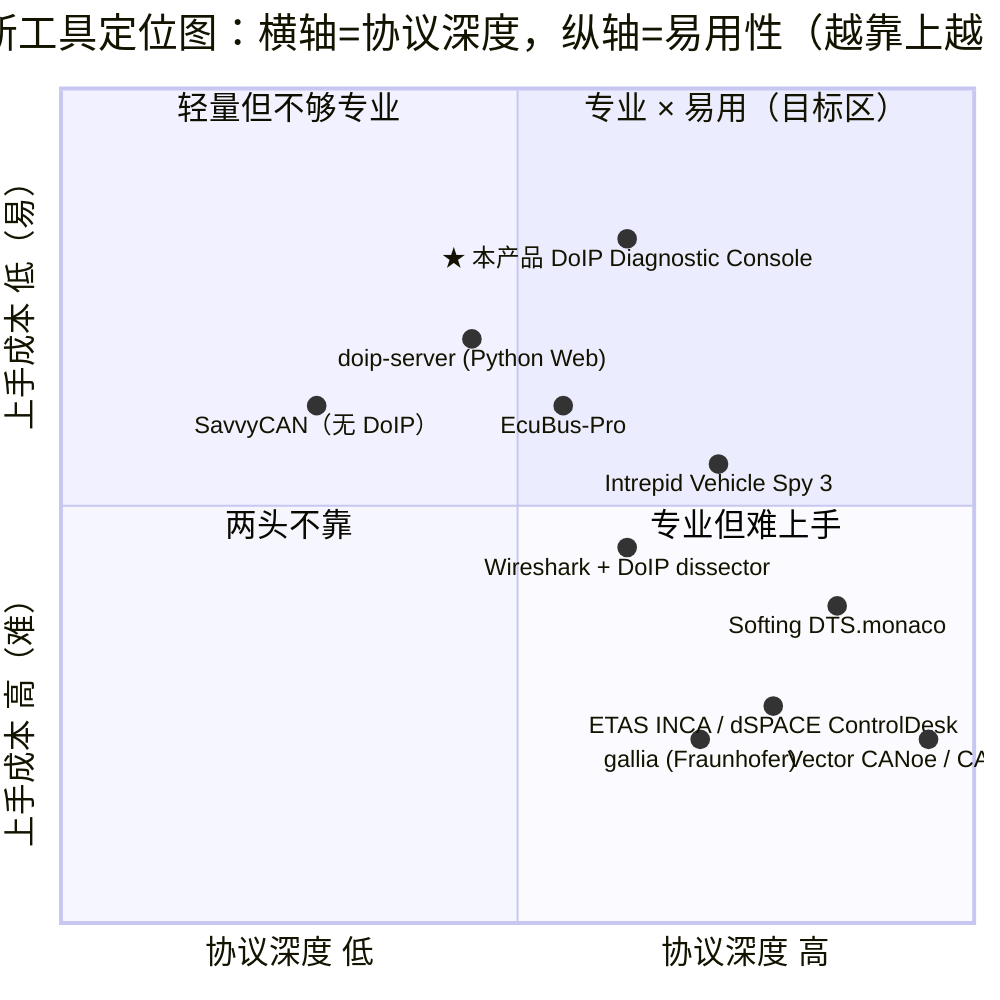
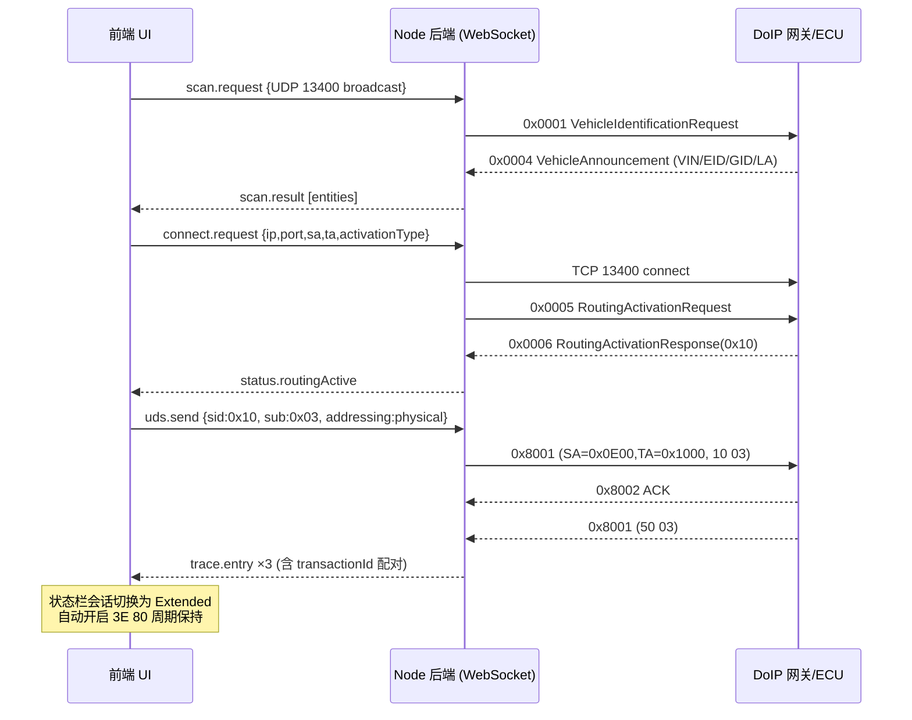
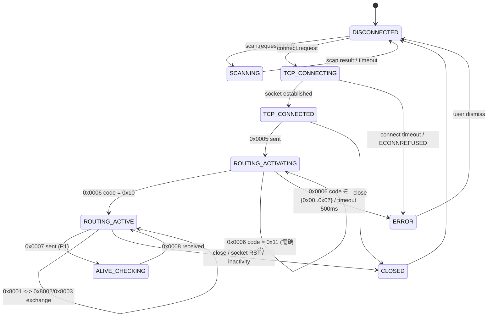

# DoIP 诊断控制台（DoIP Diagnostic Console）产品需求文档

| 项目 | 内容 |
| --- | --- |
| Language | 简体中文 |
| Programming Language | 前端 Vite + React + MUI + Tailwind CSS；后端 Node.js（TypeScript，raw socket `net` / `dgram` + WebSocket `ws`） |
| Project Name | `doip_diagnostic_console` |
| 文档版本 | v1.0（草案，待客户校对） |
| 撰写人 | 许清楚（产品经理） |
| 交付形态 | 单机本地运行的 Web 应用（浏览器 UI + 本机 Node 协议栈后端） |

---

## 0. 原始需求复述

客户为汽车电子/嵌入式方向工程师，需要一个**对标 Vector CANoe Diagnostic Console** 的 DoIP 诊断控制台客户端。

**已锁定的三项选型（不可推翻）：**

1. **交付形态**：Web 前端（React + Vite）+ 本地 Node 后端协议栈。后端直接开 DoIP 的 TCP 13400 / UDP 13400 原始 socket，前端通过 WebSocket 接收报文流。
2. **联调环境**：真实硬件与内置仿真 ECU 双模式均需支持。工具须内置**一键启动的 DoIP 仿真服务端（虚拟 ECU）**，能响应 Routing Activation、0x10 会话控制、0x27 安全访问 Seed/Key、0x3E TesterPresent、0x22 读数据、0x19 读 DTC；同时支持连接真实 ECU/台架。
3. **UDS 解码来源**：内置**可编辑的服务库 JSON**（预置常用 UDS 服务与 NRC 码表），Trace 中做服务名 / 子功能 / DID 级解码，用户可自行增删自定义服务与 DID。CDD/ODX 导入列为 P1 迭代项。

**客户点名的 P0 必须项：**

1. Trace 报文实时显示 + 导出（要求能看到**解码后**的 UDS 诊断原始报文）
2. 基础解锁 Seed/Key（0x27 Security Access）
3. 功能寻址（Functional Addressing）与物理寻址（Physical Addressing）
4. ACK 响应处理
5. 周期发送 `3E 80`（TesterPresent）做会话保持

---

## 1. 产品目标与定位

### 1.1 Product Goals（3 个正交目标）

| # | 目标 | 度量指标 |
| --- | --- | --- |
| G1 **可用性** | 零网关、零 license、五分钟内跑通"连真 ECU / 起仿真 ECU → 路由激活 → 10 03 → 27 解锁 → 22 读 DID" 全链路 | 首次成功完成 10 03 + 27 解锁的平均耗时 ≤ 5 分钟；安装包 ≤ 50 MB；无需安装 Vector / Intrepid 驱动 |
| G2 **可读性** | Trace 中的每一帧都能被**分层解码**（Ethernet→DoIP 头→UDS 服务中子功能/DID→NRC），且工程师能自定义编码表 | 0x22/0x2E/0x19/0x10/0x27/0x3E 六类报文的字段级解码覆盖率 100%；服务库 JSON 支持热编辑并即时生效 |
| G3 **可迁移性** | 双模式（仿真 / 真实）共用同一套 UI 与同一套后端协议栈，切换连接目标不需要改任何代码或配置结构 | 仿真模式与真实模式下，前端 Trace 行结构、导出格式、服务请求面板完全一致（差异仅限网络参数） |

### 1.2 非目标（明确不做）

- 不做 CAN / CAN FD / LIN / FlexRay 等其他总线（≠ 通用总线分析工具，定位是 **DoIP 侧诊断控制台**）
- 不做标定测量（XCP/CCP）与 vna/vflash 类刷写产线工具
- 第一版不做 OTA / 远程车队诊断服务端
- 不做按需授权的 license server

### 1.3 差异化定位

> 在"**协议深度**"上向 CANoe Diagnostic Console 看齐（分层解码、状态机、NACK/NRC 分层），在"**上手成本**"上向开源轻量工具看齐（一键起服务、网页 UI、JSON 编码表、无需硬件狗）。

---

## 2. 目标用户与使用场景

| 角色 | 画像 | 痛点 | 期望 |
| --- | --- | --- | --- |
| **ECU 诊断开发工程师**（主用户） | 写 DCM/DoIP 协议栈，需要一个能快速验证服务实现的 Tester | CANoe 台架被占用 / 授权不足；临时验证一个小 DID 也要开庞大工程 | 一键起内置仿真 ECU 或直连样件，秒级看到解码后的请求响应 |
| **台架 / HIL 测试工程师** | 跑回归用例，长时间挂机 | 需要导出可追溯的报文证据；偶尔网络层异常要区分是 DoIP 层还是 UDS 层 | Trace 可导出、可过滤、ACK/NACK 与 UDS NRC 分层呈现 |
| **售后/失效分析工程师** | 拿到故障件读 DTC 与快照 | 商业工具太重、临时借用麻烦 | 便携（U 盘可跑）、Trace 导出 CSV 可直接贴进报告 |
| **学生 / 爱好者 / 转岗工程师** | 学 UDS/DoIP | 缺乏可交互的学习环境；只有静态报文说明 | 内置仿真 ECU 提供"永远在线的对端"，配合解码树学习协议结构 |

**典型场景 S1：** 开发阶段，笔记本直连 ECU 样件 → 发现 → 路由激活 → 切 0x03 扩展会话 → 27 解锁 → 22 F190 读 VIN，全程 Trace 有中文/英文服务名标注。

**典型场景 S2：** 台架未就绪，先起内置仿真 ECU，验证自研 Tester 前端逻辑与自动化序列，后续只需改 IP 即可切到真件。

**典型场景 S3：** 现场偶发失败，长时间挂机记录 → 导出 CSV/JSON → 事后按"仅 NRC / 仅错误"快速定位。

---

## 3. 竞品与方案调研

### 3.1 协议标准基线（调研核对结果）

> 以下为本 PRD 的协议实现基线（依据 ISO 13400-2 公开资料、Wireshark DoIP 字段表、J2534 ISO13400 常量、python-doipclient 实现交叉核对）。**0x8003 NACK 码表在不同二手资料间存在差异，需客户以手上网关实测校准（见第 9 章开放问题 Q2）。**

#### 3.1.1 端口与传输

| 名称 | 端口 | 用途 |
| --- | --- | --- |
| `UDP_DISCOVERY` | 13400（UDP） | 车辆发现 / 实体状态 / 电源模式；也是 Vehicle Announcement 的广播目的端口 |
| `UDP_TEST_EQUIPMENT_REQUEST` | 动态 | 客户端发送请求、接收单播响应的源/目的端口 |
| `TCP_DATA`（非加密） | 13400（TCP） | 路由激活、存活检查、诊断报文、ACK/NACK |
| `TCP_DATA`（TLS） | 3496（TCP） | ISO 13400-2:2019+ 引入；Wireshark 亦注册 `DOIP_TLS_PORT 3496` |

#### 3.1.2 通用 DoIP 头（8 字节，固定）

| 偏移 | 宽度 | 字段 | 说明 |
| --- | --- | --- | --- |
| 0 | 1 B | `protocol_version` | 0x02 (2012) / 0x03 (2019) |
| 1 | 1 B | `inverse_protocol_version` | 与前一字节按位取反，校验乘积应为 0xFF（0x02 → 0xFD） |
| 2 | 2 B（大端） | `payload_type` | 见下表 |
| 4 | 4 B（大端） | `payload_length` | 后续 payload 字节数（0x00000000–0xFFFFFFFF） |
| 8 | 变长 | `payload` | 依 payload_type 定结构 |

> 实现要点：**必须先校验 inverse version 与 payload_length 上界再做内存分配**，并处理 TCP 字节流的半包/粘包/多包共存（这是自研 DoIP 栈最容易踩的坑）。

#### 3.1.3 Payload Type 全量表

| Payload Type | 名称 | 传输层 |
| --- | --- | --- |
| 0x0000 | Generic DoIP header NACK | UDP / TCP |
| 0x0001 | Vehicle identification request | UDP |
| 0x0002 | Vehicle identification request with EID | UDP |
| 0x0003 | Vehicle identification request with VIN | UDP |
| 0x0004 | Vehicle announcement / identification response | UDP |
| 0x0005 | Routing activation **request** | TCP |
| 0x0006 | Routing activation **response** | TCP |
| 0x0007 | Alive check request | TCP |
| 0x0008 | Alive check response | TCP |
| 0x4001 | DoIP entity status request | UDP |
| 0x4002 | DoIP entity status response | UDP |
| 0x4003 | Diagnostic power mode information request | UDP |
| 0x4004 | Diagnostic power mode information response | UDP |
| 0x8001 | **Diagnostic message** | TCP |
| 0x8002 | **Diagnostic message positive ACK** | TCP |
| 0x8003 | **Diagnostic message negative ACK** | TCP |
| 0x9001 | Transport layer payload type message structure（2019/Amd1 新增） | TCP |

#### 3.1.4 路由激活响应码（Routing Activation Response Code）

| 码 | 含义 | 建议行为 |
| --- | --- | --- |
| 0x00 | Denied - unknown source address | 报错，关闭 socket |
| 0x01 | Denied - all TCP_DATA sockets registered and active | 报错，提示并发上限 |
| 0x02 | Denied - SA different from the one on already activated socket | 报错，关闭 socket |
| 0x03 | Denied - SA already registered on a different socket | 报错，关闭 socket |
| 0x04 | Denied - missing authentication | 提示需认证 |
| 0x05 | Denied - rejected confirmation | 报错 |
| 0x06 | Denied - unsupported routing activation type | 提示换激活类型 |
| 0x07 | Denied - requires TLS socket（2019 新增） | 提示需走 3496 TLS |
| **0x10** | **Routing successfully activated** | ✅ 进入 `ROUTING_ACTIVE` |
| 0x11 | Routing will be activated; confirmation required | 等待/提示确认 |
| 0xE0–0xFE | Vehicle-manufacturer specific | 可自定义映射表 |

**激活类型（Activation Type）**：0x00 Default、0x01 WWH-OBD、0x02–0xDF 保留、0xE0 Central Security、0xE1–0xFF OEM 自定义。

#### 3.1.5 关键否定响应分层（本产品必须分层展示）

| 层 | Payload Type | 典型码 |
| --- | --- | --- |
| 通用头层 | 0x0000 generic header NACK | 0x00 格式错误（pattern/版本号校验失败，关 socket）、0x01 未知 payload type、0x02 报文过长、0x03 内存不足、0x04 payload 长度无效 |
| 路由层 | 0x0006 响应码 ≠ 0x10 | 见 3.1.4 |
| 诊断报文转发层 | 0x8003 NACK | 常用解释：0x02 invalid source address、0x03 unknown target address、0x04 message too large、0x05 out of memory、0x06 target unreachable、0x07 network unreachable、0x08 transport protocol error（**待实测校准**） |
| UDS 应用层 | 0x8001 载荷内 `7F <SID> <NRC>` | ISO 14229-1 NRC 码表（见 8.4） |

> **核心认知：** `0x8002 ACK` 只代表网关**收下并准备转发**，不代表 UDS 成功；UDS 结果必然通过另一条 `0x8001` 返回。二者必须在 Trace 中**关联配对显示**，否则工程师极易误判。

#### 3.1.6 ISO 15765-2（DoCAN）与 ISO 13400-2（DoIP）差异说明

| 维度 | ISO 15765-2 (DoCAN) | ISO 13400-2 (DoIP) |
| --- | --- | --- |
| 是否需要分包/流控 | 需要（SF/FF/CF/FC 四种帧、STmin、BS 流控） | **不需要**；payload_length 可表达至 4 GB，TCP 负责可靠传输 |
| 地址形式 | CAN ID（11/29 bit），需区分 Normal/Extended/Mixed 寻址 | **逻辑地址** SA/TA（各 2 字节，放在 payload 前 4 字节） |
| Padding | 需要填充到 8 字节 | 无 padding 概念 |
| 额外握手 | 无 | **Routing Activation**(0x0005/0x0006) 必须前置 |
| 额外确认 | 无 | **0x8002/0x8003 ACK/NACK** 传输层确认 |
| 存活机制 | 无传输层机制 | **0x0007/0x0008 Alive Check** + 通用 **`3E 80`**（后者是 UDS 层会话维持，二者不可互相替代） |
| 主要实现难点 | 时序/流控/定时器 IS-TP | TCP **半包、粘包、多包共存**；逆向版本校验；并发 socket 上限 |

> ISO 15765-2 在本产品中**不适用**；但需在 Trace UI 中保留"传输层"列标识（TCP/UDP/DoIP），以便与 CAN 侧日志心智模型对齐。

#### 3.1.7 建议默认时序参数（待确认，见 Q3）

| 参数 | 建议默认 | 说明 |
| --- | --- | --- |
| Routing Activation 超时 | 500 ms（`T_TCP_Alive`） | 未收到 0x0006 则判失败 |
| P2_Client（请求→首响应） | 200 ms | 默认值可放宽到 500 ms |
| P2*_Client（收到 0x78 pending 后） | 5000 ms | 可配置 |
| TesterPresent 周期 | 2000 ms | 需 < ECU 侧 S3_server（常见 5000 ms） |
| Alive Check 响应超时 | 500 ms | 仅当启用 `0x0007` 发送时有意义 |
| Vehicle Announcement 监听窗口 | 5 s | Announce 间隔通常 500 ms，发 3 次 |

---

### 3.2 商业工具调研

#### 3.2.1 Vector CANoe / CANalyzer（Diagnostic Console + DoIP Option）

- **地位**：事实标准。DoIP 支持自 CANoe 7.1 SP4 起持续演进，当前支持 ISO 13400-2:2019 + Amd1(2023)，含 **TLS 加密** 与新增 payload type（0x9001）。
- **配置方式**：Diagnostics/ISO TP 配置对话框中选择 DoIP 协议 → 设 Logical Address（典型 tester 0x0E80/0x0E00）、VIN/EID/GID、Further Action Required、Activation Type、协议版本；再从 DoIP.dll / simulation node 挂 EPB DLL。
- **Trace**：分层解码，Trace 窗口 Options 可配时间戳小数位（默认 6 位）、信号注释与 raw value、事件着色、多路复用展开；可从 DBC/CDD 加载后同时显示符号名。
- **导出**：Trace 窗口右键 Save As → `.asc` / `.txt` / `.csv`；Logging 模块格式可选 `.blf`（默认，二进制紧凑）/ `.asc`（文本，可用记事本打开、可贴 Excel 做筛选排序）/ `.mf4` / `.csv` / `.mat` / `.mdf`。
- **自动化**：CAPL / .NET / Test Feature Set + Test Report Viewer；CANoe.DiVa 可由诊断数据库自动生成测试用例。
- **优点**：协议最深、生态最全、数据库（CDD/ODX）与自动化一体。
- **缺点**：Windows-only、昂贵 licensing + Option 组合；ILinkRT 需 Vector 网卡（VN56xx/VN5640）；学习曲线陡；**没有内置"一键仿真 ECU"的轻量体验**，仿真要在 Simulation Setup 里手工搭 DLL 节点。

#### 3.2.2 Softing Diagnostic Tool Set 9 / DTS.monaco

- **模块**：DTS-Venice / DTS-Monaco / DTS-Flash / DTS-PDX Manager / DTS-Project / DTS-Analyzer / DTS-SystemConfigurator。
- **协议**：`ISO_14229_5_on_ISO_13400_2`（UDS on DoIP，作为出厂即可用的协议模板之一） + K-Line/CAN DoIP + J1939 + WWH-OBD 模板；通过 ISO 22900-2 / D-PDU API 接 VCI（并行 ≤ 4 个诊断接口）。
- **Trace**：DTS 9 新增"以太网通信（DoIP）的显示与记录"，测量数据可 `.csv` 导出。
- **数据库**：原生 ODX；运行时格式 SOD（可编辑、可回导 ODX）/ SRD / SMR（超紧凑格式，体积比 ODX 小 60–180 倍）。
- **自动化**：OTX（ISO 13209）+ Smart Diagnostic API（SDA，支持远程调用）+ Monaco 自定义 workspace/控件。
- **优点**：标准符合度高、售后与产线贯通、支持无 ECU 的 Simulated Interface、多语言。
- **缺点**：仍是 Windows 桌面重武器；许可体系复杂（BASE/PRO/TESTBENCH + 激活密钥/服务器许可）；OTX 学习成本不低。

#### 3.2.3 Intrepid Vehicle Spy 3（Enterprise / Professional / Basic）

- **网络**：Raw Ethernet、IP、UDP、TCP、**DoIP**、XCPoE、AVB/TSN；同时 CAN/CAN FD/LIN/FlexRay/J1939/GMLAN。
- **数据库**：VS3、DBC、ARXML、UEF、LDF、**ODX**、ODI、VSDB、VS3DB、FIBEX。
- **功能**：Messages View（快速过滤 + 活动高亮）、Transmit Panel、Function Blocks 图形化脚本（可下放到硬件实时执行）、Graphical Panels、Gateway Builder、J2534/RP1210。
- **版本差异**：**Basic 不支持 DoIP**；Professional 起支持 DoIP/XCPoE；Enterprise 另加 FlexRay、视频。
- **优点**：一个价格包含几乎所有功能（不用堆 license）；上手比 CANoe 快；脚本无需编程背景。
- **缺点**：仍绑定 neoVI/ValueCAN 类硬件；Windows 为主；Trace 偏总线监控视角，诊断服务解码粒度不及 CDD/ODX 驱动的工具。

#### 3.2.4 dear group / DSA Daten- und Systemtechnik（Aachen, DE）

- 定位：**整车生命周期 / 产线 EOL / 售后**方向与在研 **PRODIS 产品线**（PRODIS.MCD 诊断内核、PRODIS.PDU、PRODIS.SOVD、MFT-4 多功能测试仪、DE-4 智能诊断接口、EFS ECU 刷写工位、RCU 远程通信单元）。
- 客户覆盖：250+ 车辆生产厂、40,000+ 服务网点；近年方向是 SDV / SOVD（ISO 17978）与 FOTA。
- 与本项目关系：**非桌面单体工具的直接竞品**，更多是"工厂/售后体系级系统"。对我们有启发的是其 *虚拟 ECU*（"Diagnostics & Monitoring virtual ECU"）产品线——**印证"内置仿真 ECU"是刚需且已有成熟商业先例**。

#### 3.2.5 标定/自动化测试类（ETAS INCA、dSPACE ControlDesk / AutomationDesk）

- 定位是**标定测量与 HIL 自动化测试**，XCP on Ethernet 是主线而非 UDS/DoIP。
- 它们与我们重合的部分是"ECU 工程阶段访问"，但目标用户、数据流模型完全不同。
- **结论**：不是直接竞品；仅作为"工程阶段工具箱"背景存在。我们不需要复刻标定能力。

#### 3.2.6 商业工具功能矩阵

| 能力 | Vector CANoe/CANalyzer | Softing DTS 9 / Monaco | Intrepid Vehicle Spy 3 | dear group DSA PRODIS | ETAS/dSPACE |
| --- | --- | --- | --- | --- | --- |
| Trace 实时显示 | ✅ 强（分层+符号） | ✅ DoIP 显示/记录 | ✅ Messages View | ✅（体系内） | ✅（偏标定） |
| UDS 服务/子功能/DID 解码 | ✅ 深度（CDD/ODX 驱动） | ✅（ODX 原生） | 🟡（依赖 ODX 配置） | ✅ | 🟡 |
| 功能 / 物理寻址 | ✅ | ✅ | ✅ | ✅ | 🟡 |
| Session 保持 3E | ✅ 自动 + 可配 | ✅ | ✅ | ✅ | ✅ |
| 0x27 Seed/Key 解锁 | ✅（挂安全算法 DLL） | ✅ | ✅ | ✅ | 🟡 |
| Routing Activation 管理 | ✅（ Activation Type / 响应码可见） | ✅（ISO 14229-5 on 13400-2 模板） | ✅ | ✅ | 🟡 |
| ACK/NACK 分层呈现 | ✅ | 🟡（公开资料未明确） | 🟡 | 🟡 | ❌ |
| **内置仿真 ECU（零硬件）** | 🟡（需 Simulation Setup 手工搭） | ✅ Simulated Interface / virtual ECU | ✅ 节点/restbus 仿真 | ✅ virtual ECU 产品线 | 🟡 |
| 自动化脚本 | ✅ CAPL/.NET/DiVa | ✅ OTX + SDA | ✅ Function Blocks | ✅ PRODIS.Automation | ✅ Python/ASAM |
| 数据库支持 | CDD / ODX / DBC / ARXML | ODX / SOD / SRD / SMR | DBC / ODX / ARXML / LDF | ODX / OTX / SOVD | A2L / CDF |
| Trace 导出格式 | .asc .blf .mf4 .csv .mat .mdf .txt | .csv（测量数据） | 专有 + 通用格式 | 体系内报表 | .mf4 / 专有 |
| 跨平台 | ❌ Windows only | ❌ Windows 10/11 x64 | ❌ Windows为主 | ❌ 体系化部署 | ❌ Windows only |
| 购买/上手成本 | 高（License + Option + 硬件） | 高 | 中 | 高（项目型） | 高 |

### 3.3 开源 / 库方案调研

| 方案 | 语言/形态 | 与本项目关系 | 关键结论 |
| --- | --- | --- | --- |
| **python-doipclient** | Python 库，纯客户端 | 传输层参考实现 | 实现 ISO-13400(2019) 大部分内容；`tcp_port=13400`、`tls→3496`、`client_logical_address=3584 (0x0E00)`、`activation_type`、自动重连 `auto_reconnect_tcp`；可作为 Node 版逻辑的对照真源 |
| **udsoncan** | Python UDS 库 | UDS 语义参考 | 完整实现 0x10/0x22/0x27/0x2E/0x2F/0x31/0x34-0x37、0x29 Authentication；`security_algo(level, seed, params)` 插件式 Key 计算；请求/响应转 CK（`config` 驱动）——**我们的服务库 JSON 本质就是把 udsoncan 的 config 变成可编辑数据** |
| **python-uds / jaeger** | Python 库 | UDS 语法层参考 | python-uds 的 DoIP transport 需 fork 分支；生态碎片化，反证"自研可控编辑的服务库"有价值 |
| **DoIP-Lib (langroodi)** | C++ 库 | 报文序列化参考 | DoipController + MessageHandler 注册表模式；覆盖 VehicleId/DiagMessage/Ack/Nack/RoutingActivation/AliveCheck/EntityStatus/GenericNack；**线程安全未内置**（Node 单线程天然规避此问题，是选型优势） |
| **scapy.contrib.automotive.doip** | Python | 字段定义参考 | 给出完整 payload_type↔连接类型映射、源/目的/激活类型/ `logical_address_name` 等字段命名约定，可直接借用我们的 Trace 列名 |
| **Wireshark DoIP dissector** | 分析器 | 解码与过滤语法参考 | 注册 13400 / 3496；字段：`doip.version / .type / .source_address / .target_address / .response_code / .diag_ack_code / .diag_nack_code / .vin / .eid / .gid`；过滤 `doip.type == 0x8001`。**我们的过滤表达式建议向 Wireshark 语法靠拢**（降低用户迁移成本） |
| **SavvyCAN** | Qt/C++ 桌面 CAN 工具 | ❌ 非 DoIP 竞品 | 强在 CAN 侧：多总线、DBC 编辑、ISO-TP、UDS scan、Sniffer、流式导出十余种格式；**无 DoIP 能力**。验证"CAN 工具不能直接平移到以太网诊断" |
| **EcuBus-Pro** | C++/JS 桌面，Apache-2.0 | ⚠️ 最接近的商业替代品竞品 | CAN/CAN-FD + **DoIP** + LIN + SOME/IP；**TypeScript 脚本**（类 CAPL）、HIL 测试框架、CLI、拖拽 Panel。~871 stars。缺点：硬件依赖厂商私有驱动；Linux 支持偏弱；**无内置仿真 ECU**；CDD/ODX 仍在寻找方案（We are watching: 作者明确说 ODX 导入还没解决） |
| **doip-server (PyPI)** | Python + FastAPI + WebSocket | ⭐ **形态最接近的先例**（但角色相反） | 实现了 **Web Dashboard + WebSocket client tester**、分层 YAML 配置（gateway / ECU / services）、**功能寻址默认 0x1FFF**、响应轮转、UDP 车辆发现。说明"Web+WS 做 DoIP 测试器"完全可行；但它是**服务端**，缺少"连真ECU 的 tester 侧完整 Trace 导出与186 解码树" |
| **gallia (Fraunhofer AISEC)** | Python CLI 渗透测试框架 | 扫描策略参考 | `Discovery Scan / Session Scan / Service Scan / Identifier Scan` 四阶段；反匹配机制识别可用服务与 DID（用 serviceNotSupported / subFunctionNotSupported / requestOutOfRange 反判）；**DoS 语义**：ecubus 没有这个，这可以是我们 P2 的"服务/标识符扫描"能力蓝本 |
| **Graphically Configurable UDS Server Emulator** | Python + PySide6 | 仿真 ECU 参考 | 已实现 DoCAN/DoIP 双传输的 UDS server emulator + Trace box + 会话监控——验证"可配置仿真 ECU + Trace"组合的市场需求，但 GUI 老旧、无 Web 化 |

### 3.4 Trace 展示横向对比（客户特别要求）

| 工具 | 列定义 | 解码粒度 | 过滤 | 着色 | 导出格式 |
| --- | --- | --- | --- | --- | --- |
| CANoe Trace | 时间戳（默认 6 位小数）· 通道 · 方向 · 帧 ID/名称 · DLC · Data · **符号/信号名 + raw + 注释** | 报文级 + 信号级（需加载数据库） | 硬件 + 软件过滤，**可在 Logging 前挂 Predefined Filter** | Options→Events 事件类型树配 Text/Background 色 | .asc / .blf / .mf4 / .csv / .mat / .mdf / .txt |
| Softing Monaco | 会话/服务视角 + DoIP 记录视图 | 服务/DTC/参数级（ODX 驱动） | 由诊断序列与 workspace 决定 | 标准 Monaco 控件配色 | .csv（测量数据）/ 结构化报告 |
| Vehicle Spy 3 | 时间戳 · 网络 · ID · 方向 · 长度 · Data · 名称 | 报文 + 部分信号；UDS 扫描窗口可配 | **快速过滤**（"fast filtering"） | **活动高亮**（activity highlighting） | 专有日志 + 通用格式 |
| Wireshark (DoIP dissector) | No. · Time · Source · Destination · Protocol · Length · Info（含 DoIP 字段摘要） | **字段级最细**（doip.* / uds.sid 全展树） | `doip`、`doip.type==0x8001`、`tcp.port==13400` | 着色规则 + conversation filter | .pcap / .pcapng / Dissect as… |
| SavvyCAN | 时间戳 · ID · 标准/扩展 · 方向 · 总线 · DLC · ASCII · Data | DBC 信号级；ISO-TP/UDS 部分 | ID 范围 / 总线 | 变化字节高亮 + notching | 十余种 |
| doip-server Web UI | 简易 状态 / ECU 列表 / 请求响应 | 服务名级（依赖 YAML 定义） | 基本无 | 无 | 无 Trace 导出 |
| **本产品（目标）** | **No. · 时间戳(μs) · 相对时间 · 传输层(UDP/TCP) · 方向(TX/RX) · PayloadType(名) · SA(名) → TA(名) · 长度 · **UDS 解码（服务名/子功能/DID/NRC）** · 原始数据 HEX · 耗时/延迟** | **三层：DoIP 头 → UDS 服务/子功能/DID → 字段树（详情面板）** | Wireshark 风格表达式 `doip.type==0x8001 && uds.sid==0x22` + 一键预设（仅错误/仅 NRC/仅周期） | 按层与结果着色（请求/正响应/NRC/NACK/超时）+ 请求-响应配对着色 | **P0：CSV + JSON + 原始 HEX dump；P1：.asc / .pcapng / .jsonl 回放** |

### 3.5 各家"明显做得好 / 做得差"（客户要求标注可改进之处）

**做得好、我们要吸收：**

1. **CANoe**——路由激活失败给出具体响应码与排查提示；诊断请求面板按 CDD 自动列出服务与子功能**下拉**，不用手敲 hex。
2. **CANoe**——Trace 时间戳精度与列显示可全局配置；日志可选 `.asc`（人工可读，能贴 Excel）/ `.blf`（高吞吐）。
3. **Wireshark**——过滤表达式语法事实上已成为工程师肌肉记忆；DoIP 字段名命名规范。
4. **EcuBus-Pro / doip-server**——验证了 **TypeScript 脚本** 和 **WebSocket 网页 tester** 两条技术路线的可行性。
5. **Softing**——把"无 ECU 也能测"做成一等公民（Simulated Interface / virtual ECU）。

**做得差、是我们的机会：**

1. **平台与硬件绑定——主流商业工具几乎全部 Windows-only**，且多数需专用硬件（Vector VN56xx、neoVI、Y cable）。→ 我们 Node+Web 跨平台（Win/macOS/Linux 都能跑），DoIP 直连只需普通以太网卡。
2. **无法随时补 packet）——商业工具的解码能力来自 CDD/ODX + license**，临时加一个自定义 DID / 私有服务要回工具端走授权与流程。→ 我们服务库 JSON 可现场编辑即时生效（`EcuBus-Pro` 作者至今没解决 ODX 导入，说明这是行业真痛点）。
3. **缺少内置仿真 ECU）——CANoe 要手工在 Simulation Setup 挂 DLL 才能仿真**，新人卡半天。→ 我们"一键启动虚拟 ECU"是 P0 顶格优先级。
4. **ACK/NACK 与 UDS NRC 混淆**——多数工具的 Trace 不区分"网关没转发（0x8003）"与"ECU 拒绝了（7F xx yy）"，导致误判。→ 我们分层展示并**自动把 0x8002 ACK 与随后的 0x8001 UDS 响应按 transction 配对**。
5. **Trace 导出不友好**——`.blf` 需专有才能读；`.asc` 无 DoIP/UDS 解码信息。→ 我们 CSV 直接带**解码后的中文/英文列**，可贴 Excel/报告，零二次加工。
6. **会话保持不是一等公民——`3E` 常"隐藏在 TP 配置里"**，用户不知道还剩多久掉线。→ 我们在**状态栏可视化 S3 倒计时与 TesterPresent 心跳**，超时前预警。

### 3.6 竞品象限图



**解读：** 现有产品被一条对角线割裂——要么"够深但贵、难、绑 Windows/硬件"（CANoe/DTS/INCA），要么"便宜易得但协议深度不够"（SavvyCAN 无 DoIP、doip-server 无完整 Trace/导出）。**右上象限是空白区**，即本产品的目标位置：`协议深度 0.62 / 易用性 0.82`。要达到该位置，P0 必须拿下"分层解码 + 双模式 + 可编辑服务库 + 完整导出"，P1 通过 CDD/ODX 继续往右推。

---

## 4. 用户故事

### 4.1 诊断开发工程师（主场景）

- **US-1 一键起仿真**：作为一名 ECU 诊断开发工程师，我希望工具内置一个可一键启动的虚拟 ECU，以便在**没有台架和样件**时也能验证自己写的请求编排逻辑。验收：点击"启动仿真 ECU"后 ≤ 3 s，状态栏显示 `DoIP entity ready`，且能立刻完成路由激活并回答 `10 03`。
- **US-2 快速 discover 与连接**：作为工程师，我希望通过 UDP 广播自动发现网络中所有 DoIP 实体并看到 VIN/EID/GID/Logical Address，以便无需查阅档案就能挑目标。验收：广播 0x0001 后，实体列表在 ≤ 5 s 内返回；每条含 VIN/GID/EID/LA/NodeType。
- **US-3 服务名驱动发请求**：作为工程师，我希望从**服务名下拉**（DiagnosticSessionControl / ReadDataByIdentifier…）选择而不是手敲 hex，以便查错和培训。验收：选中服务后子功能与 DID 自动从服务库加载为可选项，选择后自动生成 hex 预览并可发送。
- **US-4 Seed/Key 解锁**：作为工程师，我希望工具自动完成 0x27 的请求种子 → 调 Key 算法 → 发送密钥三步，并支持我替换算法，以便快速通过私有安全访问。验收：选择安全等级后一键解锁；Seed/Key 均在 Trace 中明文展示；Key 算法可通过配置/脚本替换。
- **US-5 看懂失败**：作为工程师，当请求失败时我希望一眼看出是"网关没转发（0x8003）"还是"ECU 拒绝（NRC）"，以便不再误判。验收：Trace 行分层标色，并在详情面板显示三层原因。

### 4.2 台架/HIL 测试工程师

- **US-6 会话保持**：作为测试工程师，我希望会话在切到非默认会话后自动周期发 `3E 80`，并在即将超时前给出提示，以便长时回归不被掉线打断。验收：默认 2000 ms 周期；状态栏显示 S3 倒计时；可手动暂停/改周期。
- **US-7 导出证据**：作为测试工程师，我希望把 Trace 一键导出成带解码信息的 CSV，以便直接贴进测试报告，不需要再用其他工具二次转换。验收：导出的 CSV 含时间、方向、payload type、SA/TA、服务名、子功能名、DID、NRC 名、原始 hex 列。

### 4.3 售后/失效分析

- **US-8 轻量便携**：作为售后工程师，我希望工具免安装/便携、不依赖 Vector 硬件，以便在现场任意笔记本上开箱即用。验收：解压/安装后无需驱动与 license 即可连上 IP 可达的 ECU。

### 4.4 学习者

- **US-9 跟着解码学协议**：作为初学者，我希望点开任一行能看到**字段树**（逐字节归属说明），以便理解 8 字节头 / SA / TA / UDS 结构。验收：详情面板按字节偏移展示字段树，鼠标悬停高亮对应 hex 片段。

---

## 5. 需求池

> 优先级定义：**P0 = Must have（MVP 缺了不能交付）**；**P1 = Should have（首版之后 1–2 个迭代）**；**P2 = Could have（有余力再做）**。

### 5.1 P0 需求池（MVP）

| ID | 需求描述 | 验收标准 | 优先级理由 |
| --- | --- | --- | --- |
| **P0-01** | **DoIP 实体发现（UDP 13400）**：支持发送 0x0001/0x0002/0x0003 车辆识别请求，接收 0x0004 车辆公告/识别响应；支持被动监听 0x0004 广播；结果列表展示 VIN / EID / GID / Logical Address / NodeType / IP / furtherAction / VIN-GID sync status | ① 广播后 ≤ 5 s 返回在线实体；② 单播到指定 IP 也能拿到响应；③ 列表中每条字段可被拷贝；④ 支持进入下一步连接时自动带入 LA | 客户要求"DoIP 连接管理 + VIN/EID/GID 配置"，发现是连接前置步骤 |
| **P0-02** | **TCP 连接与 Routing Activation 管理（0x0005/0x0006）**：可配 Tester 源地址 SA（默认 0x0E00）、目标地址 TA、路由激活类型（0x00 Default / 0x01 WWH-OBD / 0xE0 Central Security / OEM 值）、协议版本（0x02/0x03）；在 Trace 与状态栏展示 0x0006 响应码的**明文含义**；非 0x10 时给出可操作的排查提示 | ① 0x10 成功 → 状态迁移到 `ROUTING_ACTIVE`；② 0x00–0x07 各失败码有对应中文提示（如 0x01 → "并发 socket 已达上限"）；③ 支持同一 TCP 连接上的重激活与断开重连 | 客户明确要求 "DoIP 连接管理（Routing Activation、逻辑地址配置）" |
| **P0-03** | **Trace 实时显示（三层解码）**：表格列含 No./时间戳(μs)/相对时间/传输层(UDP\|TCP)/方向(TX\|RX)/PayloadType(名)/SA→TA/长度/**UDS 解码（服务名·子功能名·DID 名·NRC 名）**/原始 hex/耗时；支持虚拟滚动、自动跟随、暂停滚动；支持请求↔响应**配对高亮** | ① 10 03、22 F190、27 01/02、3E 80、19 02、14 FF FF FF 均显示中英文名；② 未知服务/DID 显示为 `0x1F (Unknown)` 而非崩溃；③ ≥ 10,000 行滚动不掉帧 | **客户点名 5 项之一**；也是 G2 核心度量 |
| **P0-04** | **Trace 导出（含解码信息）**：支持导出 **CSV**（带列：时间、方向、payload type、SA/TA、服务名、子功能名、DID、NRC 名、原始 hex）、**JSON**（完整结构，含请求响应配对与延迟）、以及**原始 hex dump** | ① 导出的 CSV 可被 Excel 直接打开且筛选排序正常；② JSON 可被再次导入 Trace 复盘（P1 实现导入）；③ 支持"仅导出当前过滤结果"与"导出所选时间区间" | **客户点名 5 项之一** |
| **P0-05** | **物理寻址 / 功能寻址切换**：物理寻址发往具体 LA；功能寻址发往功能地址（默认 **0x1FFF**，可配）；功能寻址时能**聚合多个 ECU 的响应**并按 SA 分组展示，区分"多响应 / 单响应 / 无响应" | ① 一个开关/下拉切换；② 功能寻址下能显示每个响应来自哪个 SA；③ 支持配置"等待窗口"以收齐多响应（默认 2000 ms） | **客户点名 5 项之一** |
| **P0-06** | **ACK/NACK 处理与展示**：处理并区分 ① 0x0000 Generic DoIP header NACK（5 个码）② 0x0006 路由激活非 0x10 ③ **0x8002 ACK** ④ **0x8003 NACK** ⑤ UDS 层 `7F <SID> <NRC>`；0x8002 必须与随后到达的 0x8001 UDS 响应做**事务配对**显示 | ① 五个层各自独立标色；② 收到 0x8002 后启动 UDS 响应等待计时，超时标 `PGW forwarding timeout`；③ 收到 0x8003 时在 Trace 注明"网关未转发（非 UDS 层错误）" | **客户点名 5 项之一**；也是竞品最大短板（见 3.5-4） |
| **P0-07** | **0x27 Security Access Seed/Key 解锁**：支持选择安全等级（0x01/0x03/0x05/… 奇数请求种子，偶数发密钥）；自动完成两~三步；Seed/Key 明文展示；**Key 算法可插拔**（内置若干常见算法 + 允许自定义） | ① 一键完成整条流程并显示每步耗时；② Key 算法至少支持：内置常量、位运算（反转/XOR/移位）组合配置、自定义 JS 函数三种方式；③ 收到 NRC 0x35/0x36/0x37 时给出明确原因 | **客户点名 5 项之一** |
| **P0-08** | **周期 TesterPresent（3E 80）会话保持**：可开启自动保持，默认周期 **2000 ms**（可配 100–60000 ms）；状态栏显示 **S3 倒计时**与下一次发送倒计时；支持手动单发、暂停、立即续命 | ① 非默认会话下 ≥ 30 min 不掉会话；② 倒计时可视化；③ 周期发送行在 Trace 中打 `tag:周期3E` 且可一键过滤隐藏 | **客户点名 5 项之一** |
| **P0-09** | **内置仿真 ECU（一键启停虚拟 ECU）**：后端内置 DoIP Server，作为虚拟 ECU 响应：**0x0004 车辆公告（UDP）**、**0x0005 路由激活**、**0x10 会话控制**、**0x27 Seed/Key**、**0x3E TesterPresent**、**0x22 读 DID**、**0x19 读 DTC**；支持多逻辑地址（≥ 3 个虚拟 ECU）；支持**故障注入**（人工返回指定 NRC / NACK / 不响应 / 延迟响应） | ① 一键启动 ≤ 3 s；② 上述 7 类请求全部有正确响应；③ 可通过 UI 配置虚拟 ECU 的 VIN/EID/GID/LA 与 DID 数据集、DTC 列表；④ 故障注入面板可指定"下一个 0x22 F190 返回 NRC 0x31" | **客户点名双模式之一**，也是相对竞品的核心差异化（见 3.5-3） |
| **P0-10** | **可编辑的 UDS 服务库 JSON + 编辑器**：内置预置 JSON（常用 UDS 服务 + 完整 ISO 14229-1 NRC 码表 + 常用 DID 表 + 地址别名表）；提供 UI 编辑器可**增/删/改**服务、子功能、DID、NRC 别名；修改后**无需重启立即生效**；支持导入/导出 JSON 文件以便团队共享 | ① 预置覆盖 0x10/0x11/0x14/0x19/0x22/0x27/0x28/0x2E/0x31/0x34-0x37/0x3E/0x85 等常用服务；② 编辑器改动 → Trace 下一次解码立即体现；③ 导出/导入 JSON 往返无损；④ 用户自定义项与内置项有区分标记，升级时不被覆盖 | **客户明确要求的 UDS 解码方案**（第 3 项选型） |
| **P0-11** | **前后端 WebSocket 报文流桥接**：后端 Node 协议栈通过 WebSocket 向前端推送结构化事件（连接状态变更 / 新 Trace 条目 / 错误）；前端可下发指令（连接/断开/发请求/启停 TesterPresent/启停仿真 ECU）；含心跳与断线重连 | ① 前端重连后不丢历史事件（后端保留环形缓冲，前端重连可拉取缺失片段）；② 单条 Trace 消息端到端延迟 ≤ 50 ms；③ WS 消息有 `seq` 序号，前端可检测丢包 | 客户指定的交付形态（第 1 项选型）的技术骨架 |
| **P0-12** | **连接/会话状态机可视化与状态栏**：状态栏展示 ① TCP 连接状态 ② Routing 激活状态 ③ 当前 UDS 会话（Default/Programming/Extended）④ 安全解锁等级 ⑤ S3 与 TesterPresent 倒计时 ⑥ Trace 条数/错误数 ⑦ 与对端的往返延迟 | ① 状态机节点：`DISCONNECTED → TCP_CONNECTING → TCP_CONNECTED → ROUTING_ACTIVATING → ROUTING_ACTIVE → CLOSED/ERROR`；② 状态异常时状态栏变红并给出原因；③ 切换会话/解锁时状态栏实时更新 | 客户点名之外的必要可观测性；对应 G1"五分钟跑通"的可诊断性 |
| **P0-13** | **服务请求区（服务名驱动）**：下拉选择服务 → 自动加载子功能/参数表单（依据服务库）→ 实时预览生成的 hex → 发送；同时提供"原始报文"模式供手工输入 hex（带格式校验） | ① 至少覆盖 `10 会话控制 / 22 读 DID / 2E 写 DID / 19 读 DTC / 14 清 DTC / 27 安全访问 / 3E TesterPresent / 11 ECU 复位` 的表单化；② 原始模式支持非法 hex 提示；③ 支持勾选"抑制正响应（SuppressPosRspMsgIndication）" | 对标 CANoe Diagnostic Console 的核心交互，直接决定 G1/G2 达成 |
| **P0-14** | **错误与日志**：后端错误（socket 错误、解析错误、超时）统一上报到前端"日志/通知"区，并与对应 Trace 行互跳 | ① 每类错误有唯一错误码 + 中文说明；② 与 Trace 行双向跳转 | 稳定性保障 |

### 5.2 P1 需求池

| ID | 需求描述 | 验收标准 | 优先级理由 |
| --- | --- | --- | --- |
| P1-01 | **CDD / ODX（PDX）导入**：解析 openODX 类库，把诊断库映射为内部服务库结构 | 至少支持 ODX 2.2 的 DIAG-SERVICE / DOP / DTC 提取，导入后 Trace 立刻按 ODX 名解码 | 客户明确列为 P1 迭代项 |
| P1-02 | Trace 导出扩展：`.asc`、`.pcapng`（便于用 Wireshark 二次分析）、`.jsonl` 流式 | 导出的 pcapng 能被 Wireshark 正确识别为 DoIP | 与现有工具互操作 |
| P1-03 | **Trace 过滤与着色规则**：Wireshark 风格表达式 + 预设（仅错误 / 仅 NRC / 仅某服务 / 排除周期 3E） | 表达式支持 `doip.type`、`uds.sid`、`sa`、`ta`、`dir` 等字段；过滤后导出只含结果 | 竞品均有（3.4），缺失会显得不专业 |
| P1-04 | **多 ECU 并发连接 / 多标签页**：同时维持 ≥ 4 条 TCP 会话并独立 Trace | 每条 Trace 按 tab 隔离，可合并视图 | DoIP 网关常并发 2–4 socket，是真需求 |
| P1-05 | **自动化序列（脚本）**：支持把若干请求编排成序列，含条件分支、等待 NRC、循环；语言倾向 **JavaScript/TypeScript**（与前端同源，参考 EcuBus-Pro） | 支持录制刚执行过的操作为序列；支持导出/导入序列 JSON | 竞品都有（CAPL/OTX/Function Blocks/TS 脚本），P0 缺失可接受 |
| P1-06 | **Alive Check 支持**：发送 0x0007、接收 0x0008；在 UI 可见 | 与 TesterPresent 区分展示 | 传输层监督，很多网关会主动查 |
| P1-07 | **TLS 支持（3496）**：可选启用 TLS，Trace 标注是否加密 | 能与要求 TLS 的网关建立会话 | 新车型网关开始要求 |
| P1-08 | **0x29 Authentication**：证书/MAC 类认证服务的表单化支持 | 支持自定义 Authentication 方式的 JSON 配置 | ISO 14229-1:2020 新增，udsoncan 已实现，成本可控 |
| P1-09 | **更多 UDS 服务**：0x2F IO 控制、0x31 RoutineControl、0x34/0x36/0x37 刷写流程（含自动分段与块序号）、0x85 控制 DTC 设置 | 刷写流程能跑通 ≥ 1 MB 数据 | 拓展专业深度（象限图往右移动） |
| P1-10 | **工程/配置持久化**：把连接配置、服务库、UI 布局、TesterPresent 设置保存为工程文件，可导入导出 | 重启后自动恢复上次工程 | 工程师日常必需 |
| P1-11 | **Trace 大数据性能**：环形缓冲 ≥ 100,000 条；虚拟滚动无卡顿；后端批量推送（每 50 ms 打包一帧） | 10 万条时内存 ≤ 300 MB，滚动 > 50 fps | 挂机场景必需 |
| P1-12 | **报文序列回放**：把导出的 JSON 序列按原时序重放到仿真 ECU | 回放速率可调（0.5×/1×/最快） | 复现问题 |

### 5.3 P2 需求池

| ID | 需求描述 | 优先级理由 |
| --- | --- | --- |
| P2-01 | 图形面板（Gauge / Chart / 滑杆），把 DID 值可视化为仪表与曲线 | 提升观感与 demo 效果，不影响核心链路 |
| P2-02 | **服务/标识符扫描**（参考 gallia 的 Discovery/Session/Service/Identifier 四阶段与反匹配机制） | 逆向与自建服务库的效率利器 |
| P2-03 | CLI 命令行模式，支持 CI/CD 集成与批量自动化 | 团队落地与回归 |
| P2-04 | 远程/多人访问模式（后端不在本机，浏览器远程连） | 前提是鉴权方案成熟 |
| P2-05 | 自动生成测试报告（HTML/PDF） | 售后与质保分析流程需要 |
| P2-06 | Docker 镜像 / 便携绿色版 | 现场与网络隔离（内网）环境 |
| P2-07 | 深色/浅色主题、中英文 i18n | 打磨 |
| P2-08 | 插件市场 / 自定义 Key 算法包（`.dll`/`.so`/JS 模块） | 生态远期目标 |

---

## 6. UI 设计稿说明

### 6.1 整体布局（参考 CANoe Diagnostic Console）

```
┌──────────────────────────────────────────────────────────────────────────────────────┐
│ 顶部工具栏                                                                            │
│ [Logo] 模式:(●)真实ECU ( )仿真ECU  [目标IP____] [端口13400] [连接▾] │ [服务库] [设置] │
├──────────────┬───────────────────────────────────────────────────────────────────────┤
│ A 连接/ECU区 │  B 服务请求区   Tab: [常用服务] [原始报文] [自动化序列(P1)] [服务库编辑] │
│              │  ┌───────────────────────────────────────────────────────────────────┐│
│ 已发现实体 ▾ │  │ 服务: [DiagnosticSessionControl (0x10)          ▾]                ││
│ ┌──────────┐│  │ 子功能:[extendedDiagnosticSession (0x03)        ▾]  ☐抑制正响应     ││
│ │VIN/EID/  ││  │ 参数:  [ sessionParameterRecord: ______________ ]                  ││
│ │GID / LA  ││  │ 寻址:  (●)物理 0x1000   ( )功能 0x1FFF                              ││
│ │[连]      ││  │ 预览:  10 03                       [发送] [周期发送…] [收藏★]        ││
│ └──────────┘│  └───────────────────────────────────────────────────────────────────┘│
│              ├───────────────────────────────────────────────────────────────────────┤
│ 会话与解锁   │  C Trace 报文区（虚拟滚动表格）                                        │
│ 当前会话:    │  ┌──┬──────────┬────┬──┬─────────────┬──────┬──────────────────────┐ │
│  Extended   │  │# │时间戳(μs)│方向│PT│SA→TA        │长度  │UDS 解码 / 原始数据    │ │
│ 解锁:Lv1 ✗  │  ├──┼──────────┼────┼──┼─────────────┼──────┼──────────────────────┤ │
│              │  │1 │12.345678 │TX  │01│0E00→FFFF   │  0   │DoIP: VehicleIdentReq  │ │
│ 路由激活     │  │2 │12.401234 │RX  │04│1FFF→0E00   │ 33   │DoIP: VehicleAnnounce  │ │
│ SA 0x0E00   │  │3 │13.001122 │TX  │05│0E00→1000   │ 11   │DoIP: RoutingActivReq  │ │
│ TA 0x1000   │  │4 │13.003456 │RX  │06│1000→0E00   │ 13   │✓ RoutingActivated 0x10│ │
│ 类型 Default│  │5 │14.100000 │TX  │01│0E00→1000   │  2   │DSC(10) extended(03)   │ │
│ [重激活]     │  │6 │14.101000 │RX  │02│1000→0E00   │  2   │✓ ACK 0x8002           │ │
│              │  │7 │14.112000 │RX  │01│1000→0E00   │  2   │✓ DSC-PR(50) 03        │ │
│ 仿真ECU控制  │  │8 │16.110000 │TX  │01│0E00→1000   │  2   │TP(3E) sub 80  ⟳周期   │ │
│ [启动][停止] │  │9 │18.200000 │TX  │01│0E00→1000   │  2   │SA(27) requestSeed 01  │ │
│ [故障注入…] │  │10│18.203000 │RX  │01│1000→0E00   │  6   │SA-PR(67) 01 seed:...  │ │
│              │  │11│20.500000 │RX  │01│1000→0E00   │  2   │✗ NRC 0x35 invalidKey  │ │
├──────────────┼──┴──────────┴────┴──┴─────────────┴──────┴──────────────────────┴────┤
│ D 详情 / 响应解码树                                     [过滤: doip.type==0x8001 ▾]  │
│ └─ UDS / DiagnosticSessionControl (0x10)                                              │
│     ├─ [0] sid        = 0x10  DiagnosticSessionControl                                │
│     ├─ [1] subFunction= 0x03  extendedDiagnosticSession  (suppressPosRsp = false)     │
│     └─ [2..] dataRecord = []                                                           │
├──────────────────────────────────────────────────────────────────────────────────────┤
│ E 状态栏                                                                              │
│ ●已连接 │ 路由:ACTIVE │ 会话:Extended │ 解锁:Lv1 ✗ │ S3倒计时:3.8s │ 3E心跳:▶ 2.0s │
│ TX 12 / RX 9 │ 错误 1 │ RTT 22ms │ Trace 11 条 [清除] [导出▾] [⏸跟随]                 │
└──────────────────────────────────────────────────────────────────────────────────────┘
```

### 6.2 分区组件清单与交互说明

#### A. 连接 / ECU 配置区（`ConnectionPanel`，左侧固定宽 ~300 px，可折叠）

| 组件 | 类型 | 说明 / 交互 |
| --- | --- | --- |
| 模式切换 | MUI `ToggleButtonGroup` | `真实ECU` / `仿真ECU`；切到仿真时自动填充 `127.0.0.1:13400` 并提示"一键启动" |
| 目标 IP / 端口 | `TextField` ×2 | 默认 `192.168.x.x` / `13400`；端口可改以支持非标网关 |
| 本地绑定 IP | `Select` | 多网卡时必选；默认 Any |
| SA / TA | `TextField`（hex） | SA 默认 `0x0E00`；TA 从发现列表带入 |
| 路由激活类型 | `Select` | Default(0x00) / WWH-OBD(0x01) / CentralSecurity(0xE0) / 自定义 |
| 协议版本 | `Select` | 0x02 (2012) / 0x03 (2019) |
| 发现实体列表 | `List` + 刷新按钮 | 每行 VIN/EID/GID/LA/NodeType，点"连"带入 TA 与 IP |
| 会话与解锁卡片 | `Card` | 显示当前会话、解锁等级、SA/TA、可见 tracks-by SA；提供 `[重激活]` |
| 仿真 ECU 控制 | `ButtonGroup` | `[启动] [停止] [故障注入…]`；故障注入弹出 `Dialog`（可选：返回指定 NRC / NACK / 不响应 / 延迟 ms） |
| 连接按钮 | `Button` | 依据状态显示 `连接` / `断开`，不可用时有 tooltip 说明原因 |

#### B. 服务请求区（`RequestPanel`，右上）

| 组件 | 类型 | 说明 / 交互 |
| --- | --- | --- |
| Tab 容器 | `Tabs` | `常用服务` / `原始报文` / `自动化序列(P1)` / `服务库编辑` |
| 服务下拉 | `Autocomplete` | 数据源为服务库 JSON；显示 `名称 (0xXX)`；支持搜索 |
| 子功能下拉 | `Select` | 依据所选服务动态加载；禁用时置灰 |
| 参数表单 | 动态渲染 | 由服务库的 `params` schema 驱动（DID 选择器 / hex 输入 / 文本框）；DID 选择器带名字搜索 |
| 寻址切换 | `RadioGroup` | 物理（具体 TA）/ 功能（默认 `0x1FFF`） |
| hex 预览 | `Chip`/代码框 | 实时拼出生字节串；字节间空格；鼠标悬停说明字节归属 |
| 发送按钮 | `Button` | `发送`；支持 Enter 快捷发送；发送中 disabled 并显示 spinner 与 P2 倒计时 |
| 周期发送 | `Button` + `Dialog` | 设置周期（ms）、次数（0=无限）、是否自动加入 Trace 过滤标签 |
| 收藏 | `IconButton` | 收藏常用组合到"快捷发送"列表（本地持久化） |

#### C. Trace 报文区（`TraceTable`，中部，主视图）

| 组件 | 类型 | 说明 / 交互 |
| --- | --- | --- |
| 虚拟表格 | MUI `Table` + 虚拟滚动 | 列：No. / 时间戳(μs) / 相对时间 / 传输层(UDP\|TCP) / 方向(TX\|RX) / PayloadType(名) / SA→TA（含别名）/ 长度 / **UDS 解码（服务名·子功能·DID·NRC）/ 原始 hex / 耗时** / 标签 |
| 行着色 | CSS class | `·请求`中性；`·正响应`绿；`·NRC`橙红；`·0x8002 ACK`浅蓝虚线；`·0x8003 NACK`红；`·超时`灰；`·周期3E`淡灰可折叠隐藏 |
| 请求↔响应配对 | 虚线连 INDICATOR + 同色左边框 | 0x8002 与后续 0x8001 UDS 响应以同一 `transactionId` 关联；hover 高亮组 |
| 过滤栏 | `TextField` | Wireshark 风格表达式 + 预设 chips（仅错误 / 仅 NRC / 隐藏周期3E / 仅某服务） |
| 控制条 | `IconButton` ×N | 暂停滚动 / 自动跟随开关 / 清除 / 导出（`导出▾` 菜单：CSV / JSON / HEX） / 列显示设置 |
| 右键菜单 | `Menu` | 复制行 / 复制 hex / 复制解码串 / 以此为模板新建请求 / 加入忽略列表 |

#### D. 详情 / 响应解码树（`DetailPanel`，下部可折叠）

| 组件 | 类型 | 说明 / 交互 |
| --- | --- | --- |
| 分层树 | `TreeView` | 根节点三层：`DoIP Header` / `DoIP Payload` / `UDS`；叶节点显示 `偏移 · 字段名 · 值 · 含义` |
| Hex 视图 | 双向高亮 | 选中树节点时，同步高亮该字段对应的 hex 字节；选中 hex 字节反向定位树节点 |
| 错误解释卡 | `Alert` | 若是 NRC/NACK/超时，给出"这是什么 + 常见原因 + 建议动作"（由服务库的 NRC 表 `hint` 字段驱动） |

#### E. 状态栏（`StatusBar`，底部）

- 连接状态灯（灰/黄/绿/红）+ 状态机节点名
- 路由激活状态与最近响应码
- 当前 UDS 会话（Default / Programming / Extended）
- 安全解锁等级（每个 Level 一个 chip，绿=已解锁）
- **S3 倒计时**（秒，< 1 s 变橙）+ **TesterPresent 心跳开关与周期**
- TX/RX 计数、错误计数、最近 RTT、Trace 条数
- `[清除] [导出▾] [⏸跟随]`

#### F. 服务库编辑器（Tab 页，P0）

- 左右分栏：左=服务/子功能/DID/NRC/地址别名 五个列表导航；右=表单编辑
- 每条记录可标记 `内置` / `自定义`；导出 JSON / 导入 JSON / 重置为内置
- 编辑即时生效（无需重启）：保存时若存在正在进行的解码，直接按新表重算当前 Trace

### 6.3 关键交互流（连接建立）



---

## 7. 数据模型要点

### 7.1 DoIP 报文结构

```typescript
// 通用头：固定 8 字节
interface DoIpHeader {
  protocolVersion: number;        // 0x02 | 0x03
  inverseProtocolVersion: number; // 0xFF ^ protocolVersion；校验用
  payloadType: number;            // 0x0000 ... 0x8003 / 0x9001
  payloadLength: number;          // 后续 payload 字节数
}

// 路由激活请求（0x0005）payload
interface RoutingActivationRequest {
  sourceAddress: number;      // tester SA，2B
  activationType: number;     // 0x00/0x01/0xE0/自定义
  reservedIso: number;        // 4B = 0x00000000
  reservedOem: Buffer;        // 4B
}

// 路由激活响应（0x0006）payload
interface RoutingActivationResponse {
  testerLogicalAddress: number;  // 回显 tester SA
  doipEntityLogicalAddress: number;
  routingActivationResponseCode: number; // 0x10 = 成功
  reservedIso: number;
  reservedOem: Buffer;
}

// 诊断报文（0x8001）payload
interface DiagnosticMessage {
  sourceAddress: number;  // 2B
  targetAddress: number;  // 2B
  userData: Buffer;       // 原始 UDS 字节
}

// ACK / NACK
interface DiagnosticMessageAck  { sourceAddress: number; targetAddress: number; ackCode: number;  previousMessage: Buffer; }
interface DiagnosticMessageNack { sourceAddress: number; targetAddress: number; nackCode: number; previousMessage: Buffer; }
```

### 7.2 Trace 条目结构（前端渲染 + JSON 导出共用）

```jsonc
{
  "seq": 1234,                       // 单调序号，WS 丢包检测用
  "transactionId": "tx-0007",        // 请求↔ACK↔UDS响应 三方配对
  "ts": "2026-09-21T10:00:00.123456Z",  // 绝对时间，μs 精度
  "tsRelMs": 12345.678,              // 相对连接建立/测量起点
  "transport": "TCP",                // "TCP" | "UDP"
  "direction": "TX",                 // "TX" | "RX"
  "peer": "192.168.1.10:13400",
  "doip": {
    "protocolVersion": 2,
    "inverseVersionValid": true,
    "payloadType": 32769,
    "payloadTypeName": "Diagnostic message",
    "payloadLength": 6,
    "sourceAddress": 3584,
    "targetAddress": 4096,
    "sourceAddressName": "Tester",
    "targetAddressName": "Engine_ECU",
    "ackCode": 0,
    "nackCode": null,
    "activationResponseCode": null,
    "vin": null, "eid": null, "gid": null,
    "header": "02FD800100000006",
    "payload": "0E0010001003"
  },
  "uds": {
    "decoded": true,
    "serviceId": 16,
    "serviceName": "DiagnosticSessionControl",
    "isPositive": true,
    "subFunction": 3,
    "subFunctionName": "extendedDiagnosticSession",
    "suppressPositiveResponse": false,
    "did": null,
    "didName": null,
    "nrc": null,
    "nrcName": null,
    "nrcHint": null,
    "params": [{ "name": "sessionParameterRecord", "value": "", "offset": 2 }],
    "tree": { "sid": "0x10", "children": [ /* 字段树 */ ] }
  },
  "linkedSeq": 1232,                 // 配对的上一条
  "latencyMs": 12.4,
  "timeout": false,
  "tags": ["周期3E"],                // 用于过滤与折叠
  "errors": [],                      // 结构化错误对象
  "raw": "02FD8001000000060E0010001003"  // 完整原始帧 hex（含头）
}
```

### 7.3 会话状态机



**UDS 会话子状态（与 DoIP 状态正交）：**

| 状态 | 值 | 转换条件 |
| --- | --- | --- |
| DEFAULT | 0x01 | 上电 / 会话超时回退 |
| PROGRAMMING | 0x02 | `10 02` 正响应 |
| EXTENDED | 0x03 | `10 03` 正响应 |
| (会话维持) | — | 每 ≤ S3_server 发送 `3E 80`；超时则回 DEFAULT |
| 安全等级 | Lv N | `27 <odd>` 取 seed → `27 <even>` 发 key → 正响应则解锁；ECU 复位/会话超时则丢失 |

### 7.4 UDS 服务库 JSON Schema 草案（`uds-library.json` v1.0）

```jsonc
{
  "schemaVersion": "1.0",
  "meta": {
    "name": "builtin-uds-cn",
    "description": "内置常用 UDS 服务库（可在 UI 中编辑）",
    "updatedAt": "2026-09-21T00:00:00Z"
  },

  // ── ① NRC 码表（ISO 14229-1）
  "nrcTable": [
    { "code": "0x10", "name": "generalReject",                              "nameZh": "一般拒绝" },
    { "code": "0x11", "name": "serviceNotSupported",                        "nameZh": "服务不支持" },
    { "code": "0x12", "name": "subFunctionNotSupported",                    "nameZh": "子功能不支持" },
    { "code": "0x13", "name": "incorrectMessageLengthOrInvalidFormat",      "nameZh": "报文长度错误或格式非法" },
    { "code": "0x14", "name": "responseTooLong",                            "nameZh": "响应过长" },
    { "code": "0x21", "name": "busyRepeatRequest",                          "nameZh": "忙，请重发" },
    { "code": "0x22", "name": "conditionsNotCorrect",                       "nameZh": "条件不满足" },
    { "code": "0x24", "name": "requestSequenceError",                       "nameZh": "请求序列错误" },
    { "code": "0x25", "name": "noResponseFromSubnetComponent",              "nameZh": "子网部件无响应" },
    { "code": "0x26", "name": "failurePreventsExecutionOfRequestedAction",  "nameZh": "故障阻止了请求的执行" },
    { "code": "0x31", "name": "requestOutOfRange",                          "nameZh": "请求超范围" },
    { "code": "0x33", "name": "securityAccessDenied",                       "nameZh": "安全访问被拒绝", "hint": "先做 0x27 解锁，或等级不匹配" },
    { "code": "0x35", "name": "invalidKey",                                 "nameZh": "密钥无效", "hint": "检查 Seed/Key 算法是否正确" },
    { "code": "0x36", "name": "exceedNumberOfAttempts",                     "nameZh": "尝试次数超限", "hint": "等待延时计时器到期后重试" },
    { "code": "0x37", "name": "requiredTimeDelayNotExpired",                "nameZh": "要求的时延未过" },
    { "code": "0x70", "name": "uploadDownloadNotAccepted",                  "nameZh": "上传下载不被接受" },
    { "code": "0x71", "name": "transferDataSuspended",                      "nameZh": "数据传输暂停" },
    { "code": "0x72", "name": "generalProgrammingFailure",                  "nameZh": "一般编程失败" },
    { "code": "0x73", "name": "wrongBlockSequenceCounter",                  "nameZh": "块序号错误" },
    { "code": "0x78", "name": "requestCorrectlyReceivedResponsePending",    "nameZh": "已接收，响应待定", "hint": "应延长等待，非错误" },
    { "code": "0x7E", "name": "subFunctionNotSupportedInActiveSession",     "nameZh": "当前会话不支持该子功能" },
    { "code": "0x7F", "name": "serviceNotSupportedInActiveSession",         "nameZh": "当前会话不支持该服务", "hint": "先切到扩展会话 10 03" },
    { "code": "0x81", "name": "rpmTooHigh",                                 "nameZh": "转速过高" },
    { "code": "0x82", "name": "rpmTooLow",                                  "nameZh": "转速过低" },
    { "code": "0x83", "name": "engineIsRunning",                            "nameZh": "发动机正在运转" },
    { "code": "0x84", "name": "engineIsNotRunning",                         "nameZh": "发动机未运转" },
    { "code": "0x85", "name": "engineRunTimeTooLow",                        "nameZh": "发动机运转时间过短" },
    { "code": "0x86", "name": "temperatureTooHigh",                         "nameZh": "温度过高" },
    { "code": "0x87", "name": "temperatureTooLow",                          "nameZh": "温度过低" },
    { "code": "0x88", "name": "vehicleSpeedTooHigh",                        "nameZh": "车速过高" },
    { "code": "0x89", "name": "vehicleSpeedTooLow",                         "nameZh": "车速过低" },
    { "code": "0x8A", "name": "throttlePedalTooHigh",                       "nameZh": "油门/踏板过高" },
    { "code": "0x8B", "name": "throttlePedalTooLow",                        "nameZh": "油门/踏板过低" },
    { "code": "0x8C", "name": "transmissionRangeNotInNeutral",              "nameZh": "变速箱不在空挡" },
    { "code": "0x8F", "name": "brakeSwitchNotClosed",                       "nameZh": "制动开关未闭合" },
    { "code": "0x92", "name": "voltageTooHigh",                             "nameZh": "电压过高" },
    { "code": "0x93", "name": "voltageTooLow",                              "nameZh": "电压过低" }
  ],

  // ── ② 服务定义
  "services": [
    {
      "id": "0x10",
      "name": "DiagnosticSessionControl",
      "nameZh": "诊断会话控制",
      "positiveResponseId": "0x50",
      "supportsFunctional": false,
      "builtin": true,
      "form": [
        {
          "name": "sessionType",
          "role": "subFunction",       // subFunction | data | did
          "offset": 1,
          "length": 1,
          "widget": "select",
          "values": [
            { "value": "0x01", "name": "defaultSession",          "nameZh": "默认会话" },
            { "value": "0x02", "name": "programmingSession",      "nameZh": "编程会话" },
            { "value": "0x03", "name": "extendedDiagnosticSession","nameZh": "扩展诊断会话" }
          ]
        },
        { "name": "sessionParameterRecord", "role": "data", "offset": 2, "length": -1, "widget": "hex", "optional": true }
      ],
      "positiveResponseForm": [
        { "name": "sessionType", "role": "subFunction", "offset": 1, "length": 1, "widget": "select", "values": [] },
        { "name": "sessionParameterRecord", "role": "data", "offset": 2, "length": 1, "widget": "hex" }
      ]
    },
    {
      "id": "0x27",
      "name": "SecurityAccess",
      "nameZh": "安全访问",
      "positiveResponseId": "0x67",
      "supportsFunctional": false,
      "builtin": true,
      "flow": "seedKey",                     // ★ 特殊流程标记
      "keyAlgorithmRef": "builtin.xorShift",  // 指向 keyAlgorithms
      "form": [
        {
          "name": "securityAccessType",
          "role": "subFunction",
          "offset": 1,
          "length": 1,
          "widget": "select",
          "values": [
            { "value": "0x01", "name": "requestSeed_level1", "nameZh": "请求种子(等级1)" },
            { "value": "0x02", "name": "sendKey_level1",     "nameZh": "发送密钥(等级1)" },
            { "value": "0x03", "name": "requestSeed_level2", "nameZh": "请求种子(等级2)" },
            { "value": "0x04", "name": "sendKey_level2",     "nameZh": "发送密钥(等级2)" }
          ]
        },
        { "name": "securityKey", "role": "data", "offset": 2, "length": -1, "widget": "hex", "optional": true }
      ]
    },
    {
      "id": "0x22",
      "name": "ReadDataByIdentifier",
      "nameZh": "按标识符读数据",
      "positiveResponseId": "0x62",
      "supportsFunctional": true,
      "builtin": true,
      "form": [
        { "name": "dataIdentifier", "role": "did", "offset": 1, "length": 2, "widget": "didSelect", "multi": true }
      ]
    },
    {
      "id": "0x3E",
      "name": "TesterPresent",
      "nameZh": "测试仪在线",
      "positiveResponseId": "0x7E",
      "supportsFunctional": true,
      "builtin": true,
      "form": [
        {
          "name": "zeroSubFunction",
          "role": "subFunction",
          "offset": 1,
          "length": 1,
          "widget": "select",
          "values": [{ "value": "0x80", "name": "zeroSubFunction", "nameZh": "子功能 0x80" }]
        }
      ]
    },
    { "id": "0x11", "name": "EcuReset",                 "nameZh": "ECU 复位",          "positiveResponseId": "0x51", "builtin": true, "form": [] },
    { "id": "0x14", "name": "ClearDiagnosticInformation","nameZh": "清除诊断信息",     "positiveResponseId": "0x54", "builtin": true, "form": [] },
    { "id": "0x19", "name": "ReadDtcInformation",        "nameZh": "读取 DTC 信息",    "positiveResponseId": "0x59", "builtin": true, "form": [] },
    { "id": "0x2E", "name": "WriteDataByIdentifier",     "nameZh": "按标识符写数据",   "positiveResponseId": "0x6E", "builtin": true, "form": [] },
    { "id": "0x28", "name": "CommunicationControl",      "nameZh": "通信控制",        "positiveResponseId": "0x68", "builtin": true, "form": [] },
    { "id": "0x31", "name": "RoutineControl",            "nameZh": "例程控制",        "positiveResponseId": "0x71", "builtin": true, "form": [], "enableIn": "P1" },
    { "id": "0x85", "name": "ControlDtcSetting",         "nameZh": "DTC 设置控制",    "positiveResponseId": "0xC5", "builtin": true, "form": [] }
  ],

  // ── ③ DID 表（可被 form 引用，用户可扩展）
  "didTable": [
    { "id": "0xF190", "name": "VIN",               "nameZh": "车辆识别码", "codec": "ascii", "length": 17 },
    { "id": "0xF191", "name": "ECUHardwareNumber", "nameZh": "ECU 硬件件号", "codec": "ascii" },
    { "id": "0xF18C", "name": "ECUSerialNumber",   "nameZh": "ECU 序列号", "codec": "ascii" },
    { "id": "0xF195", "name": "SoftwareVersion",   "nameZh": "软件版本", "codec": "ascii" }
  ],

  // ── ④ DTC 表（P1，配合 0x19）
  "dtcTable": [],

  // ── ⑤ 0x27 Key 算法（可插拔）
  "keyAlgorithms": [
    { "id": "builtin.constant", "name": "常量 Key",   "type": "constant", "params": { "key": "00000000" } },
    { "id": "builtin.xor",      "name": "XOR 掩码",   "type": "xor",      "params": { "mask": "FFFFFFFF" } },
    { "id": "builtin.reverse",  "name": "字节反转",   "type": "reverseBytes", "params": {} },
    { "id": "builtin.xorShift", "name": "XOR+移位组合","type": "compose", "params": { "steps": [{"op":"xor","mask":"DEADBEEF"},{"op":"shiftL","bits":3}] } },
    { "id": "user.js",          "name": "自定义 JS",  "type": "javascript", "source": "(level, seedBuf) => seedBuf" }
  ],

  // ── ⑥ 地址别名（用于 Trace 展示友好名）
  "addressing": {
    "testerLogicalAddress": "0x0E00",
    "functionalAddress": "0x1FFF",
    "aliases": [
      { "address": "0x0E00", "name": "Tester" },
      { "address": "0x1000", "name": "Engine_ECU" },
      { "address": "0x1FFF", "name": "Functional (broadcast)" }
    ]
  }
}
```

**Schema 设计约定：**

- `role` 枚举：`subFunction`（第一字节，最高位为 suppressPosRsp 标志）/ `did`（2 字节 DID，可多选）/ `data`（其余数据）
- `length: -1` 表示"取到报文结尾"
- `widget` 枚举：`select` / `didSelect` / `hex` / `number` / `text` —— UI 表单由 schema 驱动渲染，新增服务不需改前端代码
- `builtin: true` 的条目在编辑器中标记只读提示（可复制为用户条目再改），升级内置库时不覆盖 `builtin: false` 的自定义条目
- `hint` 字段直接驱动详情面板的"错误解释卡"

### 7.5 WebSocket 消息契约草案

```jsonc
// 后端 → 前端
{ "type": "trace.entry",    "payload": { /* Trace 条目 */ } }
{ "type": "trace.batch",    "payload": { "entries": [ /* 打包推送 */ ] } }
{ "type": "status",         "payload": { "state": "ROUTING_ACTIVE", "session": "0x03", "security": [1], "s3RemainingMs": 3800 } }
{ "type": "scan.result",    "payload": { "entities": [ { "vin": "...", "eid": "...", "gid": "...", "logicalAddress": "0x1000", "ip": "192.168.1.10" } ] } }
{ "type": "error",          "payload": { "code": "E_CONN_REFUSED", "message": "...", "linkedSeq": 1232 } }

// 前端 → 后端
{ "type": "scan.request",   "payload": { "iface": null, "timeoutMs": 5000 } }
{ "type": "connect.request","payload": { "mode": "real|sim", "ip": "...", "port": 13400, "sa": "0x0E00", "ta": "0x1000", "activationType": 0, "protocolVersion": 2 } }
{ "type": "disconnect",     "payload": {} }
{ "type": "uds.send",       "payload": { "addressing": "physical|functional", "hex": "1003", "expectResponse": true, "p2TimeoutMs": 200 } }
{ "type": "testerPresent",  "payload": { "enable": true, "periodMs": 2000, "subFunction": "0x80" } }
{ "type": "sim.start",      "payload": { "entities": [ /* 虚拟 ECU 配置 */ ] } }
{ "type": "sim.stop",       "payload": {} }
{ "type": "sim.injectFault","payload": { "target": "0x1000", "matchSid": "0x22", "action": { "kind": "nrc", "code": "0x31" } } }
{ "type": "library.update", "payload": { /* 完整或部分服务库 JSON */ } }
{ "type": "trace.resync",   "payload": { "fromSeq": 1000 } }   // 前端重连后补齐
```

---

## 8. 待确认问题（请客户校对）

| # | 开放问题 | 选项 / 建议 | 影响范围 |
| --- | --- | --- | --- |
| **Q1** | **NACK / 路由激活失败的处理策略**：收到 0x8003 NACK 或路由激活失败时，工具应如何反应？ | A) 仅记录+提示，不自动重试（推荐，诊断工具的行为应可预测）<br>B) 自动重试 N 次<br>C) 自动断开重连 | 影响 P0-06 实现复杂度与行为一致性 |
| **Q2** | **0x8003 诊断报文 NACK 码表口径**：二手资料对 0x8003 的码值定义不一致（有版本为 `0x02 invalid SA / 0x03 unknown TA / 0x04 too large / 0x05 OOM / 0x06 target unreachable / 0x07 network unreachable / 0x08 TP error`，也有版本从 0x00 起定义） | 请客户用手上网关发一次"目标地址不存在"的 0x8001，抓实际返回的 NACK 码；我们据此校准内置码表 | 影响 Trace 解码准确性；**建议先按 ISO 13400-2:2012 Table 实现，并在服务库 JSON 中做成可配置表** |
| **Q3** | **超时默认值**：请确认下列值是否符合项目习惯——路由激活 500 ms / P2 200 ms / P2* 5000 ms / TesterPresent 周期 2000 ms / 功能寻址等待窗口 2000 ms | 如需改，请给出具体值或"从 ECU 侧已知 S3_server 反推" | 影响所有 P0 的可用性调参 |
| **Q4** | **多 ECU 并发连接的优先级**：是否需要 P0 就支持 ≥ 4 条并发 TCP 会话与多标签页 Trace？还是先做"单连接 + 多目标 TA 切换"？ | 建议：**P0 单连接 + TA 切换**（省一倍工期），P1 再做并发 tab。若您的网关必须多 socket 并发，请告知 | 工期分歧点，影响后端连接管理器设计 |
| **Q5** | **Trace 导出格式优先级**：当前计划 P0 = CSV + JSON + HEX dump；P1 = .asc / .pcapng / .jsonl | 请排序，特别是是否需要 `.pcapng`（便于交绐 Wireshark / 同事） | 影响 P0-04 交付内容 |
| **Q6** | **是否需要脚本自动化？** 若需要，倾向哪种形态？ | A) JS/TS 脚本（参考 EcuBus-Pro）<br>B) 图形化序列编排（类似 Function Blocks，无编程门槛）<br>C) 先不做（P0 只做手动 + 快捷收藏） | 决定是否保留 P1-05 及 API 预留 |
| **Q7** | **0x27 Seed/Key 算法的可插拔形态**：您现有的算法是什么形态？ | A) 纯算法/公式（可配置表达式）<br>B) 现成 DLL / .so 需要动态加载<br>C) 现成 Python 算法需移植<br>D) 我这边只需 JS 函数即可 | 影响 P0-07 的实现路径；**若是 DLL，需要 Node FFI 方案，工期显著增加** |
| **Q8** | **DoIP 协议版本默认取哪个？** | 建议默认 **0x02 (2012)**（兼容性最好），UI 可切 0x03 | 影响 P0-02 默认值与"路由激活码表是否需要含 0x07 requires TLS" |
| **Q9** | **是否需要 TLS（3496）？** 目前列为 P1 | 若您的网关已强制 TLS，需提到 P0 | P1-07 优先级 |
| **Q10** | **仿真 ECU 的规模与故障注入需求**：目前 P0 规划 ≥ 3 个虚拟 ECU + 可注入 NRC/NACK/超时/延迟。是否需要更进一步：**多 ECU 网关拓扑**（一个 DoIP gateway + 多个子网 ECU）？ | 建议 P0 先做扁平多 ECU；网关拓扑放 P1 | 影响 P0-09 后端结构 |
| **Q11** | **部署与访问范围**：目前假设**纯本机**（前端 localhost，后端本机进程）。是否需要支持"局域网内另一台电脑通过浏览器访问"？ | 若需要则必须加鉴权（不在当前范围），请明确 | 影响安全设计与是否需 HTTPS |
| **Q12** | **是否需要内置物流企业/项目级 DID、DTC 清单？** | 若有现有的 DID/DTC Excel/CSV，请提供，我们预置进服务库 JSON | 影响 P0-10 的预置内容质量，显著提升开箱体验 |
| **Q13** | **Naming 语言偏好**：Trace 中的服务名显示中文、英文还是中英双语（`DSC (0x10) 诊断会话控制`）？ | 建议：**中英双语**（短名 + 悬浮/列可选中文） | 影响 UI 密度与列宽设计 |

---

## 9. 附录：调研信息来源

| 类别 | 来源 |
| --- | --- |
| Vector | 《DoIP with CANoe》（Vector Congress 2019 资料）；AN-IND-1-026「Diagnostics Over Internet Protocol (DoIP) in CANoe」；CANalyzer 19 Release Notes（DoIP 支持 0x9001 payload type、TLS） |
| Softing | Softing 官网 DTS 产品页 / DTS 9 发布博客 / DTS.monaco 中文页 / datajob.cn 产品页（含 ISO_14229_5_on_ISO_13400_2 协议模板、SOD/SRD/SMR 格式、Simulated Interface） |
| Intrepid | intrepidcs.com Vehicle Spy 3 产品页与各版本对比表（DoIP 仅 Professional 及以上；数据库格式清单） |
| dear group / DSA | dsasystems.com 产品页、dsa.de 官网（PRODIS 产品线、virtual ECU、SOVD 方向） |
| 协议标准 | ISO 13400-2 payload type / 端口公开资料、IANA doip-disc/doip-data 13400、J2534 ISO13400 routing activation 响应码表（Table 25）、Rust crate `iso13400-2` 源码 Table 47/49 枚举、ISO 14229-1 NRC 码表 |
| 开源库 | python-doipclient（README + readthedocs 参数说明）；udsoncan / python-udsoncan（0x27/0x29 实现与 security_algo 插件机制）；DoIP-Lib（langroodi，C++ 控制器+处理器模式）；scapy.contrib.automotive.doip（字段与 payload↔连接映射） |
| 分析器 | Wireshark DoIP Display Filter Reference 官方页（doip.* 字段全表）；Wireshark 注册 13400 / 3496 |
| 开源工具 | SavvyCAN 官网与仓库（确认无 DoIP）；EcuBus-Pro（GitHub，Apache-2.0，TypeScript 脚本 + DoIP，无内置仿真 ECU，ODX 导入未解决）；doip-server（PyPI，FastAPI+WebSocket Web Dashboard，功能寻址默认 0x1FFF，分层 YAML 配置）；gallia（Fraunhofer AISEC，四阶段扫描与反匹配机制）；Graphically Configurable UDS Server Emulator（PySide6 DoIP/DoCAN 仿真 + Trace） |
| CANoe Trace/导出 | CANoe Options 与 Logging/Trace 配置实操资料（时间戳小数位、事件着色、BLF/ASC/MF4/CSV/MAT/MDF 格式特性、Trace 导出 .asc/.txt/.csv） |
